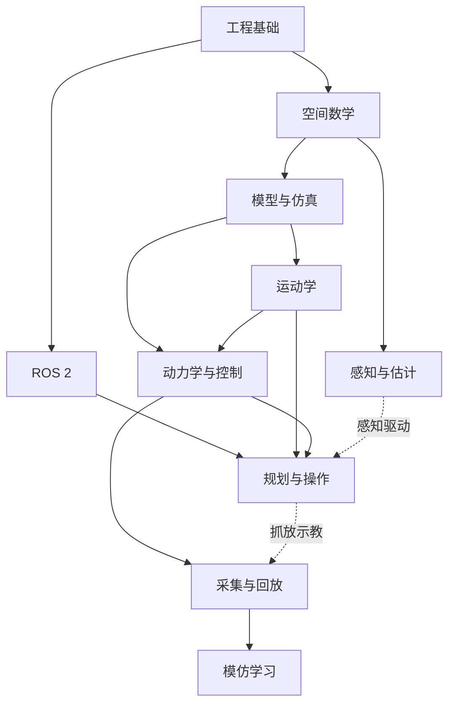

# 机器人工程学习路线

本文行数：158行，预期阅读时长：8分钟

主线是机械臂的建模、感知、规划、控制与仿真。路线用于理解知识之间的联系：遇到问题时，找到相关主题，再回查需要的基础。复习从概念和例子开始，推导与代码按需阅读。

## 主题之间的关系

| 阶段 | 核心问题 | 相关基础 | 阅读入口 |
| --- | --- | --- | --- |
| S0 工程基础 | 怎样运行程序和定位错误？ | 按任务查阅 | [工程基础](../src/foundations/engineering/README.md) |
| S1 空间数学 | 位置、朝向与误差怎样表示？ | 向量、矩阵 | [空间数学](../src/foundations/spatial_math/README.md) |
| S2 ROS 2 | 多个程序怎样交换数据？ | S0；TF 用到 S1 | [ROS 2](../src/ros2/README.md) |
| S3 模型与仿真 | 机器人结构怎样对应仿真状态？ | S0、S1 | [模型与仿真](../src/simulation/README.md) |
| S4 运动学 | 关节与末端位姿怎样互相转换？ | S1、S3 | [运动学](../src/kinematics/README.md) |
| S5 动力学与控制 | 怎样让实际运动跟上目标？ | S3；末端控制用到 S4 | [动力学与控制](../src/control/README.md) |
| S6 感知与估计 | 怎样从测量得到目标位置与状态？ | S1；仿真与 ROS 集成用到 S3、S2 | [感知与估计](../src/perception/README.md) |
| S7 规划与操作 | 怎样避障、搬运和抓放？ | S4、S5；MoveIt 集成用到 S2、S3 | [规划与操作](../src/manipulation/README.md) |
| S8 采集与回放 | 怎样保存有明确含义的动作数据？ | S5；抓放数据用到 S7 | [数据采集](../src/data_collection/README.md) |
| S9 模仿学习 | 怎样从示教学习动作策略？ | S8、机器学习基础 | [模仿学习](../src/machine_learning/18_imitation_learning/README.md) |

空间数学与 ROS 2 可以交替查阅。纯 MuJoCo 案例可以直接从模型和仿真开始；抓放可以先使用已知物体位姿，再接入视觉估计。

## S0. 工程基础

掌握程序的输入输出、启动位置和错误信息，就能使用多数案例。路径、Git、Python 数据形状、C++ 构建、调试和配置分别有[速查单元](../src/foundations/engineering/README.md)。日常 Git 操作由 agent 协助，复习时关注改动范围、提交与推送状态，以及检查点的恢复含义。

## S1. 空间数学与数值方法

先理解向量、内积、叉积和矩阵乘法，再看旋转、坐标变换与位姿误差。最小二乘、伪逆、阻尼和约束优化可以在运动学或控制中遇到时回查。

例如，`T_A_B` 把 B 系坐标转换为 A 系坐标：`p_A = T_A_B p_B`。这个方向约定贯穿相机外参、机械臂基座和工具变换。

[十章目录](../src/foundations/spatial_math/README.md) · [刚体变换例子](../src/foundations/spatial_math/examples/rigid_transforms/README.md)

## S2. ROS 2 通信与系统组织

Topic 传递连续数据，Service 处理请求与回应，Action 表达带反馈和取消的长任务。随后查参数与 launch、QoS 与回调、TF 与时间、rosbag2 与排错。机器人状态、目标和传感器数据都需要明确名称、字段和时间戳。

[五章目录](../src/ros2/README.md) · [通信案例](../src/ros2/examples/communication/README.md) · [组件案例](../src/ros2/examples/composition/README.md)

## S3. 机器人模型与仿真

先看控制流和带时间的关节轨迹，再查机器人结构、模型加载、状态索引、控制输入、步进、显示与重置。`qpos` 是位置状态，`ctrl` 是执行器输入；仿真通过时间步计算输入造成的运动。

[七章目录](../src/simulation/README.md)提供这些概念，[MuJoCo 实现](../src/simulation/mujoco/README.md)提供小模型、依赖和数值例子。PID 和跟踪误差在 S5 展开。

## S4. 正逆运动学

正运动学从关节角算末端位姿，逆运动学从目标位姿求关节角。阅读顺序可用 FK → DH 与模型对齐 → Jacobian → IK → 奇异性、冗余与工作空间。

例如，同一个末端位置可能有肘上、肘下两种构型；IK 找到角度后，还要结合关节限位和任务姿态选择。[八章目录](../src/kinematics/README.md)用平面小模型说明这些关系，[模型对齐案例](../src/kinematics/examples/model_alignment/README.md)连接 MuJoCo、Pinocchio 和 KDL。

## S5. 动力学、轨迹与控制

运动学描述几何，动力学描述力怎样改变运动。同一姿态下，空载与提着重物的位置可以相同，保持或加速所需的力矩却不同。

从力矩、惯量、重力和阻尼开始，接着查单关节、多关节动力学、正逆动力学、数值积分、轨迹与反馈控制。[章节目录](../src/control/README.md)按这条线展开。P、PD、PID、前馈、限幅、噪声和延迟在[控制与约束](../src/control/06_control_constraints/README.md)中用单杆例子解释。

开发控制程序时，用实际状态和目标曲线比较跟踪误差，并记录控制周期、输入限幅和扰动响应。直接覆盖 `qpos` 适合初始化与几何展示；执行器控制通过输入力或力矩产生运动。

## S6. 感知、坐标对齐与估计

相机得到的是图像，机器人使用的是坐标系下的目标位置与姿态。中间涉及内参、深度或物体尺寸、位姿估计和坐标变换；噪声、标定偏差与延迟会改变结果。

[六章目录](../src/perception/README.md)依次解释成像、位姿、测量误差、误差传播、Kalman 和时间对齐。[相机与 AprilTag 案例](../src/perception/examples/camera_and_tags/README.md)提供标定、检测与采集代码。

## S7. 规划与操作

运动规划找满足限位、避障和任务约束的路径；时间参数化把路径变成轨迹；控制器负责跟踪。抓放还涉及接近方向、夹爪闭合、摩擦承载、搬运和释放。

[规划与操作](../src/manipulation/README.md)包含构型空间、碰撞检测、采样规划、约束规划和轨迹优化，以及 MoveIt 配置、运动请求、规划场景、MTC 和桌面抓放。可以先用已知物体位姿理解动作流程，再加入视觉定位。

## S8. 数据采集、示教与回放

一段 episode 需要说明观测是什么、动作是什么、何时采样，以及机器人如何执行动作。例如，保存 `o_t, a_t, o_(t+1)` 时，`o_t` 对应动作执行前的观测。

数据中保留时间戳、时钟来源、采样率、关节顺序、单位和坐标系。动作还要区分绝对目标、增量、速度或力矩，并说明保持时长、插值和重置方式。图像与状态应按采样时间配对；回放使用相同动作含义，检查运动和原记录是否一致。

[数据采集入口](../src/data_collection/README.md)链接图像、位姿和状态保存程序。[时间对齐](../src/perception/06_time_alignment/README.md)解释异步观测造成的位置误差。

## S9. 模仿学习与策略评估

行为克隆（BC）用示教中的观测预测动作。先用低维状态和简单任务建立基线，再按需要加入图像、动作块或更复杂策略。

训练与测试按轨迹或场景划分，预处理统计从训练数据计算。离线动作误差说明预测与示教的差异；闭环 rollout 则观察策略反复执行后的任务成功率、跟踪误差和失败原因。

[机器学习 20 章](../src/machine_learning/README.md)提供算法基础，[18 模仿学习](../src/machine_learning/18_imitation_learning/README.md)解释 BC、DAgger、ACT 与 Diffusion Policy，[20 泛化与迁移](../src/machine_learning/20_generalization_sim2real/README.md)解释独立评估和环境变化。仓库中的采集与分类案例尚未接成完整机器人 BC 闭环案例。

## 按任务扩展

| 方向 | 遇到什么问题时查 |
| --- | --- |
| 标定与参数辨识 | 基座、工具 TCP、关节零位、负载或动力学参数不准 |
| 具体真机接入 | 设备 SDK、驱动、关节单位、控制周期、故障与恢复 |
| 接触与柔顺控制 | 摩擦、抓取稳定性、力控制、阻抗与导纳 |
| 任务执行与集成 | 状态机、超时、取消和失败恢复 |
| [VLM](../src/machine_learning/16_vision_language/README.md) | 图文匹配、看图回答与语言选目标 |
| [强化学习](../src/machine_learning/19_reinforcement_learning/README.md) | 通过交互和奖励学习行为 |
| [仿真迁移](../src/machine_learning/20_generalization_sim2real/README.md) | 模型参数、接触、延迟与噪声在换环境后影响任务 |
| 移动机器人、SLAM、双臂与灵巧手 | 项目需要定位导航、多链协同或更复杂接触 |

## 按疑问选入口

“位置为什么不对”先查坐标变换与模型对齐；“求得出角度却动不到”查轨迹、控制输入和跟踪误差；“视觉看到了却抓不准”查标定、时间对齐与抓取条件；“训练分数很好却用不好”查数据划分、闭环评估和环境变化。

## 开发时怎样记录结果

保留实际配置、模型与数据来源、输入输出的单位和时间含义，以及少量关键曲线和指标。控制程序关注误差与限幅，规划程序关注可行路径和执行结果，感知程序关注定位误差，学习策略关注独立场景中的任务表现。数值例子、源码分析和实测结果在对应章节就近说明。

[知识索引](README.md) · [源码目录](../src/README.md)
