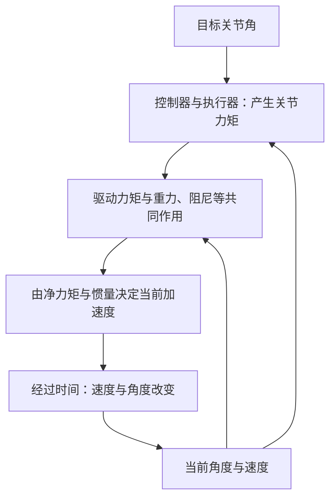

# 01：力矩、惯量、重力与阻尼——建立动力学直觉

本文行数：315行，预期阅读时长：15分钟

**动力学研究的是：物体受到力或力矩以后，运动怎样改变。** 本章从日常经验开始，不假设你学过理论力学，也不要求你会求导、积分或推导机械臂方程。

你已经知道关节角决定机械臂的姿态。现在再往前问一步：关节角为什么会变化？为什么同样一个目标，空载时很快到达，拿着重物时却可能慢下来？为什么机械臂停着不动，电机仍可能需要出力？

这些问题需要把“目标位置”与“实际运动”之间的过程补上。本章按概念建立的顺序阅读，不采用只有结论的复习提纲。所有数值均为理想模型的教学计算，不是真机或 MuJoCo 实测；计算核对范围见文末。

## 1. 先把“位置、速度、加速度”分开

### 1.1 角度说明在哪里，角速度说明怎样移动

对于一个转动关节，`q` 表示相对规定零位的关节角。机器人程序通常使用弧度 rad：一整圈是 `2π rad`，半圈是 `π rad`，`90° = π/2 rad ≈ 1.571 rad`。

但只告诉你 `q=0.5 rad`，无法知道它此刻是静止、向正方向转，还是向负方向转。描述运动还需要**角速度**，记作 `q_dot` 或数学符号 `q̇`，单位 rad/s。

假设规定逆时针为正，某关节在 `0.5 s` 内从 `0.2 rad` 转到 `0.5 rad`，这段时间的平均角速度为：

```text
角度变化 / 经过时间 = (0.5 − 0.2) / 0.5 = 0.6 rad/s
```

结果为正，表示这段时间的净角度变化沿正方向。平均值不表示整个过程中每一时刻都以 `0.6 rad/s` 运动；它也可能先慢后快。后面没有特别说明时，角速度指某一时刻的速度。

### 1.2 加速度说明速度怎样改变

角加速度记作 `q_ddot` 或 `q̈`，单位 rad/s²。它描述角速度的变化快慢。

例如在 `0.5 s` 内，角速度从 `0.2 rad/s` 增加到 `0.8 rad/s`，平均角加速度为：

```text
角速度变化 / 经过时间 = (0.8 − 0.2) / 0.5 = 1.2 rad/s²
```

可以把 `1.2 rad/s²` 理解为：如果这个加速度保持不变，每经过一秒，角速度就增加 `1.2 rad/s`。它没有直接告诉你关节当前位于哪个角度。

| 某时刻的状态 | 这意味着什么 |
| --- | --- |
| `q_dot=0`，`q_ddot>0` | 此刻速度为零，但正在开始向正方向运动；不能判断以后仍会静止 |
| `q_dot>0`，`q_ddot=0` | 此刻沿正方向转动，速度暂时不变 |
| `q_dot>0`，`q_ddot<0` | 仍向正方向转，但正在减慢；不会因为加速度为负就立刻反转 |
| `q_dot<0`，`q_ddot<0` | 向负方向转，而且转得越来越快，即速度的绝对值增大 |

**正负号表示相对于规定方向的符号。判断加速还是减速，要同时看速度与加速度。** 点号表示“随时间的变化率”，本章只需理解这个意思，不要求先学微积分运算。

## 2. 从推门理解力矩：有力，还要看怎样用力

### 2.1 力和力矩描述不同的作用

力 `F` 描述推、拉作用，单位是牛顿 N。地球表面附近，质量 `1 kg` 的物体受到的重力约为 `9.81 N`。kg 是质量单位，N 是力的单位，不能把二者当作同一种量。

一扇门绕铰链转动。同样用 `10 N` 的力垂直推门面，在靠近铰链处推与在把手处推，开门效果不同。因为使门转动的效果不仅取决于力的大小，还取决于作用位置和方向。

我们用**力矩**（torque，记作 `τ`，代码中常写 `tau`）描述这种绕轴的转动作用。力矩单位为 N·m。

对于平面内绕固定轴的转动，力矩大小是：

$$
|\tau|=F d_\perp
$$

`d_perp` 是转轴到**力的作用线**的垂直距离，称为力臂，单位 m。作用线就是沿力箭头方向延长得到的直线。它不总等于“从轴到手的距离”。这一定义及方向规则可参见 [OpenStax：Torque](https://openstax.org/books/university-physics-volume-1/pages/10-6-torque)。

### 2.2 同样的力，为什么把手处更容易推开

下面只比较手施加的力矩，暂不讨论门的摩擦、闭门器和其他阻力。力垂直门面，因此力臂等于施力点到铰链轴的距离。

| 施力情况 | 力臂 | 力矩大小 |
| --- | --- | --- |
| 在靠近铰链处推，力为 `10 N` | `0.1 m` | `10 × 0.1 = 1 N·m` |
| 在远离铰链处推，力仍为 `10 N` | `0.5 m` | `10 × 0.5 = 5 N·m` |
| 沿门面朝铰链方向推，作用线穿过转轴 | `0 m` | `0 N·m` |

第二种情况的转动作用是第一种的五倍。第三种情况虽然有力，但它对开门转轴没有力矩；不等于门和铰链完全不受力。

推广到任意夹角，大小为 `r F sin(φ)`，其中 `r` 是轴到施力点的距离，`φ` 是位置方向与力方向的夹角。初学时先用“垂直力臂”判断，比直接套三角函数更清楚。

### 2.3 力矩的正负，以及电机力矩

本章的平面图统一规定：向右是 `+x`，向上是 `+y`，`+z` 垂直纸面朝向读者。绕 `+z` 轴逆时针为正；有逆时针转动趋势的力矩记正，顺时针记负。这与右手拇指指向 `+z` 时四指弯曲的方向一致。

电机通过轴和传动机构给关节施加力矩。在本章中，`tau_motor` 指**实际传到关节侧的驱动力矩**，已经把上游传动效果算在内；它不是电机电流，也不一定等于某个 API 中 `ctrl` 的数值。

以后遇到三维公式 `τ = r × F`，它是在同时表达力臂和方向。本章先关注固定转轴上的正负标量，不要求计算三维叉乘。

## 3. 惯量：为什么有些物体更难启动，也更难刹住

### 3.1 “重”不是唯一因素

想象一根很轻的杆上固定着一个小配重，杆绕一端转动。把同一个配重从靠近轴的位置移到杆端，质量没有增加，但要让它以同样快慢启动或停止，会更费力。

描述这种“改变转动速度有多难”的量叫**转动惯量**（moment of inertia），本章记作 `I`，单位 kg·m²。它同时取决于质量、质量怎样分布，以及绕哪根轴转动。

**一个物体没有脱离转轴的唯一转动惯量。** 同一根杆绕端点转与绕中心转，惯量不同。它也不是阻力或一种额外的力矩；它描述物体对速度变化的响应。

### 3.2 一个小配重的例子

把配重近似为质点，即忽略它自身尺寸，只考虑质量集中在某个位置。配重离转轴的垂直距离为 `r` 时，它对该轴的惯量为：

$$
I=m r^2
$$

对于 `1 kg` 的配重：

| 离轴距离 | 惯量 |
| --- | --- |
| `0.2 m` | `1 × 0.2² = 0.04 kg·m²` |
| `0.4 m` | `1 × 0.4² = 0.16 kg·m²` |

距离翻倍，惯量变为四倍。这解释了机械臂把负载伸得更远后，某些关节为什么更难快速启动或刹车。这里先解释一个固定轴的现象，多关节相互影响留到第三部分。

### 3.3 一根杆的质量分布不能全部放在质心

后面使用一根质量均匀、长度 `L=0.6 m`、质量 `m=2 kg` 的理想细杆，绕一端且垂直杆的固定轴转动。质心位于中点，距轴 `l_c=0.3 m`。

在均匀重力场中，计算**重力矩**可以把总重力看作作用在质心上。但计算**惯量**时，必须考虑整根杆各处的质量分布。均匀细杆绕端点的惯量为：

$$
I=\frac{1}{3}mL^2=\frac{1}{3}\times2\times0.6^2=0.24\;\mathrm{kg\cdot m^2}
$$

若错误地把所有质量集中在中点，会得到 `2 × 0.3² = 0.18 kg·m²`，低估惯量。若真的把 `2 kg` 全集中在轻杆末端，则惯量变为 `2 × 0.6² = 0.72 kg·m²`，那已经是另一个模型。

现在不需要背所有形状的惯量公式。需要记住的是：**模型中的惯量必须匹配实际质量分布和转轴。** 细杆公式与质量分布的计算方法见 [OpenStax：Calculating Moments of Inertia](https://openstax.org/books/university-physics-volume-1/pages/10-5-calculating-moments-of-inertia)。

## 4. 力矩怎样改变运动：先算“合起来还剩多少”

假设同一根轴上，电机施加 `+3 N·m`，其他作用合计为 `−1 N·m`。沿同一正方向把它们相加，得到**净力矩**：

```text
tau_net = +3 + (−1) = +2 N·m
```

对于本章的刚体绕固定轴转动、惯量不变的模型，净力矩与角加速度满足：

$$
\tau_{\mathrm{net}}=I\ddot q
\qquad\Longrightarrow\qquad
\ddot q=\frac{\tau_{\mathrm{net}}}{I}
$$

这个关系是转动形式的牛顿第二定律。可以把它读成：“净转动作用除以改变转动有多难，得到角速度改变有多快。”原理见 [OpenStax：Newton’s Second Law for Rotation](https://openstax.org/books/university-physics-volume-1/pages/10-7-newtons-second-law-for-rotation)。它不能直接替代完整三维或多关节动力学方程。

对前面的两个质点模型，如果净力矩都为 `0.08 N·m`：

| 惯量 | 角加速度 |
| --- | --- |
| `0.04 kg·m²` | `0.08 / 0.04 = 2 rad/s²` |
| `0.16 kg·m²` | `0.08 / 0.16 = 0.5 rad/s²` |

这里指定的是**净力矩**；若存在重力、摩擦等，电机需要一起承担这些影响。不能把“电机同样输出 `0.08 N·m`”在任意姿态下直接当作上述比较条件。

**力矩直接关联的是加速度，不是角度，也不是速度本身。** 对这个固定轴模型，若净力矩持续为零，角速度保持不变：原来静止就继续静止，原来在转就继续匀速转。现实中松开门后往往会停，是因为摩擦等仍在施加反向力矩。

同样，刹车需要产生与当前速度相反的角加速度。物体有惯量，所以改变速度需要时间；反向力矩通常先让它减速，不能瞬间把它变成反向运动。

## 5. 重力：为什么机械臂不动时也可能要出力

### 5.1 用一根杆固定方向与零位

继续使用 `2 kg`、`0.6 m` 的均匀细杆，转轴固定在纸面中的 O 点，重力沿 `−y` 向下，`g=9.81 m/s²`。关节角 `q=0` 定义为杆竖直下垂；逆时针转动使 `q` 增大，因此 `q=π/2 rad` 时杆水平向右。

```text
                       +y ↑

q = 0：下垂                         q = π/2：水平向右
       O                                    O──────C──────端点 → +x
       │                                           ↓ mg
       C ← 质心                              O 到 C 为 0.3 m
       ↓ mg
       │
      端点

+z 朝向读者；两图分别表示同一根杆的两种姿态，不是同时连接的两根杆。
```

为把因果关系看清，本模型先忽略杆的变形、干摩擦、齿轮弹性、接触和限位。转轴支撑杆而不发生平移；轴处支撑力对该轴的力臂为零。

### 5.2 重力不变，重力矩却随姿态变化

总重力大小始终为 `mg = 2 × 9.81 = 19.62 N`，方向始终竖直向下。变化的是重力作用线到转轴的垂直距离。

杆水平向右时，重力作用线经过右侧的质心，力臂为 `0.3 m`。重力使杆顺时针下落，因此符号为负：

```text
tau_g = −19.62 × 0.3 = −5.886 N·m
```

杆竖直下垂时，重力作用线穿过 O，力臂为零，因此重力矩为零。**此时重力仍是 `19.62 N`，零的是绕这个轴的重力矩。**

任意角度时，质心横坐标为 `x_c=l_c sin(q)`；向下的力与该水平距离形成力矩，因此在本章的零位和方向约定下：

$$
\tau_g=-mgl_c\sin q
$$

| 姿态 | `q` | 重力矩 | 静止保持需要的电机力矩（无其他力矩时） |
| --- | --- | --- | --- |
| 竖直下垂 | `0 rad` | `0 N·m` | `0 N·m` |
| 向右偏离下垂位置 30° | `π/6 rad` | `−2.943 N·m` | `+2.943 N·m` |
| 水平向右 | `π/2 rad` | `−5.886 N·m` | `+5.886 N·m` |

如果零位改成水平，公式会出现余弦；如果正方向反过来，符号也要相应改变。不要只凭公式中出现 `sin` 还是 `cos` 判断谁对，先看坐标和角度定义。

### 5.3 保持不动为什么仍需力矩

水平杆想保持静止，需要净力矩为零。既然重力施加 `−5.886 N·m`，电机就要提供 `+5.886 N·m` 抵消它。两者都不为零，但加起来为零。

这就是重力补偿最直接的含义：提供抵消当前重力矩的驱动力矩。它并不意味着惯量消失，也不会自动把杆送到任意目标角度。若杆已经在转，在理想无阻尼条件下恰好抵消重力只会让它保持当前速度，不会自动停住。

“当前力矩平衡”也不等于控制稳定。例如杆倒立时重力矩也为零，但微小偏离就可能继续倒下。能否抵抗扰动并回到目标，要在控制部分讨论。

## 6. 阻尼：为什么会减速，却不能代替位置控制

### 6.1 先理解一个简单模型

阻尼描述一类消耗运动能量的作用。可以联想门上的缓冲机构：运动越快，阻碍运动的作用往往越明显。真实机构可能更复杂，这里使用最简单的**黏性阻尼**模型：

$$
\tau_d=-b\dot q,\qquad b\geq0
$$

`b` 是阻尼系数，单位 N·m·s/rad；`q_dot` 是 rad/s，两者相乘得到 N·m。负号表示它的力矩总与速度方向相反。

当 `b=0.2 N·m·s/rad` 时：

| 角速度 | 阻尼力矩 | 含义 |
| --- | --- | --- |
| `+1 rad/s` | `−0.2 N·m` | 阻碍正方向运动 |
| `−1 rad/s` | `+0.2 N·m` | 阻碍负方向运动 |
| `0 rad/s` | `0 N·m` | 静止时此模型不提供力矩 |

所以阻尼不总是负力矩，它总是反抗**速度**。有重力或电机同时作用时，物体仍可能越转越快；阻尼只是其中一个减弱运动的因素，不保证总加速度一定让它减速。

### 6.2 为什么不能靠阻尼把杆托在水平位置

水平杆刚好静止时，黏性阻尼力矩为零，而重力矩为 `−5.886 N·m`。如果电机不出力，净力矩仍向下，杆会开始下落；产生速度后才出现相应阻尼。

因此，增加阻尼可能让下落或摆动更缓和，但不会凭空出现保持水平所需的力矩。阻尼没有“目标角度”的概念。

现实中的门有时停在任意角度，是因为还存在静摩擦、锁止等因素。**静摩擦能在零速度时承担一定范围的力矩，黏性阻尼在零速度时为零。** 二者不能混用。后续建模时再按需要区分干摩擦、弹簧和控制器的作用。

## 7. 把四个概念放到同一个时刻里

现在只算一个时刻，先不推导完整轨迹。仍是上述均匀细杆，惯量 `I=0.24 kg·m²`，此时：

- 角度为 `q=π/6 rad`，即从下垂向右转了 30°。
- 角速度为 `q_dot=+1 rad/s`，杆正在沿正方向向上抬起。
- 关节侧电机力矩为 `+3.5 N·m`。
- 黏性阻尼系数为 `0.2 N·m·s/rad`，没有其他力矩。

先列出每种实际作用，再求合力矩：

| 来源 | 本时刻的力矩 |
| --- | --- |
| 电机 | `+3.500 N·m` |
| 重力 | `−2.943 N·m` |
| 阻尼 | `−0.200 N·m` |
| 合计 | `+0.357 N·m` |

由此得到：

```text
q_ddot = tau_net / I = 0.357 / 0.24 = +1.4875 rad/s²
```

**解释：** 电机先要克服重力和阻尼，剩下的净力矩才决定加速度。此时速度与加速度都为正，杆正沿正方向运动，并且正在加快。`I q_ddot` 表示合力矩造成的响应，不是需要在上表再加一次的额外阻力矩。

如果在**相同角度和速度**下，把电机力矩改为 `+2 N·m`，净力矩为 `2−2.943−0.2=−1.143 N·m`，角加速度为 `−4.7625 rad/s²`。杆此刻仍向上运动，但开始减速。这不是“正电机力矩一定带来正加速度”。

我们只知道这一时刻的加速度。随着杆移动，角度、重力矩、速度和阻尼都会改变，不能把 `1.4875 rad/s²` 当成以后一直不变，再直接推出数秒后的角度。第二部分会进一步组织单关节方程，第五部分再解释怎样逐步推进时间。

## 8. 回到机械臂：现在可以怎样理解“给一个目标”

假设程序给出 `q_target=0.5 rad`。这个数表达希望到达的位置，本身没有告诉你当前需要多少力矩。使用位置伺服时，控制器要结合当前位置和速度等信息产生驱动力矩；如果使用力矩接口，这部分计算通常由上层程序承担。



图中动力学关系仍是本章固定轴模型的概念说明。完整机械臂还需考虑关节之间的耦合。MuJoCo 一类物理引擎负责计算模型下的运动，控制器负责决定输入；画面展示的是算出的状态。

这样就能理解三个常见现象：拿起重物后，同样的目标可能更难跟上；停在水平位置时，电机可能一直需要力矩；降低阻尼可能让运动更容易持续，但不代表更容易准确停在目标。

程序里的 `ctrl` 究竟表示目标位置还是其他输入，由执行器配置决定，可在需要时查阅[仿真控制输入](../../simulation/06_actuation/README.md)。本章先不要求运行模型或调控制参数。

## 9. 本章概念之间的关系

| 概念 | 回答的问题 | 本章单位 |
| --- | --- | --- |
| 角度 `q` | 在哪里？ | rad |
| 角速度 `q_dot` | 正向还是反向运动，转得多快？ | rad/s |
| 角加速度 `q_ddot` | 角速度怎样改变？ | rad/s² |
| 力矩 `tau` | 绕这个轴的转动作用有多大、方向怎样？ | N·m |
| 惯量 `I` | 绕这个轴改变转动速度有多难？ | kg·m² |
| 重力矩 `tau_g` | 重力在当前姿态下怎样拉动关节？ | N·m |
| 阻尼力矩 `tau_d` | 当前速度引起多大的反向作用？ | N·m |

## 参考与计算边界

本章模型为固定转轴的理想刚体，重力均匀，阻尼采用线性黏性模型。数值为教学计算，杆的参数不是 Panda 或仓库 MuJoCo 模型参数。概念参考上述 OpenStax 教材；重力与黏性阻尼的符号还可对照 [MIT：The Simple Pendulum](https://underactuated.mit.edu/pend.html)。该教材使用的质点单摆惯量为 `ml²`，本章均匀杆绕端点为 `mL²/3`，不能直接互换。

2026-09-26 使用 Python 标准库核对：速度与加速度平均值、推门力矩、质点惯量与加速度比值、细杆惯量、三个姿态的重力矩、正负速度下的阻尼，以及综合例子的两组加速度。另用二维叉乘分量 `x F_y − y F_x` 核对重力矩方向，用沿杆均匀划分的质量求和核对细杆惯量，并检查静止补偿后净力矩为零。结果与正文一致；这是公式和算术核对，没有运行动力学仿真、控制闭环或真机，不作为跟踪性能证据。

[返回动力学目录](../README.md) · [下一部分：单关节动力学](../02_single_joint_dynamics/README.md) · [学习路线 S5](../../../doc/learning-roadmap.md#s5)
