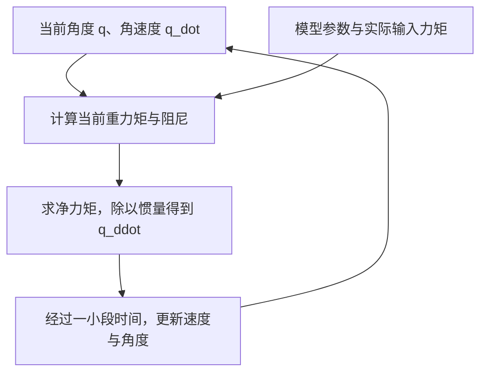

# 02：单关节动力学——从一根杆的受力到运动

本文行数：332行，预期阅读时长：14分钟

**单关节动力学把“当前角度、当前速度和实际力矩”联系起来，计算这一时刻的角加速度。** 知道角加速度以后，还要随时间不断更新，才能得到一段运动。

[第一章](../01_dynamics_intuition/README.md)分别解释了力矩、惯量、重力和阻尼。本章继续使用同一根杆，把这些概念组成一个可以反复使用的模型：松手为什么会落下，怎样托住，怎样抬起，怎样减速，以及拿起负载后什么会改变。

阅读时不需要求解微分方程，也不需要运行程序。正文中的数值是给定理想模型下的解析计算，已用文末脚本核对；没有把它们写成仿真测量或真机结果。

## 1. 我们到底在研究什么

### 1.1 一根杆、一个转轴、一个电机

这里的“单关节”是一根刚性杆绕固定轴转动，电机在轴上施加力矩。杆不能沿轴移动，也不能在空间里随意翻转，描述它的姿态只需一个角度 `q`。

沿用第一章：纸面向右为 `+x`、向上为 `+y`，`+z` 朝向读者。转轴沿 `+z`，逆时针为正；杆竖直下垂时 `q=0`，向右抬起到水平时 `q=π/2 rad`。

```text
            +y ↑
               O  ← 固定转轴，电机在这里施加力矩
               │╲
    q 的零位 → │ ╲  q > 0 时的杆
               │  C  ← 质心
               │  ↓ mg
               │    ╲ 端点
                         → +x

O 到质心 C 的距离是 l_c；O 到端点的距离是 L。
重力竖直向下；电机力矩正值使杆产生逆时针加速的趋势。
```

| 参数 | 本章取值 | 表达什么 |
| --- | --- | --- |
| 杆质量 `m` | `2 kg` | 杆本身有多少质量 |
| 杆长 `L` | `0.6 m` | 从转轴到端点的距离 |
| 质心距轴 `l_c` | `0.3 m` | 均匀杆的质心在中点 |
| 绕轴惯量 `I` | `mL²/3 = 0.24 kg·m²` | 整根杆绕端点转动的惯量 |
| 重力加速度 `g` | `9.81 m/s²` | 方向为世界坐标系的 `−y` |
| 黏性阻尼系数 `b` | `0.2 N·m·s/rad` | 阻尼力矩与角速度的比例系数 |

基准模型没有额外负载、干摩擦、弹性、碰撞和机械限位。后面讨论负载或力矩上限时，会明确改变了哪个条件。

**它不是“任意机械臂中抽出一个关节”的通用模型。** 多关节机械臂中，其他杆的姿态和运动也会影响这个关节；本章先把这些影响隔离，下一部分再讨论耦合。

### 1.2 参数、状态、输入，各指什么

这三个词以后会反复出现，可以先这样区分：

| 类别 | 本章例子 | 什么时候需要知道 |
| --- | --- | --- |
| 模型参数 | `I`、`m`、`l_c`、`b`、`g` | 确定这是什么样的物理系统；本章单次运动中视为不变 |
| 当前状态 | `q`、`q_dot` | 确定此刻在哪里、怎样运动；每一时刻都可能变化 |
| 输入 | 关节侧实际电机力矩 `tau_motor` | 电机此刻给了多大的驱动作用 |
| 额外外力矩 | `tau_ext` | 人推杆、环境施力等折算到该转轴上的作用；基准例子取零 |
| 本次计算结果 | `q_ddot` | 当前角速度怎样改变 |

初始状态就是运动开始时的 `q(0)` 和 `q_dot(0)`。只给初始角度还不够：同样在 30°，一根杆静止，另一根杆正向下转，它们之后的运动不同。

这里的输入是关节侧的**实际力矩**，单位 N·m。程序中的目标位置或未经传动、限幅处理的输入数值，不能自动当成 `tau_motor`。

## 2. 从受力清单一步步得到方程

### 2.1 先把实际力矩列在同一侧

绕同一根轴、采用同一个正方向，把力矩相加：

```text
净力矩 = 电机力矩 + 额外外力矩 + 重力矩 + 阻尼力矩
```

在本章约定下：

- 重力矩为 `−m g l_c sin(q)`。杆向右抬起时，重力让它顺时针下落。
- 阻尼力矩为 `−b q_dot`。速度变号时，阻尼力矩也变号。
- 电机和额外外力矩按实际方向取正负。

第一章已经知道，固定轴、惯量不变时 `I q_ddot = 净力矩`，所以得到：

$$
I\ddot q=\tau_{\mathrm{motor}}+\tau_{\mathrm{ext}}-b\dot q-mgl_c\sin q
$$

这就是本章的单关节动力学方程。它没有额外引入神秘的力：右侧只是把刚才的力矩清单写在一起。

### 2.2 同一个方程的两种读法

如果已知实际电机力矩，想知道关节会怎样改变速度，就除以惯量：

$$
\ddot q=\frac{\tau_{\mathrm{motor}}+\tau_{\mathrm{ext}}-b\dot q-mgl_c\sin q}{I}
$$

如果已知希望产生的角加速度 `q_ddot_des`，想知道此刻需要多少电机力矩，则移项得到：

$$
\tau_{\mathrm{motor,req}}=I\ddot q_{\mathrm{des}}+b\dot q+mgl_c\sin q-\tau_{\mathrm{ext}}
$$

`des` 表示期望，`req` 表示计算出的需求；电机能否实际输出该力矩还要看能力限制。这两种读法分别是后面正动力学、逆动力学的最小例子，本章只用它们解决眼前的问题。

移到左侧的 `+m g l_c sin(q)` 是需要抵消的重力影响，**不是实际重力矩突然变成了正值**。同样，`I q_ddot` 是净力矩与加速度之间的关系，不能再把它作为额外阻力加回受力清单。

每个力矩项的单位都是 N·m。角度 `q` 代入三角函数时使用 rad；人读到的“30°”在计算中要写成 `π/6`，不能直接计算 `sin(30)`。

固定轴净力矩关系参考 [OpenStax：转动形式的牛顿第二定律](https://openstax.org/books/university-physics-volume-1/pages/10-7-newtons-second-law-for-rotation)。本章重力和阻尼结构也可对照 [MIT：The Simple Pendulum](https://underactuated.mit.edu/pend.html)，但该教材的质点单摆惯量与这里的均匀杆不同，参数不能照搬。

## 3. 场景一：在 30° 松开，刚开始会发生什么

设杆起初静止在 `q=π/6 rad`，电机不出力，也没有额外外力矩：

```text
q = π/6 rad
q_dot = 0 rad/s
tau_motor = 0 N·m
tau_ext = 0 N·m
```

一步一步计算：

1. 重力矩：`−2 × 9.81 × 0.3 × sin(π/6) = −2.943 N·m`。
2. 阻尼力矩：`−0.2 × 0 = 0 N·m`，因为刚松开时速度为零。
3. 净力矩：`−2.943 N·m`。
4. 角加速度：`−2.943 / 0.24 = −12.2625 rad/s²`。

**结果与解释：** 杆此刻还没有速度，但已经具有负角加速度，接下来会向顺时针方向下落。静止只意味着此刻速度为零，不意味着受力平衡。

为什么不能直接用这个加速度算下一秒的位置？因为下落后角度和速度都变了，重力矩与阻尼也会随之改变。这个计算回答“刚松开时怎样开始运动”，没有回答“整整一秒以后在哪里”。

## 4. 场景二：怎样托住，为什么托住的力矩不等于刹车力矩

### 4.1 保持在一个角度，需要同时满足什么

“停在 30° 不动”包含两个条件：角速度为零，并且以后不开始加速。因此希望 `q_dot=0`、`q_ddot=0`。

在没有额外外力矩时，方程变成：

```text
tau_motor = m g l_c sin(q)
```

在 30° 处，需要 `+2.943 N·m`；在水平位置，需要 `+5.886 N·m`。这两个数是对应姿态下的静止保持需求。

如果杆本来就在 30° 静止、模型完全准确、没有扰动，持续给 `2.943 N·m` 可以保持该状态。但这不等于“无论从哪里开始，给 `2.943 N·m` 就会准确到达 30°”。

### 4.2 同一个角度，速度不同，结果就不同

仍在 30°，电机都给 `+2.943 N·m`，只是当前速度不同：

| 当前角速度 / rad/s | 阻尼力矩 / N·m | 净力矩 / N·m | 角加速度 / rad/s² | 此刻的运动趋势 |
| --- | --- | --- | --- | --- |
| `0` | `0` | `0` | `0` | 在这个状态可以保持静止 |
| `+1` | `−0.2` | `−0.2` | `−0.833333` | 仍向上抬，但开始减速 |
| `−1` | `+0.2` | `+0.2` | `+0.833333` | 仍向下转，但开始减速 |

后两行都不是立即停住。速度要经过一段时间才会改变，杆在这段时间里也会改变位置；若电机仍固定输出 `2.943 N·m`，离开 30° 后它就不再恰好抵消重力。

这也是为什么不能只读一个关节角就判断运动是否稳定。要同时看速度，并区分“本时刻力矩平衡”“保持一个静止状态”“受扰动后回到目标”这几个问题。最后一个需要反馈控制，留到第六部分。

## 5. 场景三：怎样主动抬起、保持速度和减速

现在杆位于 30°，正以 `+1 rad/s` 向上抬，没有额外外力矩。当前重力矩为 `−2.943 N·m`，阻尼力矩为 `−0.2 N·m`。

### 5.1 想让角速度暂时不变

取期望角加速度为零，则需要：

```text
tau_motor,req = 0.24 × 0 + 0.2 × 1 + 2.943
              = 3.143 N·m
```

此时净力矩为零，但角速度仍是 `+1 rad/s`，杆仍在运动。若要在后续时刻继续保持这个速度，需随角度变化调整重力补偿部分，不能一直固定这个数。

### 5.2 想继续加快，角加速度达到 +2 rad/s²

代入同一个需求公式：

```text
抵消重力：             2.943 N·m
抵消当前阻尼：         0.200 N·m
产生期望加速度：0.24 × 2 = 0.480 N·m
合计：                 3.623 N·m
```

把 `3.623 N·m` 放回受力方程，净力矩就是 `0.48 N·m`，除以 `0.24 kg·m²` 得到 `+2 rad/s²`。这是同一个模型的正向与反向计算互相核对。

这里使用的是当前角度和速度；并未证明持续使用固定力矩会形成某条期望轨迹，更没有保证实际电机完全匹配模型。

### 5.3 想减速，电机力矩一定要反向吗

如果仍在同一状态，却只给 `+2 N·m`：

```text
tau_net = 2 − 2.943 − 0.2 = −1.143 N·m
q_ddot = −1.143 / 0.24 = −4.7625 rad/s²
```

当前速度为正、加速度为负，因此杆会减速。**电机力矩仍为正，净力矩却为负**，因为重力和阻尼超过了驱动作用。所以“电机反转矩”不是唯一的减速来源。

反过来，若杆正在向下转，`q_dot=−1 rad/s`，要让它减速，就需要正角加速度。在这个状态给 `+3.5 N·m`，得到：

```text
tau_net = 3.5 − 2.943 + 0.2 = +0.757 N·m
q_ddot = 0.757 / 0.24 ≈ +3.154167 rad/s²
```

阻尼此时帮助阻止下落，因此是正力矩。判断刹车效果，要看**净力矩产生的加速度是否与当前速度相反**，不能只看电机力矩的符号。

## 6. 场景四：同一个动作，杆端多挂 1 kg 会怎样

### 6.1 负载同时改变惯量和重力矩

现在在杆端刚性固定一个 `1 kg` 的小物体，近似为质点，离转轴 `0.6 m`。暂不考虑它自身尺寸、连接弹性或摆动，阻尼系数仍取原值。

它增加的惯量为：

```text
I_load = 1 × 0.6² = 0.36 kg·m²
I_total = 0.24 + 0.36 = 0.60 kg·m²
```

重力矩需要把杆和负载各自的贡献相加：

$$
\tau_g=-\left(mg l_c+m_{\mathrm{load}}gL\right)\sin q
$$

括号中的值为 `5.886 + 5.886 = 11.772 N·m`。不能只把杆质量从 2 改成 3、继续假定全部质量均匀分布在杆上；新增质量位于端点，分布已经改变。

### 6.2 用同一个状态比较

比较条件仍为 `q=π/6 rad`、`q_dot=+1 rad/s`，希望角加速度为 `+2 rad/s²`：

| 需求 | 原杆 | 杆端加 1 kg |
| --- | --- | --- |
| 总惯量 | `0.24 kg·m²` | `0.60 kg·m²` |
| 抵消当前重力所需力矩 | `2.943 N·m` | `5.886 N·m` |
| 抵消当前阻尼所需力矩 | `0.200 N·m` | `0.200 N·m` |
| 产生 `+2 rad/s²` 所需净力矩 | `0.480 N·m` | `1.200 N·m` |
| 所需电机力矩合计 | `3.623 N·m` | `7.286 N·m` |

负载使需要抵消的重力更大，也使产生同样加速度所需的净力矩更大。这是两个不同的影响。

如果已经加上负载，电机却仍给原来的 `3.623 N·m`，实际角加速度会是：

```text
q_ddot = (3.623 − 5.886 − 0.2) / 0.60 = −4.105 rad/s²
```

期望是加快向上抬，结果却开始减速。这个计算说明**模型参数或负载不匹配会改变响应**；它没有包含控制器随后如何纠正误差。以后使用现成动力学库时，负载设置仍是需要自己确认的输入。

## 7. 场景五：算得出需要多少，不代表电机给得出

回到没有额外负载的原杆。假设电机实际关节侧力矩限制为 `−4～+4 N·m`，没有其他约束或辅助支撑。

水平静止时需要 `+5.886 N·m`，但电机最多只能给 `+4 N·m`。于是：

```text
tau_net = 4 − 5.886 = −1.886 N·m
q_ddot = −1.886 / 0.24 ≈ −7.858333 rad/s²
```

它会开始下落。发送更大的数值并不意味着执行器会产生更大的实际力矩；程序需要用限幅后的实际输入理解系统行为。

还可以反过来问：在从下垂到水平的 `0≤q≤π/2` 范围里，最多能静止托住多大的角度？静止时黏性阻尼为零，必须满足：

$$
5.886\sin q\leq4
\quad\Longrightarrow\quad
q\leq\arcsin\left(\frac{4}{5.886}\right)\approx0.747188\;\mathrm{rad}\approx42.81^\circ
$$

这里 `arcsin` 是反过来由正弦值求角度。这个结果只表示给定模型和区间内的**静止力矩可行边界**，不是机械限位、运动学可达边界，也不保证能按任意速度到达或抵抗扰动。边界处全部正向力矩已用于抵消重力，没有额外正向力矩余量。

## 8. 外界推一下，方程里怎样体现

`tau_ext` 用来表示尚未包含在电机、重力和阻尼中的额外力矩。不能把同一个负载的重力既计入负载模型，又当作额外力矩加一遍。

例如原杆在 30° 静止，电机给 `+2.943 N·m`。此时若额外施加 `+0.48 N·m` 的关节外力矩，则：

```text
q_ddot = (2.943 + 0.48 − 2.943) / 0.24 = +2 rad/s²
```

若希望它仍静止，电机此刻只需 `2.943−0.48=2.463 N·m`，因为外界已经帮忙承担了部分力矩。若外力矩反向，则电机需要提供更多。

实际外界通常施加的是某个位置上的力，要先按力臂和方向折算成绕轴力矩。这里直接给 `tau_ext`，是为专注说明它在单关节方程中的角色。

## 9. 从一个时刻走向一段运动，还缺什么

到这里，每个例子都使用同一套计算过程：



要计算整段运动，还必须给出初始状态、输入随时间怎样变化，并选择时间推进方法。每次状态更新后，都重新计算当前受力；数值积分细节留到第五部分。

动力学方程本身没有“去 0.5 rad”的目标。若希望它自动到目标并停住，需要控制器决定不同状态下该给多少力矩；控制器再好的计算，也受实际力矩范围和模型误差影响。这就是后面动力学、轨迹与控制要一起考虑的原因。

## 10. 读完以后应能区分的几件事

| 容易混在一起的说法 | 本章中的准确含义 |
| --- | --- |
| “现在不动，所以受力平衡” | 可能只是速度暂时为零，还应计算净力矩和加速度 |
| “力矩平衡，所以已经停止” | 净力矩为零意味着当前加速度为零，当前速度仍可能不为零 |
| “给静止保持力矩就能到目标” | 保持某状态与从其他状态到达并停下，是不同问题 |
| “电机力矩为正，所以一定越转越快” | 看净力矩和当前速度；重力、阻尼和外力也参与运动 |
| “负载只多了一点重量” | 质量分布改变，惯量与重力矩都可能改变 |
| “逆向算出的力矩就是实际力矩” | 还需经过执行器能力、传动和限幅等条件核对 |

本章建立的是“模型参数与状态 → 力矩收支 → 加速度”的理解。无需先推导拉格朗日方程或背诵一套惯量表；看懂这些带结果的例子，就可以继续学习多关节为什么会耦合。

## 数值核对与边界

配套 [check_examples.py](check_examples.py) 仅依赖 Python 标准库，保存正文计算的核对材料，不是读者必做练习。需要复查时，从仓库根目录运行：

```bash
python3 src/control/02_single_joint_dynamics/check_examples.py
```

2026-09-26 核对内容：释放初态、静止保持、正负速度下的阻尼和减速、由加速度反算力矩、端点负载、力矩上限、外力矩，以及对称状态下的符号关系。另由质心坐标与向下重力的叉乘分量独立检查重力矩，由沿杆质量离散求和核对带负载惯量；静止边界检查包含边界两侧。8 项检查全部通过，结果见脚本输出。

这些检查验证教学公式与算术的一致性；没有运行随时间积分的仿真、闭环控制、外部机械臂模型或真机，也不证明任何跟踪性能。杆参数沿用第一章，不是仓库 MuJoCo 单摆的参数。多关节耦合、接触、柔性和电机电气过程不属于本模型。

[上一部分：动力学直觉](../01_dynamics_intuition/README.md) · [返回动力学目录](../README.md) · [下一部分：多关节动力学](../03_multi_joint_dynamics/README.md) · [学习路线 S5](../../../doc/learning-roadmap.md#s5)
