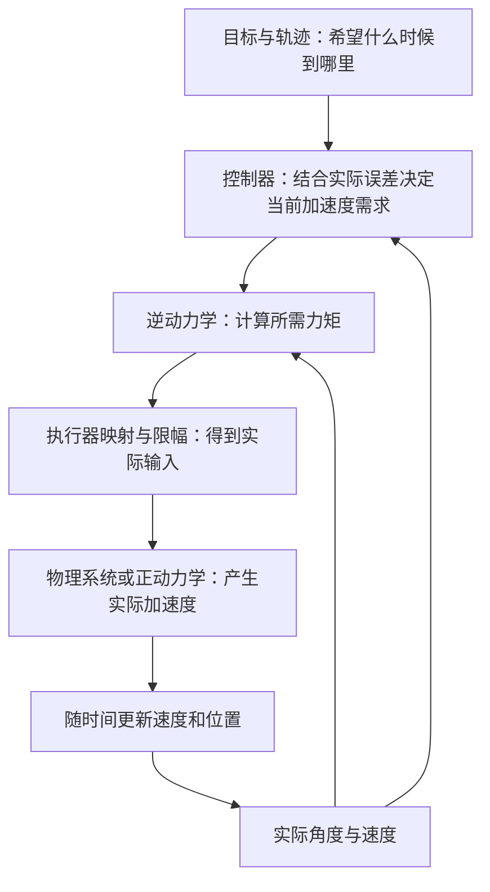

# 04：正动力学与逆动力学——知道力矩求运动，知道运动求力矩

本文行数：310行，预期阅读时长：13分钟

**正动力学回答“当前状态下，给这些实际力矩，会产生什么加速度”；逆动力学回答“当前状态下，要产生这些加速度，需要多少力矩”。** 两者使用同一套物理模型，已知量与待求量不同。

前两章已经算过这两类问题。本章把它们整理成清晰的接口认识，并给出一个能与手算对照的 MuJoCo 调用例子。重点是知道该填什么、该读什么、怎样判断结果；不要求实现底层求解算法。

正文数值分为两类：前文单杆、两连杆的解析计算，以及本章小模型在 MuJoCo 3.8.1 中的瞬时计算结果。均不代表控制跟踪成功，不要求读者安装环境或运行程序。

## 1. 先别与正运动学、逆运动学混在一起

“正”和“逆”不表示机械臂向前或向后运动，也不是把一段动画倒放。

| 问题 | 已知什么 | 求什么 |
| --- | --- | --- |
| 正运动学 FK | 机器人几何模型、关节构型 | 工具或连杆的位姿 |
| 逆运动学 IK | 几何模型、目标位姿及求解条件 | 满足目标的关节构型 |
| 正动力学 FD | 动力学模型、当前位置与速度、实际力矩和外力条件 | 当前加速度 |
| 逆动力学 ID | 动力学模型、位置与速度、指定加速度和外力条件 | 所需力矩 |

例如“末端去这个位置”首先是运动学、规划与轨迹问题。逆动力学不会仅凭一个末端目标就告诉你整段运动该怎样施力；它还需要具体的关节状态和加速度。

这一章都限定为固定基座、独立转动关节、没有接触约束的模型。角度与速度长度相同。自由关节、接触和欠驱动系统需要额外处理，不能直接套用所有结论。

## 2. 把输入与输出摆清楚

### 2.1 两种计算共享哪些条件

两者都需要一致的模型参数和状态：质量、质心、惯量、阻尼、重力方向，以及当前关节角 `q` 和角速度 `q_dot`。

对 `n` 个转动关节，本章中：

- `q` 是长度 `n` 的角度向量，单位 rad。
- `q_dot` 是长度 `n` 的角速度向量，单位 rad/s。
- `q_ddot` 是长度 `n` 的角加速度向量，单位 rad/s²。
- `tau` 是长度 `n` 的关节力矩向量，单位 N·m。

每个向量必须按同一关节顺序。第三章的两连杆固定为 `[肩,肘]`；数组长度正确，不等于关节顺序正确。

### 2.2 用第三章的方程看两个方向

沿用第三章记法：

$$
M(q)\ddot q+c(q,\dot q)+G(q)+D\dot q
=\tau_{\mathrm{motor}}+\tau_{\mathrm{ext}}
$$

这里 `c` 只表示速度相关惯性项，`G` 是重力补偿项，`D q_dot` 是黏性阻尼补偿项。它们的含义不会因为求解方向变化而改变。

**正动力学：** 先扣除需要抵消的影响，再求解加速度。

```text
rhs = tau_motor + tau_ext − c − G − D*q_dot
求解 M*q_ddot = rhs
```

**逆动力学：** 指定加速度，把各项相加，再扣除已经由外界承担的部分。

```text
tau_motor_required = M*q_ddot_des + c + G + D*q_dot − tau_ext
```

对于单杆，“求解”就是除以惯量。对于多个关节，应解线性方程组，不能逐项除以质量矩阵的对角元素。库内部可能采用专门的递推算法，也可能利用矩阵分解；不要求你先展开整个矩阵才能调用。

上述式子返回的是本章定义的**电机力矩需求**。具体库的逆动力学接口可能返回总广义力，或没有包含你额外建模的阻尼和摩擦，需要核对，不能只看函数名称。

## 3. 先用单杆完成一次“算回去”

继续用第二章的均匀杆：质量 `2 kg`、长度 `0.6 m`、质心距轴 `0.3 m`、绕轴惯量 `0.24 kg·m²`，阻尼系数 `0.2 N·m·s/rad`，重力加速度 `9.81 m/s²`。

杆在世界 x-y 竖直平面内转动，重力沿 `−y`，转轴沿朝向读者的 `+z`。下垂为零位，逆时针为正。

给定当前状态：

```text
q = π/6 rad       # 从下垂向右抬起 30°
q_dot = +1 rad/s  # 正在沿正方向转动
tau_ext = 0 N·m
```

### 3.1 逆动力学：我希望角加速度为 +2 rad/s²

这时已知加速度、未知电机力矩：

```text
惯性项：  0.24 × 2                      = 0.480 N·m
阻尼项：  0.2 × 1                       = 0.200 N·m
重力项：  2 × 9.81 × 0.3 × sin(π/6)      = 2.943 N·m
所需力矩：                              = 3.623 N·m
```

### 3.2 正动力学：如果实际给了 3.623 N·m，会怎样

位置、速度和模型都不变，把刚才的力矩作为输入：

```text
q_ddot = (3.623 − 0.200 − 2.943) / 0.24
       = +2 rad/s²
```

这叫一次正逆一致性核对：先用逆动力学求力矩，再用正动力学检查该力矩是否产生指定加速度。

一致性成立需要两边使用同一状态、同一模型和同一外力假设，而且实际施加的力矩没有被改变。**两种计算互相对得上，只能说明它们在这个模型里一致，不能证明这个模型就是实际机器人。** 两边使用同一个错误的负载，仍可能算回原来的加速度。

## 4. 两个关节时，调用方向不变，耦合仍然存在

复用第三章的两根均匀杆，各长 `0.6 m`、质量 `2 kg`。当前状态为：

```text
q = [0, π/2] rad
q_dot = [1, 2] rad/s
q_ddot_des = [1, 0] rad/s²
关节顺序 = [肩, 肘]
tau_ext = [0, 0] N·m
```

第三章已得到各项：

```text
M = [[1.20, 0.24], [0.24, 0.24]] kg·m²
c = [−2.88, 0.36] N·m
G = [5.886, 5.886] N·m
D*q_dot = [0.2, 0.4] N·m
```

逆动力学给出所需电机力矩 `[4.406,6.886] N·m`；把它送入同模型的正动力学，得到 `[1,0] rad/s²`。

可以把库调用关系想成下面的伪代码，函数名仅说明语义，不是某个库的真实 API：

```python
tau_required = inverse_dynamics(model, q, q_dot, q_ddot_des, external)
q_ddot_check = forward_dynamics(model, q, q_dot, tau_required, external)
```

`q_ddot_des[1]=0` 并不意味着 `tau_required[1]=0`，因为肘电机还要处理耦合、速度项、重力和阻尼。也不能交换输出的两个数后仍期望原来结果：力矩向量与关节向量属于同一个有序接口。

## 5. 结果为什么有时“算回去”却不一样

### 5.1 力矩被限幅：算出来的需求不等于实际输入

单杆在水平静止时，逆动力学要求保持不动，得到 `+5.886 N·m`。如果执行器只能输出 `+4 N·m`，实际正动力学得到：

```text
q_ddot = (4 − 5.886) / 0.24 ≈ −7.858333 rad/s²
```

逆动力学计算没有因此错误，它回答的是“需要多少”；正动力学使用的是“实际给了多少”。是否满足力矩限制，是还需要检查的条件。

### 5.2 负载模型不同：名义力矩不能代表实际响应

在第 3 节状态下，未带负载模型给出 `3.623 N·m`。若实际杆端挂了 `1 kg` 质点负载，按照第二章计算，总惯量为 `0.60 kg·m²`，当前重力补偿需求为 `5.886 N·m`。

实际加速度变为 `(3.623−0.2−5.886)/0.60 = −4.105 rad/s²`，与期望的 `+2 rad/s²` 不同。此时要核对负载和模型，不能只在逆动力学输出上随意乘一个系数。

### 5.3 同样的角度，不同速度也会不同

仍在 30°、电机给 `3.623 N·m`，若实际速度是 `−1 rad/s`，阻尼方向反过来，加速度变为：

```text
(3.623 + 0.2 − 2.943) / 0.24 ≈ +3.666667 rad/s²
```

因此，核对正逆计算时必须保持整个状态一致，不能只复制 `q` 而忘记 `q_dot`。

## 6. 怎样理解 MuJoCo 的正逆动力学接口

### 6.1 三个函数分别干什么

| MuJoCo 调用 | 本章关注的输入 | 关注的输出 | 推进时间吗 |
| --- | --- | --- | --- |
| `mj_forward(model, data)` | `qpos`、`qvel`、执行器输入及外力 | `qacc` 等计算结果 | 不推进 |
| `mj_inverse(model, data)` | `qpos`、`qvel`、预先指定的 `qacc` | `qfrc_inverse` | 不推进 |
| `mj_step(model, data)` | 当前状态、执行器输入及外力 | 推进后的状态 | 推进 |

`mj_forward` 包含动力学计算，不只是 FK 或更新显示。`mj_inverse` 调用前需要设置期望的 `qacc`，之后读取 `qfrc_inverse`；如果中途调用了 `mj_forward`，原先写入的 `qacc` 会被重新计算。接口行为依据 [MuJoCo 官方 API](https://mujoco.readthedocs.io/en/stable/APIreference/APIfunctions.html#main-simulation)，下面在 3.8.1 上实际核对。

### 6.2 先把模型条件做得足够清楚

本章提供 [single_rod.xml](single_rod.xml)，只含一个 hinge 和一个直接驱动 motor，与第二章的固定轴运动参数一致：

- 质量为 `2 kg`、质心位置为局部 `(0,−0.3,0) m`，关节轴为局部 `+z`。
- 明确指定质心惯量 `Izz=0.06 kg·m²`，加上 `m×0.3²` 得到关节轴惯量 `0.24 kg·m²`。
- 为得到合法三维惯量，XML 取 `Ixx=0.06`、`Iyy=0.001 kg·m²`；该固定 z 轴运动只使用对应的绕轴惯量。显示用 capsule 不反向决定质量和惯量。
- 阻尼为 `0.2 N·m·s/rad`，无 armature、干摩擦、弹簧、接触或关节限位。
- motor 的 `gear=1`，控制范围为 `[-4,4]`。此特定配置下，未限幅的 `ctrl` 数值对应关节力矩 N·m。

模型无外部网格、私人模型路径或显示依赖。它与仿真章节中附带自由球的单摆不是同一份模型，也不依赖那份模型的数组索引。

### 6.3 先调用逆动力学，再建立独立数据核对

下面片段放在本章目录的脚本中，按脚本位置加载 XML。完整可运行核对在 [check_examples.py](check_examples.py)：

```python
from pathlib import Path
from math import pi
import mujoco

xml = Path(__file__).resolve().parent / "single_rod.xml"
model = mujoco.MjModel.from_xml_path(str(xml))

inverse_data = mujoco.MjData(model)
inverse_data.joint("hinge").qpos[0] = pi / 6
inverse_data.joint("hinge").qvel[0] = 1.0
inverse_data.joint("hinge").qacc[0] = 2.0
mujoco.mj_inverse(model, inverse_data)
required = inverse_data.qfrc_inverse.copy()

forward_data = mujoco.MjData(model)
forward_data.qpos[:] = inverse_data.qpos
forward_data.qvel[:] = inverse_data.qvel
# 本模型仅一个 gear=1 的 motor，无额外外力，3.623 未超过限幅。
forward_data.actuator("motor").ctrl[0] = required[0]
mujoco.mj_forward(model, forward_data)
```

**MuJoCo 3.8.1 的实际结果：** `required≈[3.623] N·m`，`forward_data.qacc≈[2] rad/s²`，两份数据的 `time` 都保持 `0 s`；`qpos`、`qvel` 未因这些调用前进。

使用两份 data 是为了让“指定的加速度”和“正向计算出的加速度”容易比较。直接写 `qpos`、`qvel` 是设置计算状态，不是在执行一条轨迹。

### 6.4 qfrc_inverse 为什么不一定就是电机力矩

在本章无接触的模型中，`qfrc_inverse` 表示**执行器与额外外力合计需要提供的广义力矩**，被动阻尼的影响已由计算处理。它并不自动决定这些力矩分别由哪个执行器或外力来源承担。该输出定义见 [MuJoCo 逆动力学计算流程](https://mujoco.readthedocs.io/en/stable/computation/index.html#inverse-dynamics)。

仍在第 3 节状态下，希望加速度为 `2 rad/s²`，如果另有 `+0.48 N·m` 的外力矩：

```text
qfrc_inverse 所需合计： 3.623 N·m
已知外力矩：           0.480 N·m
电机应承担：           3.143 N·m
```

在新的 forward_data 中，设置 `qfrc_applied[0]=0.48`、motor 输入为 `3.143`，再调用 `mj_forward`，实际仍得到约 `2 rad/s²`。

如果既完整给 motor `3.623`，又加 `0.48` 的外力矩，就重复提供了这部分需求，得到约 `4 rad/s²`。这说明调用前应明确输出是“总需求”还是“已减去外力后的电机需求”。

同理，本模型 `qfrc_bias≈2.943` 包含重力影响，`qfrc_passive≈−0.2` 表示当前阻尼；逆动力学结果已经考虑它们，不应再额外加一次重力或阻尼。真实接口有接触、其他被动力或笛卡尔外力时，需按各自定义核对，不能把这段减法原样用于任意系统。

## 7. 广义力到执行器命令，还隔着一层映射

本章一个 hinge 对应一个 motor、`gear=1`，所以示例可以把单个力矩分量送到单个 `ctrl`。这是模型条件，不是普遍规则。

如果仅把这个 motor 的 `gear` 改为 2，直接驱动模型下有：

```text
关节力矩 = 2 × motor 输入
```

仍需要 `3.623 N·m` 时，应给 `ctrl=1.8115`，而不是继续把 `3.623` 直接复制进去。本章脚本也核对了这个传动变化。

更一般地，`qfrc_inverse` 长度对应自由度数量 `nv`，`ctrl` 长度对应执行器数量 `nu`，两者可能不同。位置执行器还把 `ctrl` 解释为目标位置，不能把 N·m 塞进位置目标数组。相关接口含义可查[仿真控制输入](../../simulation/04_control_inputs/README.md)。

如果某些自由度没有执行器，逆动力学可能算出那些方向也需要力，却没有输入可以实现；多个执行器共同驱动时也需要分配。因此，“有逆动力学结果”不等于“所有加速度都能由当前执行器实现”。

## 8. 逆动力学为什么还不能替代控制器

如果指定的加速度为零，逆动力学只是计算怎样让当前速度暂时不变，不会把当前速度清零。若希望到达一个目标角度，首先还要决定现在应该加速还是减速，以及加速度取多大。

可以这样分清职责：



这是使用逆动力学的一种控制组织方式，并非所有控制器都必须这样实现。也可以用期望轨迹的状态做前馈，再结合反馈处理偏差；具体方法留到第六部分。

本章只完成中间两种计算及其输入输出核对，没有用上述流程驱动闭环运动。实际模型误差、延迟、扰动、接触和限幅，都可能让轨迹跟踪偏离理想计算。

## 9. 使用接口时，按这个顺序核对结果

| 核对内容 | 一个典型错误 |
| --- | --- |
| 模型和负载 | 逆向计算没带负载，实际模型带了负载 |
| 同一时刻的完整状态 | 角度复制了，速度却仍是默认零 |
| 关节顺序、单位与坐标 | `[肩,肘]` 与 `[肘,肩]` 混用，或把角度制直接当 rad |
| 被动力与外力的记账方式 | 已包含的阻尼再次相加，已知外力重复计入 |
| 关节力矩到执行器的映射 | 把广义力向量直接赋给任意 `ctrl` |
| 实际输入与限幅 | 使用需求力矩核对，却忽略实际执行器已经饱和 |
| API 是否推进时间 | 把 `mj_forward` 的瞬时结果当成已经执行了运动 |

先能说明“输入是什么、输出是什么、结果适用于哪些条件”，再去研究具体的递推算法，会更容易把理论与代码对应起来。

## 实现与验证记录

[check_examples.py](check_examples.py) 复用第二、三章的解析实现，避免再维护一套同样的公式；本章另外提供小型 MJCF 用于真实 API 核对。

从仓库根目录按需运行，不作为阅读作业：

```bash
# 只运行解析核对，不需要 MuJoCo。
python3 src/control/04_forward_inverse_dynamics/check_examples.py

# 使用已有 MuJoCo 环境，同时运行解析与 API 核对。
~/mujoco-env/bin/python src/control/04_forward_inverse_dynamics/check_examples.py --mujoco
```

依赖版本沿用 [MuJoCo 固定依赖](../../simulation/mujoco/requirements.txt)。官方 stable 文档可能更新，本章 API 行为以 2026-09-26 在已有 Python 3.10.12 / MuJoCo 3.8.1 环境下的实际核对为准，不据此宣称独立环境安装已验证。

检查包括单杆和两连杆的正逆一致性、状态与负载不匹配、外力分配、无时间推进、被动阻尼、执行器限幅以及 `gear=2` 的映射。所有 MuJoCo 核对无窗口、无接触、不调用 `mj_step`；未进行轨迹积分、闭环控制或真机验证。6 项解析检查与 5 项实际 API 检查共 11 项全部通过，输入输出数值及检查结果见配套脚本。

[上一部分：多关节动力学](../03_multi_joint_dynamics/README.md) · [返回动力学目录](../README.md) · [下一部分：数值积分与仿真步进](../05_integration_step/README.md) · [学习路线 S5](../../../doc/learning-roadmap.md#s5)
