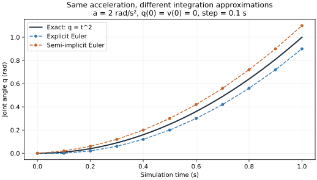

# 05：数值积分与仿真步进——从这一刻的加速度到下一刻的状态

本文行数：343行，预期阅读时长：15分钟

**正动力学算出当前加速度；数值积分利用一小段时间，把速度和位置向前更新。不断重复这两个过程，才得到一段仿真运动。**

第四章中，`mj_forward` 算出了加速度，但时间仍为零，杆也没有沿时间运动。本章补上这一步：一小段时间怎样进入计算，为什么更新顺序会影响结果，以及为什么仿真步长不能只按画面是否流畅来选择。

不要求你先学积分技巧，也不要求安装环境。先用能手算的例子建立理解，再看真实 MuJoCo 步进结果。正文中的解析结果、教学数值积分与引擎实际运行结果会分别标明。

## 1. “积起来”是什么意思

### 1.1 速度保持不变时，位置变化很好算

假设一个关节的角速度始终为 `1 rad/s`，经过 `0.1 s`，角度就增加：

```text
角度增加量 = 角速度 × 时间 = 1 × 0.1 = 0.1 rad
```

若这段时间速度不断变化，就不能拿其中任意一个时刻的速度代表整段运动。可以先把时间分成很多小段，每一小段用一个近似速度计算角度变化，再把变化量加起来。这就是理解数值积分的一个入口。

加速度到速度也是同样的道理：如果某小段时间内角加速度近似为 `2 rad/s²`，经过 `0.1 s`，角速度近似增加 `0.2 rad/s`。

### 1.2 每一步需要留下什么

这里用 `v` 简写角速度 `q_dot`，用 `a` 简写角加速度 `q_ddot`。对于本章的 hinge，单位分别是 rad/s、rad/s²，`q` 的单位是 rad。

令 `h` 表示每次向前推进的时间，叫**步长**（timestep），单位 s。下标 `k` 表示第 k 个时刻，`k+1` 表示下一时刻：

```text
当前：t_k、q_k、v_k
    ↓ 根据当前模型、状态和输入计算 a_k
推进 h 秒
    ↓ 按积分方法更新
下一时刻：t_(k+1)、q_(k+1)、v_(k+1)
```

时间更新为 `t_(k+1)=t_k+h`。下一步要用新状态重新计算加速度，因为重力、阻尼等可能已经改变。

这里的 `v` 能直接表示角度的变化率，是因为我们先研究一个标量转动关节。包含自由关节或球关节时，位置可能用四元数，不能把所有 `qpos` 与 `qvel` 当作等长数组直接相加。

## 2. 先用一个有准确答案的运动看近似误差

### 2.1 暂时让加速度恒定

为单独观察积分误差，本节人为规定：

```text
初始角度 q(0) = 0 rad
初始角速度 v(0) = 0 rad/s
角加速度 a = 2 rad/s²，整个过程中恒定
```

这是独立的教学运动，不是前几章默认重力单杆的自然下落。它的精确关系很简单：

$$
v(t)=2t,\qquad q(t)=t^2
$$

为什么位置是 `t²`？速度从零匀速增加到 `2t`，这一段时间的平均速度是 `t`，再乘经过的时间 `t`，就得到 `t²`。这是恒加速度的特殊结果，不需要先掌握一般积分公式。

因此在 `t=1 s`，精确速度为 `2 rad/s`，精确角度为 `1 rad`。下面用它判断计算方法的误差。

### 2.2 显式欧拉：这一小步都用步首速度

最直接的近似是：

$$
v_{k+1}=v_k+h a_k,\qquad q_{k+1}=q_k+h v_k
$$

这叫**显式欧拉法**。速度用步首加速度更新，位置用步首速度更新。若 `h=0.1 s`，第一步为：

```text
v_1 = 0 + 0.1 × 2 = 0.2 rad/s
q_1 = 0 + 0.1 × 0 = 0 rad
```

真实角度在 `0.1 s` 时已经是 `0.01 rad`，但这个近似用整段开始时的零速度算位置，漏掉了小段内速度增加带来的位移。**不是物体真的先停了 0.1 秒，而是这个近似第一步没有反映出那部分位移。**

这里加速度恒定，所以速度更新恰好准确；位置更新依然有误差。

### 2.3 半隐式欧拉：先更新速度，再用新速度更新位置

另一种顺序是：

$$
v_{k+1}=v_k+h a_k,\qquad q_{k+1}=q_k+h v_{k+1}
$$

这叫**半隐式欧拉法**，与前一式只差位置更新用了新速度。相同步长下，第一步变成：

```text
v_1 = 0.2 rad/s
q_1 = 0 + 0.1 × 0.2 = 0.02 rad
```

真实值为 `0.01 rad`，这次又多算了一点，因为用整段末尾较大的速度代表了整段。对这个恒加速度例子，使用步首与步末速度的平均值就能精确计算位置；一般状态相关加速度需要相应的积分方法，不能把这种特殊性质直接推广。

| 时间 / s | 精确角度 / rad | 显式欧拉 / rad | 半隐式欧拉 / rad |
| --- | --- | --- | --- |
| `0.0` | `0.00` | `0.00` | `0.00` |
| `0.1` | `0.01` | `0.00` | `0.02` |
| `0.2` | `0.04` | `0.02` | `0.06` |
| `0.3` | `0.09` | `0.06` | `0.12` |
| `1.0` | `1.00` | `0.90` | `1.10` |



图中深色实线为精确结果，蓝色为显式欧拉，橙色为半隐式欧拉，圆点间隔为 `0.1 s`。这是按上述公式生成的教学图，不是机器人测量。这个例子中两种方法在终点的绝对误差相同，不能仅凭它就判断哪一种对所有机械系统更好。

### 2.4 步长减小，为什么误差会变小

保持同一个初态、同一个加速度、同样算到 `1 s`，只改变步长：

| 步长 h / s | 步数 | 显式欧拉末角度 / rad | 半隐式欧拉末角度 / rad | 两者末角度绝对误差 / rad |
| --- | --- | --- | --- | --- |
| `0.10` | `10` | `0.90` | `1.10` | `0.10` |
| `0.05` | `20` | `0.95` | `1.05` | `0.05` |
| `0.01` | `100` | `0.99` | `1.01` | `0.01` |

每小段里速度变化变少，用一个速度代表整段的近似就更贴近真实。代价是需要更多计算步数。

注意比较条件是**相同的仿真时长**。步长减半以后，还只跑原来的步数，模拟的是一半时长，不能把两次终点不同直接当作精度问题。

## 3. 回到重力单杆：加速度每一步都要重新算

恢复前几章的模型：`I=0.24 kg·m²`、`m=2 kg`、`l_c=0.3 m`、`b=0.2 N·m·s/rad`、`g=9.81 m/s²`，下垂为零，逆时针为正，重力沿世界 `−y`。

初态是 `q0=π/6 rad`、`v0=0 rad/s`，不提供电机力矩和额外外力矩。第二章已经算出起始加速度：

```text
a0 = (0 − 0 − 2×9.81×0.3×sin(π/6)) / 0.24
   = −12.2625 rad/s²
```

为了便于手算，先用教学半隐式欧拉和 `h=0.01 s`，第一步得到：

```text
v1 = 0 + 0.01×(−12.2625) = −0.122625 rad/s
q1 = π/6 + 0.01×(−0.122625) ≈ 0.522372526 rad
```

下一步先用 `q1`、`v1` 重新算重力矩和阻尼，再更新。不能始终沿用最初的 `−12.2625 rad/s²`，否则模拟的是另一种恒加速度运动。

下面的代码表达这个教学顺序，不是 MuJoCo 内部实现的逐行复制：

```python
for _ in range(number_of_steps):
    a = (tau_motor - b * v - m * g * l_c * sin(q)) / I
    v = v + h * a
    q = q + h * v  # 用更新后的速度：半隐式欧拉
    t = t + h
```

每一步位置变化很小，但它已经改变了下一步计算所需的条件。“重复小步计算”连接起了动力学方程与整段运动。

## 4. 误差与不稳定，是两个不同问题

### 4.1 不发散，不代表足够准确

第 2 节末角度 `0.9 rad` 和 `1.1 rad` 都是有限的数，曲线也平滑，但它们与精确值仍相差 `0.1 rad`。能稳定算完，只是最基本的一层要求。

一种实用核对方法是：固定模型、初态、输入规律和仿真终止时间，逐次减小步长，看关心的位置、速度或误差是否趋于一致。这通常叫**步长收敛检查**。它检验数值计算，不证明模型参数与真机相符。

### 4.2 纯阻尼也可能被粗糙计算变成“越转越快”

再构造一个用于说明稳定性的独立例子：保持 `I=0.24 kg·m²`，关闭重力和驱动力矩，把阻尼系数改为 `b=24 N·m·s/rad`。初始速度为 `1 rad/s`。

真实关系为 `a=−(b/I)v=−100v`：只有阻尼消耗运动能量，速度会保持正号并逐渐趋向零。

若显式欧拉使用 `h=0.03 s`，则：

```text
v_next = v + h×(−100v) = (1 − 100×0.03)v = −2v
速度序列：1 → −2 → 4 → −8 → … rad/s
```

这个“每一步反向、幅值越来越大”的现象是数值方法与步长组合造成的不稳定，不是阻尼真的在给系统加能量。

若把阻尼项按下一步速度处理，即写成 `v_next=v−100h v_next`，移项得到：

```text
v_next = v / (1 + 100h)
```

相同一步后的速度为 `0.25 rad/s`，方向和衰减趋势合理；但精确值为 `exp(−100×0.03)≈0.049787 rad/s`，误差仍明显。指数函数这里仅作为已知参照，不要求推导。

**稳定性是在问“会不会出现错误增长”，精度是在问“离目标物理模型的解有多近”。** 换一种更稳定的方法，不代表可以任意放大步长。

这个纯阻尼例子的参数与前面默认单杆不同，也不是说 MuJoCo 默认使用了会发散的显式欧拉；下一节解释实际区别。

## 5. MuJoCo 的一步实际做了什么

### 5.1 mj_forward 与 mj_step 的区别

继续复用第四章的 [single_rod.xml](../04_forward_inverse_dynamics/single_rod.xml)，不用新建重复模型。

| 调用 | 对本章模型的作用 |
| --- | --- |
| `mj_forward(model, data)` | 用当前状态和输入更新动力学与派生量；不推进 `time`、`qpos`、`qvel` |
| `mj_step(model, data)` | 计算动力学并按所选积分器推进一段时间，更新位置与速度 |

`mj_step` 的时间步由 `model.opt.timestep` 控制；不是 Python 循环运行一次实际花了多少秒，也不是两次鼠标操作的时间间隔。流程依据 [MuJoCo 仿真说明](https://mujoco.readthedocs.io/en/stable/programming/simulation.html#simulation-loop)，本章还在 3.8.1 上实际核对。

### 5.2 MuJoCo 的 Euler 不等于前面的显式欧拉

本章明确选择 `mjINT_EULER`。在所用版本中，它以新速度更新位置，并默认对关节阻尼进行隐式处理。相关原理见 [MuJoCo 数值积分说明](https://mujoco.readthedocs.io/en/stable/computation/index.html#numerical-integration)。

对本章无接触单杆，这意味着速度更新可以写成：

$$
v_{k+1}=\frac{I v_k+h\left(\tau_k-mgl_c\sin q_k\right)}{I+h b},\qquad
q_{k+1}=q_k+h v_{k+1}
$$

分母里的 `h b` 就是关节阻尼隐式处理在这个简单模型中的体现。它使结果不完全等于“步首加速度乘步长”的教学显式更新。

初态仍为 `q=π/6 rad`、`v=0`、输入力矩为零，使用 XML 原步长 `h=0.002 s`：

```text
v_next = (0 − 0.002×2.943) / (0.24 + 0.002×0.2)
       ≈ −0.024484193012 rad/s
q_next = π/6 + 0.002×v_next
       ≈ 0.523549807212 rad
time_next = 0.002 s
```

上述结果已与 MuJoCo 实际一步的输出核对。这个式子只针对当前模型和积分设置，不应套到包含其他耦合、接触或不同积分器的模型。

其他积分器会以不同方式估计一小步内的变化。首次学习先掌握“加速度计算”和“时间更新”是两个环节，算法细节按需要查看；`Euler` 只是名称，不能据此猜定所有更新顺序。

## 6. 同一根杆、同样 0.2 秒，不同步长有什么差别

条件固定为本章原单杆、30° 静止释放、零控制输入、无接触。使用 MuJoCo 3.8.1 的 `Euler`，比较三种步长，均算到 `0.2 s`：

| 步长 / s | 步数 | 末角度 / rad | 末角速度 / rad/s | 相对数值参照的角度绝对差 / rad |
| --- | --- | --- | --- | --- |
| `0.020` | `10` | `0.289744911` | `−1.932587033` | `0.017857278` |
| `0.010` | `20` | `0.298678459` | `−1.936672554` | `0.008923729` |
| `0.002` | `100` | `0.305817296` | `−1.940921757` | `0.001784892` |

**上表是实际运行的 MuJoCo 无窗口步进结果。** 数值参照来自同一连续单杆方程的四阶 Runge–Kutta（RK4）计算，步长 `0.00005 s`，得到 `q≈0.307602188402 rad`、`v≈−1.942121852085 rad/s`；把参照步长从 `0.0001 s` 减半后，两项差值均小于 `1e-10`。

参照是高精度数值估计，不是解析真值，也不是实测机器人轨迹。步长减小后，本例角度结果更接近参照，说明这里数值误差正在减小。它不提供适用于所有机器人、所有接触或所有控制器的通用步长。

这个例子没有跟踪目标：杆在重力作用下运动，输入始终为零。它验证的是给定模型下的时间推进，不能标为轨迹跟踪或位置控制通过。

## 7. 记录步后状态时，别把两个时刻混在一起

### 7.1 为什么步后 qpos 已更新，其他字段却可能还没对齐

一次 `mj_step` 中，许多派生量是在积分之前或内部计算阶段得到的；最后更新位置和速度以后，这些数组不一定全部对应新的 `qpos`。不能仅凭它们都存放在同一个 data 中，就认为时间完全一致。

本章 Euler 一步后的 `qacc` 仍约为步首的 `−12.2625 rad/s²`。保持新 `qpos`、`qvel` 不变再调用 `mj_forward`，得到新状态对应的加速度约为 `−12.241056438 rad/s²`；仿真时间仍为 `0.002 s`。杆的世界姿态也随派生量更新而与新的角度一致。

因此，如果要记录同一时刻的位置、速度、加速度和世界位姿，可以在步后重新计算派生量，再一起保存。本章没有控制回调，额外的 `mj_forward` 只用于重算；实际有回调的系统还需留意它会触发的计算。

### 7.2 一个能直接对应正文的循环

下面代码放在本章目录的脚本中；模型路径按脚本位置确定。完整核对见 [check_examples.py](check_examples.py)。

```python
from pathlib import Path
from math import pi
import mujoco

xml = Path(__file__).resolve().parent.parent / "04_forward_inverse_dynamics" / "single_rod.xml"
model = mujoco.MjModel.from_xml_path(str(xml))
model.opt.timestep = 0.002
model.opt.integrator = mujoco.mjtIntegrator.mjINT_EULER
data = mujoco.MjData(model)
data.joint("hinge").qpos[0] = pi / 6  # 仅用于初始状态

def snapshot():
    return {
        "time": float(data.time),
        "q": data.qpos.copy(),
        "v": data.qvel.copy(),
        "a": data.qacc.copy(),
    }

data.actuator("motor").ctrl[0] = 0.0
mujoco.mj_forward(model, data)
records = [snapshot()]  # t=0 的初态
for _ in range(100):
    mujoco.mj_step(model, data)
    mujoco.mj_forward(model, data)  # 在步后状态重算派生量，不增加时间
    records.append(snapshot())
```

结果有 `101` 条记录，包含初态与 100 个步后状态；末时间约为 `0.2 s`。浮点数可能显示 `0.20000000000000015`，这是数值表示误差，不应使用严格字符串或完全相等比较判断是否到时。

保存数组使用 `.copy()`，否则日志可能只是指向以后还会被更新的内存，回头看时早期记录已不再代表早期状态。初始 `qpos` 写入以后，循环通过动力学步进改变状态，不是每一步覆盖目标角度。

## 8. 物理步长、控制周期和画面刷新不是同一个时间

如果物理步长为 `0.002 s`，控制器每 5 步更新一次输入，画面每 20 步刷新一次：

| 工作 | 对应仿真间隔 | 频率 |
| --- | --- | --- |
| 物理步进 | `0.002 s` | `500 Hz` |
| 控制更新 | `0.010 s` | `100 Hz` |
| 画面刷新 | `0.040 s` | `25 Hz` |

两次控制更新之间可以保持上一次输入，但物理系统仍在每个小步更新。保持输入不等于保持加速度，因为重力、阻尼和状态在变化。高阶积分器内部还可能多次计算动力学，不应把内部次数当作画面帧数。

控制器或轨迹若以仿真时间为准，应使用 `data.time`。电脑真实经过的时间叫墙钟时间，受机器性能和 `sleep()` 等影响；程序等待一秒而不步进，不会让仿真自动前进一秒。进一步的显示说明见[显示与频率](../../simulation/05_viewer_rendering/README.md)。

调小物理步长时，如果还固定“每 5 步更新一次控制”，控制周期也随之改变。要比较积分误差，应保持输入规律和控制更新时刻等条件一致；本章用恒定零输入，避免混入控制周期的变化。

## 9. 遇到异常，先判断是哪一类问题

| 现象 | 先核对什么 |
| --- | --- |
| 能算出加速度，关节却一直不动 | 是否只调用了 `mj_forward`，没有真正步进 |
| 换步长后末状态差很多 | 是否比较同一仿真时长、同一输入规律；再做步长收敛检查 |
| 很大阻尼下速度交替反向增大 | 积分方法与步长是否导致数值不稳定；不要立刻认定物理模型会自激 |
| 位置正确，但加速度或世界位姿对不上 | 是否混用了积分前和积分后的字段 |
| 历史日志每行最后都变得一样 | 是否忘了复制持续更新的状态数组 |
| 画面更流畅，但物理误差没变小 | 显示刷新与数值积分精度是不同问题 |

本章建立的是时间推进的理解。积分器让“物理方程”变成“随时间变化的数值状态”；它不会替你设计控制器，也不能修复质量、惯量、外力或执行器配置本身的错误。

## 实现与验证记录

2026-09-26 使用 Python 3.10.12、MuJoCo 3.8.1，在无窗口环境核对本章内容。[检查脚本](check_examples.py)复用第二章的单杆解析模型和第四章 XML，RK4 只作连续方程的数值参照，图由 Matplotlib 3.10.9 生成。

共 10 项检查通过：5 项教学数值检查覆盖恒加速度、更新顺序、纯阻尼稳定性、参照收敛与单杆步长收敛；5 项 MuJoCo 检查覆盖步进与非步进、关节阻尼处理、步后数据与记录、同一时长的步长比较和强阻尼行为。`0.002 s` 的 100 步运行从干净初态重复后，末角度差小于 `1e-12 rad`。

按需复查命令如下，不是必做实验：

```bash
python3 src/control/05_integration_step/check_examples.py
~/mujoco-env/bin/python src/control/05_integration_step/check_examples.py --mujoco
# 可选：重新生成正文图，需要 Matplotlib。
~/mujoco-env/bin/python src/control/05_integration_step/check_examples.py --plot
```

MuJoCo 与 NumPy 版本沿用[固定依赖](../../simulation/mujoco/requirements.txt)；Matplotlib 仅用于图表再生成，不影响默认数值检查或阅读。未验证新环境安装、Viewer、接触、真机或闭环控制。本章新增了实际开环时间步进的证据，但没有新增轨迹跟踪验收。

[上一部分：正动力学与逆动力学](../04_forward_inverse_dynamics/README.md) · [返回动力学目录](../README.md) · [下一部分：控制与约束](../06_control_constraints/README.md) · [学习路线 S5](../../../doc/learning-roadmap.md#s5)
