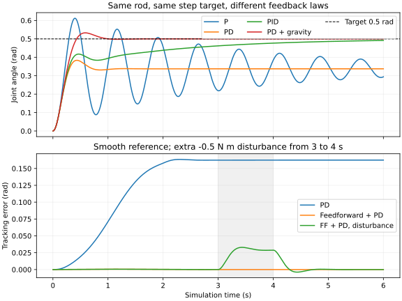
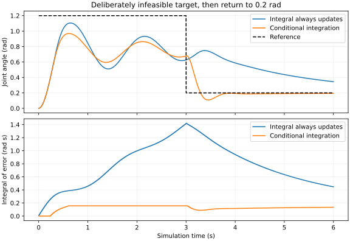

# 06 控制与约束：让实际运动跟上目标

本文行数：369行，预期阅读时长：19分钟

**轨迹告诉我们“每个时刻希望在哪里、运动多快”；控制器根据目标、实际状态和模型计算输入；执行器施力后，动力学与时间积分才产生实际运动。** 有了目标轨迹，实际关节仍可能落后、振荡或到不了。本章从这些现象建立控制直觉。

前五章已经回答了“力怎样产生加速度、加速度怎样更新状态”。现在把实际状态读回来，再据此调整下一次力矩，就形成了闭环。重点是理解每一环的输入输出，能判断结果和常见失败；不要求手写完整机械臂控制框架。

本文先讲单关节，再连接关节轨迹和末端目标。[实际指标与复查方式](verification.md)单独存放，读正文无需运行代码。

## 1. 从“给一个目标”到“持续修正误差”

### 1.1 继续使用同一根杆

沿用[第四章模型](../04_forward_inverse_dynamics/single_rod.xml)：质量 `2 kg`、杆长 `0.6 m`、质心距关节 `0.3 m`，绕关节的转动惯量为 `0.24 kg·m²`，物理阻尼为 `0.2 N·m·s/rad`。

世界坐标 `x` 向右、`y` 向上、`z` 朝向读者，重力沿负 `y`。关节绕正 `z` 轴逆时针转动为正，`q=0` 时杆竖直向下，`q=π/2` 时向右水平。它的方程是：

\[
0.24\ddot q+0.2\dot q+5.886\sin q
=\tau_{\mathrm{motor}}+\tau_{\mathrm{ext}}.
\]

左侧重力项记作 `G(q)=5.886 sin(q)`，单位 `N·m`。没有额外外力时，静止保持所需的电机力矩就是 `G(q)`。

本例电机力矩限制为 `±4 N·m`。初态均为 `q=0 rad`、`q̇=0 rad/s`，主要目标为 `0.5 rad`，约 `28.65°`；这个姿态需要约 `2.822 N·m` 才能静止保持，处于力矩范围内。

### 1.2 位置、速度、力矩接口接收的东西不同

| 接口接收什么 | 你给出的含义 | 后面仍需完成的工作 |
| --- | --- | --- |
| 位置目标 `q_d`，转动关节用 rad | 希望到达的角度 | 底层控制器根据误差驱动电机 |
| 速度目标 `q̇_d`，用 rad/s | 希望维持的运动速度 | 底层速度控制根据反馈调整驱动 |
| 力矩命令 `τ`，用 N·m | 希望电机施加的关节力矩 | 机械系统按动力学响应；通常还存在驱动器内部电流环 |

位置接口也离不开力和动力学，只是接口后面已经有控制环。本章选择理想力矩电机，把“目标如何变成力矩”直接写出来。

这里的 MuJoCo 模型只有一个 `motor`，传动 `gear=1`，所以本模型的 `data.ctrl[0]` 数值对应关节力矩命令。**不能把这一对应关系推广到所有模型。** 位置执行器的控制量可以是目标位置，其他传动、增益或执行器动态也会改变控制量到广义力的映射。参见 [MuJoCo 执行器建模说明](https://mujoco.readthedocs.io/en/stable/modeling.html#actuators)。

直接把 `qpos` 改成目标角度，会跳过本章要观察的受力和跟踪过程。下面的仿真通过 `ctrl` 驱动，不在步进循环中改写 `qpos/qvel`。

### 1.3 闭环每次做什么


例如当前目标 `0.5 rad`，实际只有 `0.3 rad`，位置误差为：

\[
e=q_d-q=0.2\ \mathrm{rad}.
\]

正误差表示实际角度落在目标后面。但仅有这一条信息还不够：杆可能正在快速接近目标，也可能正往反方向下落。这就是为什么控制器往往同时看位置误差和速度。

## 2. P、PD、PID：分别利用了哪种信息

### 2.1 P：偏得越多，修正得越用力

比例控制（P）是：

\[
\tau_{\mathrm{raw}}=K_p(q_d-q).
\]

`K_p` 是比例增益，单位 `N·m/rad`。本例取 `K_p=12`，偏差 `0.2 rad` 会请求 `2.4 N·m`。请求值还要经过 `±4 N·m` 限幅，才成为实际命令。

可以把它想成一根把关节拉向目标的虚拟扭簧：偏得越远，恢复力矩越大。不过杆有惯量，到达目标时速度不一定恰好为零，因此可能冲过目标，再被拉回来。

还有一个更容易忽略的问题：**在有重力的姿态，单纯 P 控制通常需要留下误差，才能产生托住杆的力矩。** 如果实际角度恰好等于目标，P 输出变成零，重力却仍在拉杆下落。

本例的静态平衡条件为：

\[
12(0.5-q)=5.886\sin q.
\]

数值求解得到 `q≈0.337555 rad`，误差约 `0.162445 rad`。这是模型与控制律推导出的平衡点，不是传感器读错，也不是积分器精度不足。单用 P 的本次运行在 6 秒内还带有明显振荡，末时刻不必恰好等于这个平衡点。

### 2.2 PD：同时考虑“差多远”和“运动多快”

加入速度误差后：

\[
\tau_{\mathrm{raw}}=K_p(q_d-q)+K_d(\dot q_d-\dot q).
\]

`K_d` 的单位是 `N·m·s/rad`。本例取 `K_d=2`。对于静止目标，`q̇_d=0`，速度项变成 `-K_d q̇`：杆朝正方向跑得太快时，它提供负向力矩，帮助刹车。

例如误差仍为 `0.2 rad`，实际速度却已经是 `1 rad/s`，PD 请求的力矩为：

\[
12\times0.2+2\times(0-1)=0.4\ \mathrm{N\cdot m}.
\]

相比 P 的 `2.4 N·m`，它减少了继续加速的力矩。目标尚未到达就减速，是为处理惯量造成的冲过头。

注意两个不同的量：模型里的物理阻尼系数是 `0.2`，控制器里的 `K_d` 是 `2`。前者描述机械系统，后者通过反馈主动产生力矩；单位相同不表示它们是同一个参数。

PD 能改善振荡，却仍不能单靠速度项消除上述静态误差，因为停下来后速度误差也为零。上述 P、PD、PID 与重力补偿的关系可对照 [MIT Manipulator Control](https://manipulation.mit.edu/force.html)。

### 2.3 PID：把长期存在的偏差也记下来

积分项记录误差随时间的累积：

\[
z(t)=\int_0^t e(\xi)\,d\xi,\qquad
\tau_{\mathrm{raw}}=K_pe+K_d(\dot q_d-\dot q)+K_iz.
\]

`z` 的单位是 `rad·s`，`K_i` 的单位是 `N·m/(rad·s)`。若连续一秒都差 `0.1 rad`，积分就增加 `0.1 rad·s`；本例 `K_i=8`，对应额外 `0.8 N·m`。

积分项的作用是：即使瞬时误差已经很小，它仍可以保留一份持续输出，抵消重力或恒定扰动。只有在系统稳定、目标可实现、限幅等条件允许时，才能期待它逐渐消除恒定偏差。它不会凭空增大电机的最大力矩，也不是一加上就立刻没有误差。

### 2.4 同一根杆的实际响应

上图比较从 `0` 突然切到 `0.5 rad` 的位置目标；下图比较后面介绍的平滑轨迹。两图均为本章 MuJoCo 数值仿真，灰色区域表示施加额外外力矩的时段。



| 阶跃目标下的控制器 | 最后一秒误差 RMSE，rad | 本次运行说明 |
| --- | ---: | --- |
| P | 0.175082 | 振荡仍明显，且存在重力导致的静态偏差 |
| PD | 0.162445 | 振荡消退，停在目标下方 |
| PID | 0.011159 | 积分逐渐补上托住杆的力矩，但 6 秒内尚未满足本例到位判据 |
| PD + 重力补偿 | 小于 1e-10 | 在准确模型和无扰动条件下到达目标；不是实际机器人精度承诺 |

这里的阶跃用于看清响应差异。目标速度在代码中设为零，速度反馈用于刹车；**这不表示突变位置具有有限且连续的真实导数。** 真正移动时应给可跟踪的带时间轨迹。

## 3. 路径、轨迹、插值与时间参数化

### 3.1 “走哪条路”和“什么时候走到”

路径描述经过哪些状态，例如关节从 `0` 到 `0.5 rad`。轨迹还给出时间：第 `0 s` 在哪里，第 `1 s` 在哪里，第 `2 s` 是否停下。

多关节中可写成路径 `q(s)`，其中 `s∈[0,1]` 表示路径进度；再给进度随时间变化的规律 `s(t)`，得到 `q(t)=q(s(t))`。这一步把速度、加速度需求带进来。同一路径走得越快，所需加速度和力矩通常也越大。

### 3.2 不只能线性插值

对于从零到 `0.5 rad`、用时 `2 s` 的线性位置插值，运动段速度恒为 `0.25 rad/s`。但是如果起止时原本静止，速度会在边界突然跳变，理想加速度不再是普通有限值；真实系统只能用有限力矩逐渐改变速度。

可以自定义满足需求的插值函数。常见三次多项式可指定起止位置与速度，五次多项式还可指定起止加速度。本例选择五次时间缩放，起止速度、加速度均为零：

\[
u=t/T,\quad s(u)=10u^3-15u^4+6u^5,\quad
q_d(t)=q_0+(q_f-q_0)s(u),\quad 0\le t\le T.
\]

这里 `u`、`s` 无量纲，`T` 单位为秒。对时间求导就得到一致的 `q̇_d`、`q̈_d`；到达 `T` 后保持终点，速度和加速度参考均为零。该形式见 [Modern Robotics 的点到点轨迹说明](https://modernrobotics.northwestern.edu/nu-gm-book-resource/9-1-and-9-2-point-to-point-trajectories-part-2-of-2/)。

本例 `q_0=0`、`q_f=0.5 rad`、`T=2 s` 的解析结果是：

| 时刻或指标 | 位置 rad | 速度 rad/s | 加速度 rad/s² |
| --- | ---: | ---: | ---: |
| 起点 `t=0 s` | 0 | 0 | 0 |
| 中点 `t=1 s` | 0.25 | 0.46875 | 0 |
| 终点 `t=2 s` | 0.5 | 0 | 0 |
| 全程最大绝对值 | 0.5 | 0.46875 | 0.721688 |

中点加速度为零，并不表示全程没有加速度：前半段先加速，后半段再减速。

```python
# 静态调用示例；完整实现位于 run_examples.py。
q_d, v_d, a_d = quintic(t=1.0, duration=2.0, goal=0.5)
# 返回 (0.25, 0.46875, 0.0)，单位依次为 rad、rad/s、rad/s²。
```

### 3.3 平滑不等于满足限制

上述五次轨迹的速度峰值正比于 `1/T`，加速度峰值正比于 `1/T²`。同样走 `0.5 rad`，把时间从 `2 s` 缩到 `1 s`，速度翻倍，加速度变成四倍。若缩到 `0.5 s`，峰值分别为 `1.875 rad/s` 和约 `11.547 rad/s²`。

本例软件设置参考速度上限 `0.6 rad/s`、参考加速度上限 `1 rad/s²`，因此 `2 s` 轨迹通过检查，`0.5 s` 轨迹被拒绝。它们是本例的参考轨迹阈值，不是 XML 中的硬件速度、加速度约束，也不保证实际状态永不超出参考峰值。

更完整的轨迹检查还需考虑沿途关节限制、碰撞、力矩和接触条件。本例只检查目标角范围、终点静态力矩及该单调五次轨迹的速度、加速度峰值，没有实现完整动力学可行性求解。五次轨迹也不自动限制 jerk（加速度的变化率）；若应用要求，应进一步约束。

多关节可使用共同的时间进度保证同步，但关节空间插值一般不会产生末端直线。若在每个途经点都要求速度归零，机械臂会逐点停顿，不能把多段拼接自然当成连续流畅运动。

## 4. 重力补偿和前馈：提前提供已知需求

### 4.1 重力补偿：先托住，再纠偏

已经知道当前姿态需要多少力矩抵抗重力，可以直接加入：

\[
\tau_{\mathrm{raw}}=G(q)+K_pe+K_d(\dot q_d-\dot q).
\]

当杆静止且到达 `0.5 rad` 时，误差项可以为零，而 `G(q)` 仍提供约 `2.822 N·m`。这就不必依赖“留下位置误差”来生成全部保持力矩。

这里补偿的是**测得的当前角度**对应的重力。载荷或质心不准时，补偿仍会有误差；重力补偿本身也不替你完成加减速所需的全部力矩计算。

### 4.2 轨迹前馈：根据想要的运动预测力矩

本例将单杆的期望位置、速度和加速度代入动力学模型：

\[
\tau_{\mathrm{ff}}=0.24\ddot q_d+0.2\dot q_d+5.886\sin q_d,
\]

再加反馈：

\[
\tau_{\mathrm{raw}}=\tau_{\mathrm{ff}}+K_pe+K_d(\dot q_d-\dot q).
\]

前馈项分别提供加速、克服阻尼、托住重力的预测力矩。它根据期望轨迹计算，即使误差暂时为零，也可以输出非零力矩。反馈负责纠正初态不准、模型误差、数值误差和未预知的扰动。

这与上一小节有个细节区别：重力补偿用 `G(q)`，这里轨迹前馈用 `G(q_d)`；代码保留了两种不同控制方式。此处是“期望轨迹前馈 + 力矩 PD”，没有实现完整多关节反馈线性化，也没有在每次控制更新中调用 `mj_inverse`。

### 4.3 从实际结果理解各自作用

| 2 秒平滑移动、随后保持至 6 秒 | 全程误差 RMSE，rad | 最后一秒 RMSE，rad | 最大实际电机力矩，N·m |
| --- | ---: | ---: | ---: |
| PD | 0.143064 | 0.162445 | 1.986312 |
| 前馈 + PD | 0.000197 | 小于 1e-10 | 2.823913 |
| 前馈 + PD，3～4 秒受额外负向力矩 | 0.011753 | 0.000071 | 3.311566 |

第二行模型与仿真一致，因此跟踪误差很小；有限控制周期等因素仍使运动过程中存在误差。它没有验证未知负载下的模型准确性。

第三行在 `3≤t<4 s` 加上 `-0.5 N·m` 外力矩，控制器不知道扰动数值。杆因此偏离目标，反馈增加正向力矩，扰动撤去后逐渐恢复。只用前馈而不读实际状态，就缺少这条根据偏差修正的通道。

PD 对持续恒定扰动一般仍会留下误差；本例最终能恢复原目标，是因为扰动已经撤去，不能由此断言它消除了持续扰动下的全部静差。

## 5. 采样、限幅、积分累积、噪声与延迟

### 5.1 仿真步长与控制周期是两个时间

本章物理步长 `h=0.002 s`，控制周期 `T_c=0.01 s`。因此每五个物理步更新一次控制量，中间保持上一条力矩命令：

```text
t = 0.00 s：读取状态 → 计算参考和力矩 → 积分五步
 t = 0.01 s：读取新状态 → 重新计算 → 再积分五步
 t = 0.02 s：继续反馈……
```

代码按步数判断何时更新，不依赖浮点时间取模。公式里的离散积分近似为 `z_next=z+e*T_c`，不能误用物理步长，否则积分强度会改变。

控制周期内即使误差已经变化，输出也暂时不变；当系统运动很快或增益很大时，这段时间就不可忽略。缩小物理步长主要改善数值积分，缩短控制周期则改变反馈更新频率，两者不能混为一谈。

### 5.2 电机做不到时，加大命令也没用

实际输入是：

\[
\tau=\operatorname{clip}(\tau_{\mathrm{raw}},-4,4).
\]

如果请求 `10 N·m`，电机仍只得到 `4 N·m`。因此记录需要同时保留“请求力矩”和“实际执行器力矩”；只看请求值会误以为系统真的施加了那样大的力。

目标 `1.2 rad` 的静态保持力矩约 `5.486 N·m`，超过上限。它可能因惯性瞬间经过该位置，却无法靠这台电机静止保持。普通运行会返回 `rejected_static_torque`，不会通过增大 PID 增益继续尝试。

目标 `π/2` 在本例首先超过软件目标角范围 `±1.3 rad`，返回 `rejected_joint_target`；即使放宽这一范围，它需要的 `5.886 N·m` 也超过电机能力。目标检查与力矩检查是不同层的判断。

### 5.3 积分饱和：电机已经顶满，积分还在增加

假设 PID 长时间追逐到不了的目标。正误差持续存在，于是 `z` 越积越大，请求力矩远远超过 `4 N·m`。后来目标降低，即使已不需要那么大力矩，旧积分仍在向上推，必须等待反向误差将它慢慢释放。这叫积分累积或积分饱和（integral windup）。

本例演示条件积分：

- 正向饱和且误差为正，或负向饱和且误差为负：暂时冻结积分，避免继续加深饱和。
- 误差反向、有助于退出饱和时：允许积分更新。
- 未处于上述情况时：正常累计误差。

代码先用已有积分计算本次命令，再决定是否更新积分供下次使用。这是一种基础 anti-windup 方法，不表示已经覆盖所有执行器动态或所有稳定性问题。

为了单独展示该现象，`windup_demo` **刻意绕过普通目标可保持性检查**：前 3 秒目标为不可保持的 `1.2 rad`，随后降为 `0.2 rad`。该分支只用于本地仿真对比，仍保留力矩限幅。



| 同一 PID、同一目标切换 | 最大积分绝对值，rad·s | 最后一秒误差 RMSE，rad |
| --- | ---: | ---: |
| 总是累计积分 | 1.418457 | 0.189155 |
| 条件积分 | 0.156634 | 0.007134 |

条件积分明显改善目标降低后的恢复，却没有让最初的 `1.2 rad` 变得可保持。处理积分累积和判断目标可行性需要分别完成。

### 5.4 噪声：测量抖动也会进入控制力矩

若测量位置和速度包含噪声，控制器就会对这些变化产生响应。尤其是用相邻位置差分估计速度时，位置误差差值还要除以很小的采样周期，速度噪声可能被放大。

本例直接给已有的位置和速度测量分别加入标准差 `0.001 rad`、`0.01 rad/s` 的独立高斯噪声，固定随机种子为 `7`。它没有实现位置差分测速，也没有加入滤波器。

实际全程 RMSE 从无噪声的 `0.000197 rad` 增加到 `0.000362 rad`，最后一秒约 `0.000283 rad`。这些是当前噪声设置下的结果，不能用作传感器的通用性能指标。

工程中可改善传感器、估计速度、加入适当滤波并重新调整增益。滤波会引入额外动态甚至延迟，不能只追求曲线看起来平滑。

### 5.5 延迟：正在纠正过去的状态

延迟案例把位置和速度反馈滞后十个控制周期，即 `0.1 s`；当前时刻的参考不滞后。控制器看到的可能仍是“离目标很远”，实际杆却已经接近目标，因此继续加速，之后又来不及刹车。

本次全程误差 RMSE 增加到 `0.012866 rad`。在第 6 秒，位置误差虽然很小，但速度绝对值仍超过 `0.02 rad/s`，所以未满足到位判据。这说明只看最后一帧位置会漏掉持续振荡。

该例说明延迟可能损害响应，不表示任何系统在 `100 ms` 延迟下都会失败，也没有给出通用稳定性界限。

## 6. 从单关节连接到机械臂和末端目标

### 6.1 多关节轨迹仍然给出目标状态

对 `n` 个转动关节，`q_d`、`q̇_d`、`q̈_d` 是长度为 `n` 的向量，单位依次是 rad、rad/s、rad/s²，必须与模型和控制接口的关节顺序一致。移动关节的位置、速度单位则分别为 m、m/s。

多关节模型前馈可以根据第三章的惯量、速度相关项和重力项计算期望力矩，再按需要加上摩擦或阻尼项。现成动力学库能完成主要计算，但你仍要明确输入状态、负载、外力假设、执行器限制，以及接口是否已补偿某些项，避免重复加重力。

逐关节 PD 可以是反馈的一部分；各关节的真实动力学存在耦合，不能把单杆增益直接复制到所有轴，便认为已经验证了机械臂控制。

### 6.2 末端目标怎样接上这条链路

如果采用关节空间执行方式，一条常见链路是：

```text
末端目标位姿
  → 逆运动学 / 运动规划，得到合适的关节路径
  → 时间参数化，得到 q_d(t)、q̇_d(t)、q̈_d(t)
  → 控制器读取实际关节状态并计算命令
  → 执行器和机械系统运动
  → 用实际 q 做正运动学，评估末端实际位姿
```

规划处理路径和碰撞等问题，控制处理实际跟踪；两者还需要通过限制与反馈配合。这里也可以换成直接使用末端误差的任务空间控制，但本章没有实现这一分支。

接口若接收位置轨迹，执行侧会由配置的控制器和底层驱动继续处理；接口若接收力矩，你才需要在对应层输出力矩。理解这条链路并不要求所有项目都自己实现一遍 PID。

### 6.3 关节误差、末端误差和 IK 求解误差不同

给一个纯运动学的静态例子：两杆均长 `0.6 m`，同样在世界 `x-y` 平面运动。第一关节从竖直向下计角，第二关节相对第一杆计角，正向均绕正 `z`。

\[
x=0.6\sin q_1+0.6\sin(q_1+q_2),\qquad
y=-0.6\cos q_1-0.6\cos(q_1+q_2).
\]

期望关节角为 `[0.30, -0.20] rad`，实际为 `[0.29, -0.19] rad`，关节误差是 `[0.01, -0.01] rad`。两组末端方向角 `q_1+q_2` 都是 `0.10 rad`，方向一致，但由正运动学计算的位置距离仍约为 `0.006 m`，即 `6 mm`。

这个结果来自静态公式核对，**不是两关节闭环仿真**。它说明关节角误差不能直接当成末端毫米误差，而且方向正确不表示位置也正确。

| 检查什么 | 比较什么 | 可以定位的问题 |
| --- | --- | --- |
| IK 求解残差 | IK 解经正运动学得到的位姿，与目标位姿 | 求解精度、可达性、约束或模型设置 |
| 关节跟踪误差 | 实际 `q(t)` 与同一时刻的 `q_d(t)` | 控制、执行器、时间或关节映射问题 |
| 末端实际误差 | 实际关节状态对应的末端位姿，与同一时刻目标 | 任务最终表现，还会受标定和模型误差影响 |

比较末端位置必须使用同一坐标系、同一工具点和同一时间；方向误差应使用约定明确的旋转表示，不直接把欧拉角分量相减当成通用姿态距离。

## 7. 怎样判断“跟踪得好”

到过目标、稳定停住、沿途跟得准，是三个不同问题。本例保存实际轨迹，并同时看误差、速度和执行器输入。

全程误差 RMSE 为 `sqrt(mean((q_d-q)²))`。本章统计 `0～6 s` 的步后样本，其中包括移动和保持阶段，因此全程 RMSE 小不等于每个时刻都满足最大误差要求。

为避免只看一帧，本例另设一个**有限时间的末段到位判据**：运行正常完成，最终位置误差绝对值不超过 `0.01 rad`，最终速度绝对值不超过 `0.02 rad/s`，最后一秒误差 RMSE 不超过 `0.01 rad`。这个判据用于比较本例在六秒仿真内的响应。

| 观察到的现象 | 优先检查 |
| --- | --- |
| 静止目标始终差一点 | 是否有重力或恒定扰动；是否靠 P 误差提供保持力矩 |
| 反复冲过目标 | 速度反馈、增益、采样周期、延迟及力矩饱和 |
| 目标降低后仍往原方向推 | 积分是否累积过多，是否需要 anti-windup |
| 运动越快误差越大 | 参考速度和加速度、可用力矩、模型前馈及更新频率 |
| 关节目标看似正确，末端仍偏 | 关节顺序、工具与基座坐标、时间对齐、运动学模型和标定 |
| 位置已接近目标，但还在摇动 | 实际速度和一段时间的误差，不能只看最终位置 |

案例对不合法的普通目标直接返回拒绝状态；运行中若状态非有限、`|q|>2.5 rad` 或 `|q̇|>20 rad/s`，则停止本次数值仿真并标记异常。这些是教学脚本的诊断边界，不是模型中的机械挡块，也不是实际机器人安全控制实现；给真机置零力矩未必能安全停住。

本章实际验证覆盖单杆闭环、力矩限幅、扰动恢复、噪声、延迟与积分累积。模型为理想 motor 驱动的单杆，无接触。完整结果、环境和 14 项检查见[验证记录](verification.md)。

[上一部分：数值积分与仿真步进](../05_integration_step/README.md) · [返回动力学目录](../README.md) · [参数辨识例子](../07_derivation_identification/run_examples.py) · [学习路线 S5](../../../doc/learning-roadmap.md#s5)
