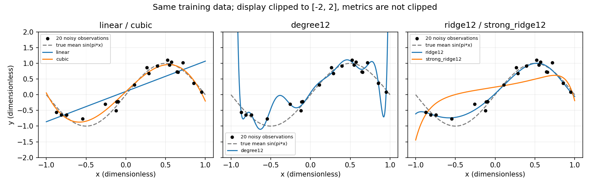

# 02 回归：误差、模型容量与正则化

本文行数：169行，预期阅读时长：10分钟

## 速记要点

- 回归预测数值。线性回归用“特征加权求和 + 截距”表示预测。
- 残差在这里定义为 `y - ŷ`，正数表示预测偏低；损失将多个样本的偏差汇总。
- MAE 与目标同单位，MSE 为目标单位的平方，RMSE 再回到目标单位。
- 先和简单基线比较；平均误差小也可能掩盖少量很大的错误。
- 模型容量决定能表示多复杂的关系；更低的训练误差不保证更好的新样本预测。
- 正则化在拟合数据之外增加偏好；适度约束可减少对噪声的追随，过强也会欠拟合。

本章先解释“怎样拟合、为什么要约束”，第四章接着解释“怎样选模型、增加数据有什么用”。房价材料保留为历史案例，合成回归图表来自 2026-09-29 的实际运行；2026-10-11 补充的手算例子为静态计算，见[数值核对](../examples/README.md)。

## 例子：房价预测与误差

教学模型设为 `预测价格 = 2 × 面积 + 10`：面积单位为平方米，价格单位为万元，系数单位为万元/平方米，截距为万元。系数只是示意，不是 Ames 数据的拟合结果。

| 面积（平方米） | 真实价格（万元） | 预测价格（万元） | 残差（万元） |
| ---: | ---: | ---: | ---: |
| 50 | 108 | 110 | -2 |
| 80 | 173 | 170 | 3 |

**静态计算结果：** MAE = (2+3)/2 = 2.5 万元；MSE = (4+9)/2 = 6.5 万元²；RMSE = √6.5 ≈ 2.55 万元。平方使较大的错误得到更大权重；MSE 和 MAE 的数值不能脱离单位直接比较大小。

拟合时选择系数，让训练集上的损失尽量小。最小二乘最小化残差平方和；固定样本数量时，与最小化 MSE 得到相同的最优解。梯度只是求解的一种方式，线性回归也可以使用矩阵数值方法。

## 多个特征怎样一起用

`ŷ = b + w₁x₁ + … + w_Dx_D` 中，D 为特征数。面积、房龄是数值特征；社区名称属于类别特征，通常编码后再进入线性模型。预处理和模型共同决定系数的含义：对标准化后的特征拟合时，系数不能直接解释为原始单位变化一单位的价格变化。

“线性”主要指对待学习系数呈线性关系；加入 `面积²` 这样的特征后，仍可用线性回归拟合系数。预测关系也不等于因果关系。

## 最小二乘：怎样从数据算出系数

**例子输入：** 无量纲训练点 `(x,y)` 为 `(0,1)`、`(1,2)`、`(2,2)`，模型为 `ŷ=b+wx`，最小化三个样本的平均平方误差。先对数据取平均，得到 `x̄=1`、`ȳ=5/3`。

对于一个特征且 x 存在变化，最小二乘解为：

$$w=\frac{\sum_i(x_i-\bar x)(y_i-\bar y)}{\sum_i(x_i-\bar x)^2}=\frac{1}{2},\qquad b=\bar y-w\bar x=\frac{7}{6}.$$

分子描述 x、y 一起变化的程度，分母描述 x 自身的变化；截距使拟合直线通过训练数据的均值点。若所有 x 相同，分母为零，仅凭这组数据不能分别确定斜率和截距。

| x | y | 预测 b+wx | 残差 y−ŷ |
| ---: | ---: | ---: | ---: |
| 0 | 1 | 7/6 | −1/6 |
| 1 | 2 | 5/3 | 1/3 |
| 2 | 2 | 13/6 | −1/6 |

**结果与解释（静态计算，已核对）：** MSE=1/18≈0.055556。直线没有穿过所有点，而是使残差平方总和最小。此处残差和为 0，且 `Σxᵢ×残差ᵢ=0`，对应截距与斜率方向上的驻点条件；它不意味着每个残差为零。

多个特征时可以写为 `ŷ=X̃θ`：在 `[N,D]` 的特征表前增加全为 1 的一列，得到 `X̃` 的形状 `[N,D+1]`，`θ=[b,w₁,…,w_D]ᵀ` 为 `[D+1]`，预测为 `[N]`。实际数值求解通常使用分解或最小二乘求解器；特征相关或矩阵病态时，直接套逆矩阵公式容易放大数值误差。最小二乘与秩的解释可回查[数学专题](../../foundations/spatial_math/08_least_squares/README.md)。

## 梯度：每一步为什么这样改参数

本章采用 `J=(1/N)Σ(yᵢ−b−wxᵢ)²`，所以：

$$\frac{\partial J}{\partial b}=-\frac{2}{N}\sum_i(y_i-\hat y_i),\qquad \frac{\partial J}{\partial w}=-\frac{2}{N}\sum_i x_i(y_i-\hat y_i).$$

梯度是损失对参数的局部变化率：沿它的反方向小幅移动，通常能降低当前损失。它与残差符号相反，是因为增加预测会减少 `y−ŷ`。

**沿用三个点，从 b=w=0 开始：** 初始 MSE=3，梯度为 `∂J/∂b=−10/3`、`∂J/∂w=−4`。取学习率 0.1，同时用旧参数处的梯度更新，得到 `b′=1/3`、`w′=0.4`，新 MSE≈0.933333（静态计算，已核对）。一次更新已改善拟合，但还没有到闭式解。

本例所有量无量纲。真实任务中学习率与特征、目标的尺度有关；不能把这个 0.1 当作任何回归任务都适用的配置。较大步长也可能越过低损失区域。

## 同一组数据：直线、曲线与过拟合

我们知道一个人为设定的真实规律，因此可以清楚区分规律与噪声：

```text
x 均匀取自 [-1,1]
y = sin(πx) + ε，ε 独立服从均值 0、标准差 0.2 的高斯分布
```

x、y 都无量纲；这不是房价或机器人测量数据。训练样本 20 个（种子 42），独立验证样本 2,000 个（种子 2026），五个模型共享同一划分。真实函数仅用于生成数据和画参考线，不作为模型输入。

比较 `ŷ=b+w₁x+…+w_dxᵈ`。次数 d=1、3、12 时分别有 2、4、13 个待拟合系数；高次数允许更多弯曲。在这个嵌套模型族中，高次数也能把新增系数设为零，表示低次数模型，因此精确最小二乘的最优训练误差不会因增加次数而变大。对有限精度数值求解和其他模型，不能不加条件地套用这一结论。

**容量是可表达关系的丰富程度，不等于训练轮数，也不能仅用参数个数跨模型比较。** 多项式对 x 非线性，但对待学习系数仍线性。

| 模型 | 正则强度 λ | 训练 MSE | 验证 MSE |
| --- | ---: | ---: | ---: |
| 1 次：直线 | 0 | 0.1410 | 0.2519 |
| 3 次：较简单曲线 | 0 | 0.0184 | 0.0534 |
| 12 次：不加正则 | 0 | 0.0070 | 15.0297 |
| 12 次：适度正则 | 0.001 | 0.0147 | 0.0676 |
| 12 次：强正则 | 1 | 0.1696 | 0.3837 |



图例 linear、cubic、degree12、ridge12、strong_ridge12 按表中顺序对应。灰虚线是真实均值函数，黑点是带噪声训练数据；三幅图共用坐标。为便于看清主体，纵轴限制在 [-2,2]，无正则高次曲线的一部分超出画面；表中误差没有截断。

**结果与解释：**

- 直线无法表达正弦的弯曲关系，训练和验证误差都较高，是这个例子中的欠拟合。
- 三次曲线已经能近似主要变化，比直线明显改善。
- 无正则十二次曲线进一步贴近训练点，却在训练点之间及边缘剧烈偏离。它把部分随机噪声也拟合进去了；训练采样稀疏的边界尤其脆弱。
- 同为十三个系数，加入适度正则后验证误差从约 15.03 降至 0.0676，但仍高于三次模型。这说明正则化不保证让复杂模型成为最佳选择。
- 强正则的训练与验证误差都上升：约束也可能过头。

这些是固定划分的结果；次数和 λ 是教学预设候选，没有把这一张表当成所有数据上的定律。三十次训练抽样的波动见[第四章](../04_model_selection/README.md)。

## 正则化到底改了什么？

本例使用 L2 正则（Ridge 思路），目标函数为：

```text
J(b,w) = (1/n) Σᵢ (yᵢ − b − zᵢᵀw)² + λ Σⱼ wⱼ²
```

n 是训练样本数，z 是多项式特征 `[x,…,xᵈ]` 按训练集均值和标准差标准化后的向量；截距 b 不受惩罚。λ≥0，λ=0 回到普通最小二乘；λ 增大时更不愿使用大的系数。求解的是“数据误差 + 参数惩罚”，表中仍单独报告预测 MSE，不把惩罚项混入误差。

模型不再只争取穿过训练点，而是在拟合程度与系数规模间取舍。正则化没有删除这些参数，也不保证每个系数都单调缩小或曲线处处平滑；L2 的约束效果依赖特征表示与尺度。换单位或换多项式基底后，不能直接照搬同一个 λ。

**为什么先标准化？** 若某列数值放大 1,000 倍，保持相同预测时其系数可缩小到千分之一，平方惩罚会改变。标准化让惩罚更有可比性，但多项式列之间仍然相关。均值、标准差只由训练集求得，验证时原样使用。

此实现最小化“平均平方误差 + λ 惩罚”。scikit-learn 1.7 的 `Ridge` 使用“残差平方和 + alpha 惩罚”；在同样的标准化特征、自由截距与其他条件下，等价关系为 `alpha=n×λ`，不能把两个参数数值直接互换。[官方 Ridge 定义](https://scikit-learn.org/1.7/modules/generated/sklearn.linear_model.Ridge.html)

## L1 与 L2：为什么一种能得到零系数

再用一个对称、无量纲例子：`x=[−1,0,1]`、`y=[−2,0,2]`，模型 `ŷ=wx`，截距固定为 0，输入保持这些原始教学值。其数据损失为 `MSE=(2/3)(w−2)²`，无正则时最优 w=2。

| 惩罚 | 本例目标函数 | 最优系数 |
| --- | --- | --- |
| L2 | `(2/3)(w−2)²+λw²` | `w=4/(2+3λ)` |
| L1 | `(2/3)(w−2)²+λ|w|` | `w=max(2−3λ/4,0)` |

| λ | L2 的 w | L1 的 w |
| ---: | ---: | ---: |
| 0 | 2 | 2 |
| 1 | 0.8 | 1.25 |
| 3 | 0.363636 | 0 |

**结果与解释（静态推导，已核对）：** L2 惩罚在零附近的斜率也趋于零，这个例子中有限 λ 使系数缩小但不归零；L1 在零的两侧仍有固定大小、方向相反的斜率，惩罚足够大时最优点可以停在零。L1 因而常产生部分系数恰为零的稀疏解；这不保证留下的特征就是因果因素。L2 在其他数据条件下也可能出现零系数，不能把表格当作普遍排除。

此处 λ 按上表目标定义，未沿用前面标准化多项式的特征；不能跨两个例子直接比较“λ=1”的约束程度。库接口的缩放约定也可能不同，查阅 [scikit-learn 1.7 的 Ridge 与 Lasso](https://scikit-learn.org/1.7/modules/linear_model.html)时先对齐目标函数。

## 噪声为什么让误差难以归零？

即使预测恰好等于 `sin(πx)`，新观测仍含随机噪声。本模型中噪声与 x 独立且均值为零，因此给定一个已训练好的预测函数：

```text
新样本的期望 MSE = E[(预测 − 真实均值函数)²] + 0.2²
```

`0.04` 是这个人为模型中不可预测噪声的方差，不是任意真实任务的误差下限。有限验证集的实测 MSE 可以在它附近上下波动；训练集误差更能低于它，因为模型可能贴合了训练噪声。把训练误差压到零，不代表消除了新样本中的噪声。

## 仓库历史结果：Ames Housing

[实验记录](experiment_log.md)使用 2,344 个训练样本和 586 个测试样本，种子 42；目标 SalePrice 为美元。数值列填补、缩放，类别列编码，再比较均值基线和线性回归。

| 模型 | 测试 MAE（美元） | 测试 R² |
| --- | ---: | ---: |
| 所有房子都预测训练集平均房价 | 64,611 | -0.015 |
| 线性回归 | 15,648 | 0.895 |

**解释：** 该划分中，房屋特征显著改善了平均预测误差；它不能保证每套房都预测准确。历史记录中的最大绝对误差约 426,097 美元，比平均误差大得多。本次没有重训 Ames；新增实验使用上面的合成数据。

R² = 1 - 残差平方和 / 真实目标相对其均值的平方和（目标有非零方差时）。它不是“预测正确的百分比”，也可以小于零；测试集均值与训练集均值不同，所以训练均值基线在测试集上不一定恰好为零。

## 按需查阅

[合成例子的实现与核对](examples/capacity/README.md) · [数据量与模型选择](../04_model_selection/README.md)


[训练源码](src/train_baselines.py) · [预处理源码](src/preprocess_ames.py) · [数据来源](data/README.md) · [历史拟合公式](outputs/linear_regression_formula.md) · [详细笔记](reference.md)

[下一章：预处理与指标](../03_preprocessing_pipeline/README.md) · [目录](../README.md)
