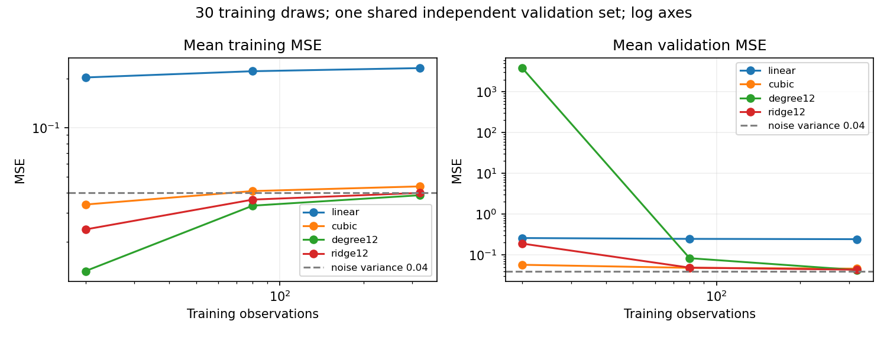

# 04 泛化、过拟合与模型选择：误差来自哪里

本文行数：144行，预期阅读时长：9分钟

## 速记要点

- 参数由训练拟合，超参数与模型方案由验证结果选择，测试集用于最终独立评估。
- 过拟合的典型信号是训练好、验证明显差；两者都差可能是欠拟合，也可能是数据或实现有问题。
- 数据增多通常改善估计稳定性，但不能保证修复表达能力不足、错误标签或分布变化。
- 交叉验证比较配置；最终模型用选定配置在全部训练数据上重新拟合，不挑某一折的临时模型。
- 偏差描述平均预测偏离规律的程度，方差描述换一份训练数据后预测的波动；一次训练验证差不能直接给出它们。

## 例子：该选哪个模型

以下准确率为教学示意，来自同一任务、同样划分的假设比较。

| 候选模型 | 训练准确率 | 验证准确率 | 理解 |
| --- | ---: | ---: | --- |
| A | 78% | 76% | 两者都低，可能能力不足或特征不合适 |
| B | 100% | 86% | 差距大，有过拟合信号 |
| C | 98% | 96% | 在这次比较中验证最好，优先考虑 |

**结果与解释：** 不因 B 的训练满分就选 B。C 的结论仍受划分和样本量影响，需要看验证波动，并在方案确定后报告测试表现。训练与验证有少量差距是常见现象，不等于自动判定失败。

## 五折交叉验证怎样比较配置

将保留测试集之外的训练数据分成五折，每次用四折拟合、一折验证，循环五次。若有三个候选配置，共产生 15 次临时拟合（静态计数），比较各配置的验证均值和波动；最终再用选定配置拟合一次完整训练集。

交叉验证内的预处理也必须只拟合那四折。对于有关联的轨迹、视频或时间序列，随机五折可能不合适，要按组或时间组织划分。

## KNN 与决策树在调整什么

| 模型 | 怎么预测 | 常见复杂度控制 |
| --- | --- | --- |
| KNN | 最近邻投票 | K 小时更贴近局部，K 大时更平滑 |
| 决策树 | 按特征阈值分支，到叶节点输出类别 | 最大深度、叶节点最少样本数、剪枝 |

树在训练时寻找能改善类别区分的划分，例如“某像素是否大于阈值”。很深的树可以细分到少量样本，容易贴合偶然细节。限制深度或增加叶节点样本数，是约束复杂度的方式。

学习曲线观察训练数据量变化：两条分数都低，先查特征、模型与学习过程；训练高而验证低，可考虑更多有代表性的数据或限制复杂度。曲线是诊断线索，不是确定病因的证明。

## 接着第二章：数据增多，模型会怎样变化？

沿用[第二章的合成数据与模型](../02_regression/README.md)，每次独立生成 320 个训练样本，取前 20、80、320 个形成嵌套子集。训练抽样种子 100～129，共 30 次；每个子集上重新拟合标准化和模型，验证集固定为第二章那 2,000 个独立样本。表中为 30 次验证 MSE 的平均值。

| 模型 | 20 个训练样本 | 80 个 | 320 个 |
| --- | ---: | ---: | ---: |
| 1 次：直线 | 0.2589 | 0.2469 | 0.2427 |
| 3 次：较简单曲线 | 0.0571 | 0.0480 | 0.0459 |
| 12 次：不加正则 | 3819.8670 | 0.0829 | 0.0425 |
| 12 次：适度正则 | 0.1891 | 0.0486 | 0.0432 |

图中左右分别为平均训练 MSE、平均验证 MSE，横纵轴均采用对数刻度，以容纳高次模型小样本时的大误差。虚线 0.04 是本合成模型的噪声方差；它不是有限样本训练误差的下界。

**从实际结果读出四件事：**

1. **更多数据不能让直线变成曲线。** 直线的验证 MSE 从 0.2589 降到 0.2427，仍明显高于其他模型；这里主要受表达能力限制。
2. **高容量并非总是坏事。** 无正则十二次模型在 20 个样本时很不稳定，320 个样本时平均验证误差降到 0.0425。本例的大样本结果甚至略优于三次模型，但不能扩展为普遍排序。
3. **正则化在小样本时尤其有帮助。** 十二次模型在 20 个样本时平均误差从约 3819.87 降到 0.1891，但仍有波动，且不如三次模型。
4. **训练误差上升也可能是好现象。** 十二次模型的平均训练 MSE 随样本数从 0.0132 上升到 0.0385，同时验证误差下降。它越来越难记住所有训练噪声，却更能预测新样本；不同训练集之间不要求训练误差单调。

### 为什么平均误差会达到几千？

高次多项式在少量随机采样点的覆盖空缺处，尤其边界附近，可能大幅振荡。20 样本的无正则十二次模型，30 次验证误差的**中位数为 72.40，均值为 3819.87，样本标准差为 12997.17**：有极端失败把均值拉高，不能隐藏它们，也不能只挑种子 42 的较好结果。

对应正则模型的中位数为 0.0796，均值为 0.1891，样本标准差为 0.2753。标准差描述这里训练抽样带来的结果离散程度，不是均值的置信区间；由于共用同一验证集，也没有覆盖验证集抽样的不确定性。每次原始指标保存在[结果 JSON](../02_regression/examples/capacity/results/metrics.json)。

## 容量、正则化与数据量要一起看

可以把误差来源先理解成三部分：模型表达偏差、训练样本变化导致的估计波动，以及观测噪声。在平方损失与适当随机性假设下，这对应常说的偏差—方差—噪声分解；这里没有直接估计完整分解，不能把一次训练误差叫作“偏差”、把训练验证之差叫作“方差”。

### 偏差与方差：在同一个输入位置看变化

**教学条件：** 固定一个无量纲输入 x，其真实平均目标为 f(x)=2。新标签为 `y=2+ε`，ε 以相同概率取 −0.5 或 +0.5，且与训练数据独立，因此噪声均值为 0、方差为 0.25。设三种训练数据情况出现概率相同，分别得到下表预测。

| 方案 | 换三份训练数据后的预测 | 平均预测 | 偏差平方 | 预测方差 | 新标签上的期望 MSE |
| --- | --- | ---: | ---: | ---: | ---: |
| A | `[1,2,3]` | 2 | 0 | 2/3 | 11/12≈0.916667 |
| B | `[1.5,1.5,1.5]` | 1.5 | 0.25 | 0 | 0.50 |

这里偏差为“平均预测−真实均值”，方差为“各次预测到平均预测的平方距离再取平均”。E 表示对所有可能情况按概率取平均；在上述平方损失、零均值独立噪声条件下：

$$E[(\hat f_D(x)-y)^2]=[E_D\hat f_D(x)-f(x)]^2+E_D[(\hat f_D(x)-E_D\hat f_D(x))^2]+E[\varepsilon^2].$$

D 表示发生变化的训练数据集。三项依次是偏差平方、预测方差和噪声方差，单位都与目标平方相同。

**结果与解释（静态计算，已逐项枚举核对）：** A 的平均预测恰好正确，但每次训练可能偏到 1 或 3，所以新标签上的平均损失更高；B 有固定偏差，却足够稳定。这个单点示例说明取舍，不代表 B 在所有输入或任务中更好。scikit-learn 的[偏差—方差示例](https://scikit-learn.org/1.7/auto_examples/ensemble/plot_bias_variance.html)展示了对多次训练重新取平均的做法。

只有一份真实训练数据时，很难直接知道完整分解。交叉验证、学习曲线和多次抽样帮助观察稳定性，但各折共享部分训练样本，折间分数标准差也不是简单的独立实验置信区间。

| 观察到的现象 | 本例中的解释 | 可以优先考虑什么 |
| --- | --- | --- |
| 训练、验证都高，更多数据改善很小 | 直线模型无法表达弯曲关系 | 更合适的特征或模型；也要排查数据与实现 |
| 训练很低、验证高且抽样波动大 | 高次曲线追随偶然细节 | 限制容量、适度正则或增加有代表性数据 |
| 正则很强，两侧误差都高 | 参数被过度约束 | 在验证集上比较较弱正则 |
| 验证误差逐渐接近噪声水平 | 本例中剩余改进空间变小 | 改善观测质量，而非无限增加复杂度 |

这里的趋势不是必须呈标准 U 形的定律。高容量模型是否过拟合，还与正则化、数据分布、求解方式等有关。给低质量数据重复复制多次不等于增加独立信息；机器人同一轨迹的相邻帧也不能简单当成大量独立样本。

## 三种曲线不要混淆

| 曲线 | 横轴改变什么 | 回答的问题 |
| --- | --- | --- |
| 学习曲线 | 训练样本数，固定模型配置并重新训练 | 增加数据可能有用吗？ |
| 验证曲线 | 一个超参数，如次数、正则强度或树深 | 怎样的复杂度较合适？ |
| 训练过程曲线 | epoch 或迭代次数 | 当前优化是否在收敛、何时出现过拟合？ |

本页图是学习曲线，第二章表是候选配置比较；都不是“多训练几轮”的曲线。可结合 [scikit-learn 学习与验证曲线说明](https://scikit-learn.org/1.7/modules/learning_curve.html)查阅。

本实验的 λ 按“平均损失 + 惩罚”定义，在不同数据量间保持 λ=0.001；如果直接使用 `Ridge(alpha=常数)`，其等价 λ 会随 n 改变，会混入正则相对强度变化。标准化统计仍会随训练子集重新估计。

## 怎样从教学比较走到模型选择？

本次候选配置预先写在源码里，所有比较只使用训练集和验证集；**没有设置或报告最终测试集**，所以这些结果用于理解现象，不宣称某个最终方案的独立测试性能。若要交付模型，应先固定候选与验证规则，选择配置后，再用未参与选择的测试数据评估。

学习曲线也会影响是否换模型、收集数据等决策，因此反复查看的留出集承担的是验证职责。扩大数据量不代表可以把验证样本混入训练后继续报告同一验证成绩。

## 机器人数据：按帧分开为什么可能高估泛化

**教学例子：** 有四条抓取轨迹 A、B、C、D，每条各 100 帧。同一条轨迹中，背景、物体、视角和连续动作都相近。如果把 400 帧随机分成训练和测试，一段动作的相邻画面可能同时落入两边，测试更接近“识别刚看过的场景”。

一种按轨迹划分的示意是训练用 A、B，验证用 C，测试用 D；每条轨迹只出现在一组。这个划分仍然很小，仅用于解释规则，不足以代表完整评估。如果四条都来自同一场景，按轨迹分开也不能证明跨场景泛化；若目标是适应新物体或新场景，就应按这些层级留出。

| 想判断的能力 | 留出时关注什么 | 容易发生的误判 |
| --- | --- | --- |
| 同一条件下新轨迹的表现 | 整条轨迹分组 | 相邻帧泄漏让分数偏高 |
| 新背景、新物体或新相机条件 | 按场景、物体或设备分组 | 只换轨迹却声称适应新环境 |
| 未来时间段的表现 | 训练早期、验证与测试后期 | 随机混合过去与未来 |

**结果与解释：** 划分方式定义了“新数据”究竟有多新。输入列里没有标签，仍可能因近似样本或时间信息泄漏而得到过于乐观的结果。策略观测与动作语义见 [18](../18_imitation_learning/README.md)，独立划分与闭环评价见 [20](../20_generalization_sim2real/README.md)；本章先明确评估问题。

## 仓库例子：Digits

Digits 每张图为 `8×8` 灰度像素，展平为 64 个输入特征，输出数字 0～9。它与第六章 `28×28` 的 MNIST 不是同一个数据集。

[历史测试记录](outputs/tables/final_test_metrics.json)包含 360 个样本，准确率为 **98.33%（354/360）**，macro F1 约 **0.9830**；macro 表示先计算各类别指标，再对类别等权平均。Digits 沿用保存的历史结果，本次没有重训，也不据此与 MNIST 的成绩直接比较。

## 按需查阅

[模型选择源码](src/select_models.py) · [学习曲线源码](src/plot_learning_curves.py) · [最终评估源码](src/evaluate_final_model.py) · [实验记录](experiment_log.md) · [详细笔记](reference.md)

[下一章：无监督聚类](../05_clustering/README.md) · [目录](../README.md)
