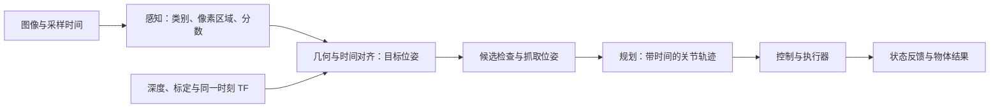

# 08 与机器人结合：从模型输出到任务执行

本文行数：164行，预期阅读时长：12分钟

## 开发者理解：从模型预测到机器人完成任务

**机器人任务需要把感知、几何定位、规划、控制与结果反馈连起来。** 机器学习可以承担其中一部分，例如判断物体类别或找出图像中的目标；要实现“抓起杯子并放到指定位置”，还需要其他能力共同完成。

把抓杯子理解成几种功能的衔接：

| 功能 | 使用什么信息 | 得到什么结果 |
| --- | --- | --- |
| 感知 | 图片等观测 | 目标身份或图像区域，取决于模型能力 |
| 定位 | 目标区域、深度、相机参数与几何信息 | 目标在机器人参考系中的位置，必要时估计朝向 |
| 抓取与规划 | 目标几何、机器人当前状态、周围场景 | 夹爪接近目标的方式，以及运动轨迹 |
| 控制与执行 | 轨迹和状态反馈 | 驱动机器人移动、操作夹爪 |
| 结果判断 | 物体与机器人执行后的观测 | 是否真正完成抓取与放置 |

**例子（教学场景）：** 相机找到桌上的杯子后，系统需要估计它相对机械臂的位置，确定夹爪该从哪边接近，安排运动，再观察杯子是否随夹爪被提起并放到目标区域。第 07 章的材料分类器只给材料类别，不具备这条完整抓取链路。

**位置和朝向合在一起称为位姿。** 知道杯子在哪里，还不等于知道夹爪应该放在哪里、朝向哪里；抓杯身或杯把需要不同的接近方式。规划解决怎样从当前状态运动到目标，控制负责把运动要求落实到执行器并利用反馈调整，两者作用不同。

**坐标系和单位决定位置数字的含义。** 图像位置通常以像素表示，机器人空间位置可以用米表示；相机视角中的位置还要转换到机器人使用的参考系。类别、像素框和米制位姿是不同信息，不能直接替换。三维定位还需要深度或其他几何依据。

**位置也有时间含义。** 相机记录的是采样时看到的物体状态；处理和规划期间，物体或相机可能已经移动。即使几何换算正确，使用旧位置也可能抓空，因此“根据当前观测行动”和“依据旧图像行动”是不同的任务条件。

**任务成功要看最终物体结果。** 识别正确、轨迹规划成功、机械臂到达位置，分别说明某一环完成，不代表杯子已经被抓起。沿用本章教学计数：40 次尝试中 38 次识别正确，但只有 26 次最终抓取并放置成功；识别通过率是 95%，完整任务成功率是 65%，两者回答不同问题。

当目标不明确、位置无效或执行失败时，系统可能需要重新观测、重新规划或结束本次尝试。这属于完整任务行为，也决定一个模型输出应怎样被使用；动作策略的选择和具体接口实现需要结合实际系统。

**需要深入时：** [输入输出链路](#1-先把输入输出链路分清楚) · [像素到三维位置](#2-一个像素位置怎样变成基座系的点) · [抓取位姿](#3-一个点还不是抓取-tcp-位姿) · [时间影响](#4-时间坐标正确为什么仍然抓空) · [任务结果统计](#6-任务成功怎样统计失败怎样解释)。

**机器学习输出经过坐标变换、时间对齐、规划与控制，才能用于机器人任务。** 本章用机械臂抓杯子串起这条流程，也介绍识别结果如何接入 ROS 2。消息和任务流程均为教学设计。

## 速记要点

- 分类给类别，检测可给像素框；它们不自动给出机器人基座系下以米表示的抓取位姿。
- 每项空间结果都要带参考坐标系、单位、采样时刻和有效性。不同时间基准不能直接相减。
- 物体位姿、抓取 TCP 位姿、关节目标与执行器命令是不同层级的数据，不能互相替代。
- 分数阈值只筛选一部分候选；深度缺失、过期状态、不可达或碰撞都需要各自处理。
- 规划成功、轨迹完成与物体真正被抓起是不同证据。任务成功率要按完整任务统计。

## 1. 先把输入输出链路分清楚

沿用桌面杯子的任务。第 07 章材料分类器只能产生类别分数；本例另行给定检测框、深度与相机几何，用来解释后续接口，不把它们说成现有分类代码的能力。

| 阶段 | 输入 → 输出 | 数据含义 |
| --- | --- | --- |
| 感知 | 图片 → 类别、框、分数 | 框以 px 表达；分数依模型定义，默认不等于抓取成功概率 |
| 几何 | 框、深度、标定 → 三维点或物体位姿 | 点是位置；完整位姿还包含朝向 |
| 对齐 | 相机系结果、同一时刻 TF → 基座系结果 | 转换数值与参考系，保留测量采样时间 |
| 抓取选择 | 物体几何与位姿 → TCP 目标 | TCP 是选定的工具参考点；偏移和朝向由物体与夹爪条件决定 |
| 规划 | 当前状态、目标、场景 → 关节轨迹 | 关节顺序明确，位置通常为 rad，各轨迹点有相对开始时间 |
| 执行 | 轨迹 → 控制指令与状态反馈 | 控制器生成位置、速度或力矩等具体命令，依接口而定 |
| 判断结果 | 状态、接触与物体观测 → 成功或失败 | 末端到达目标不保证夹住了物体 |

输入形状也体现区别：RGB 图常为 `[H,W,3]` 或 `[B,3,H,W]`，三维点为 `[3]`，齐次变换为 `[4,4]`；有 K 个轨迹点、n 个关节时，关节位置表为 `[K,n]`，时间表为 `[K]`。不同数组不能只因“都是数字”就直接相接。

## 2. 一个像素位置怎样变成基座系的点

**教学输入：** 已校正畸变的图像宽 640 px、高 480 px，像素 u 向右、v 向下。人为给定杯子框 `[u_min,v_min,u_max,v_max]=[360,240,400,280]`，中心为 `(380,260)` px；该像素沿相机光学 z 轴的深度 Z=0.5 m。相机参数 `fx=fy=400 px、cx=320 px、cy=240 px`。

相机光学系 C 约定 x 向右、y 向下、z 向前。针孔模型反投影为：

$$p_C=\begin{bmatrix}(u-c_x)Z/f_x\\(v-c_y)Z/f_y\\Z\end{bmatrix}=\begin{bmatrix}0.075\\0.025\\0.5\end{bmatrix}\ \mathrm{m}.$$

**结果与解释（静态计算，已核对）：** 这是框中心像素对应的可见表面点。深度是沿光学轴的 Z，不是到相机原点的欧氏距离；框中心也不一定是物体几何中心。单张图片和类别分数不能确定该点的米制深度，实际需要深度、已知几何、立体视觉等额外条件。

设基座系 B 为右手系，教学安装的轴关系和相机原点位置给定为：

$$R_{B,C}=\begin{bmatrix}0&0&1\\-1&0&0\\0&-1&0\end{bmatrix},\qquad t_{B,C}=\begin{bmatrix}0.2\\0\\0.8\end{bmatrix}\ \mathrm{m}.$$

`T_B_C` 把 C 系坐标变到 B 系；R 为无量纲 `[3,3]` 矩阵，t 为 `[3]` 平移列向量。本例 R 将光学前方变为基座 +x、光学右方变为基座 −y、光学下方变为基座 −z。不能只换 frame_id 而保留原数值。

$$p_B=R_{B,C}p_C+t_{B,C}=[0.7,-0.075,0.775]^T\ \mathrm{m}.$$

**结果（静态计算，已核对）：** 相机系 `[0.075,0.025,0.5] m` 和基座系 `[0.7,−0.075,0.775] m` 是同一个点的两种坐标表示。逆变换为 `p_C=Rᵀ(p_B−t)`；程序核对了往返和距离保持。相机成像与完整目标位姿解释见[感知专题](../../perception/README.md)。

## 3. 一个点还不是抓取 TCP 位姿

完整物体位姿 `T_B_O` 包含位置与朝向；抓取工具位姿为 `T_B_G=T_B_O T_O_G`，其中 O 是物体参考系，G 是抓取时的 TCP 系。`T_O_G` 由物体几何、夹爪定义和抓取方案给定，不是类别编号或框中心直接算出的量。

**延续教学例子：** 另外假设已确定物体系原点就是上述点、`R_B_O=I`，并已给定抓取偏移 `t_O_G=[0,0,0.1] m`；工具抓取朝向也另外指定。则 TCP 目标位置为 `[0.7,−0.075,0.875] m`。这一步使用额外的物体与抓取假设，没有从单个三维点推断朝向，也没有证明这套夹爪偏移物理上有效。

从 TCP 位姿到关节目标，还需要 IK、关节限制与碰撞判断；从关节目标到执行，要形成满足速度、加速度及控制接口的轨迹。可回查[运动学](../../kinematics/README.md)、[规划与操作](../../manipulation/README.md)及[仿真与真机控制流](../../simulation/00_control_flow/README.md)。直接改仿真 qpos 可以检查位姿，不能据此宣称执行器完成了抓取。

## 4. 时间：坐标正确，为什么仍然抓空

**教学时序：** 图像采集于 ROS 时间 10.00 s，感知处理完成于 10.20 s，准备提交规划时为 10.25 s。消息 stamp 仍标记采样时间 10.00 s，因此目标状态年龄为 0.25 s；若改盖处理完成时间，会把感知过程的 0.20 s 隐藏掉。

动态相机的 TF 应对应图像采样时刻。`lookup_transform(target_frame,source_frame,time)` 中目标为 base、来源为 camera；查询时间 0 表示最新，而最新未必适合旧图像。接口方向与时间语义见 [ROS 2 Humble tf2 源码](https://raw.githubusercontent.com/ros2/geometry2/humble/tf2_ros_py/tf2_ros/buffer.py)和[本仓库 TF 笔记](../../ros2/04_tf_time/README.md)。

**结果与解释（静态推导）：** 若目标沿某轴以 0.2 m/s 匀速移动，0.25 s 内位移为 0.05 m，即 50 mm。即使点变换完全正确、状态年龄未超过示例阈值 0.3 s，允许误差只有 10 mm 的抓取仍可能失败。更新时间、预测运动、缩短延迟或重新观测，解决的是不同条件下的问题。

状态年龄还要在实际执行前重新检查；规划时间和排队时间会继续增加它。静态场景与动态场景允许的时效不同，0.3 s 只用于本章教学筛选，不是通用配置。ROS 仿真时间、系统时间和单调耗时的区分见[时间对齐专题](../../perception/06_time_alignment/README.md)。

## 5. 给 ROS 2 的是什么信息

建议接口分两层：图像观测保留类别、像素框、分数和图像 header；几何处理后发布有 frame、stamp、单位与有效性的三维结果。以下是给基座系候选点设计的字段示意，不是已经实现的 ROS 消息类型或抓取指令：

~~~text
clock: ros
stamp_s: 10.00                 # 原测量的采样时间
frame_id: base
class_id: cup
score: 0.94
point_m: [0.7, -0.075, 0.775]  # 物体参考点，不是 TCP 目标
~~~

实际 `header.stamp` 按 ROS 消息格式表示时间，`frame_id` 表示参考系；`PointStamped` 本身没有类别和分数字段，需要另行设计或使用匹配的感知消息。字段名、类别映射、深度来源与模型版本应约定清楚；消息到达不等于几何有效。

本章的[标准库程序](../examples/check_foundations.py)只实现教学候选筛选：同一时间基准、frame=base、class=cup、分数在 `[0,1]` 且不低于 0.8、年龄在 `[0,0.3] s`、三维点有限且处于示例粗范围 `x∈[0.2,0.8]、y∈[−0.3,0.3]、z∈[0.1,1.0] m`。这个盒子不是机械臂真实工作空间，更不替代朝向、IK 或碰撞检查。

| 输入变化，其他条件相同 | 教学筛选结果 | 下一步含义 |
| --- | --- | --- |
| 原候选，当前时间 10.25 s | 通过 | 可继续构造抓取位姿并询问规划器 |
| score=0.6 | 不通过 | 拒绝此候选，按任务策略重试或请求新视角 |
| point_m 缺失，例如未获取有效深度 | 不通过 | 先获取有效几何，不能把像素当米；筛选器本身不核验深度来源 |
| frame 仍为 camera_optical | 不通过 | 完成正确时刻的变换，不能仅改标签 |
| stamp=9.6 s | 不通过，年龄 0.65 s | 更新观测，不能复用过期点 |
| 点为 `[700,−75,775]`，误把 mm 标成 m | 不通过，超示例范围 | 修正单位；范围检查不保证能发现所有单位错误 |
| 时间来自 system、当前时间来自 ros | 不通过 | 先对齐时间基准，不能直接计算年龄 |

**结果（实际运行教学筛选）：** 原候选通过；程序还检查低分、NaN、缺几何、错参考系、错类别、时间基准不一致、过期或未来时间等 10 个失败输入，并核对阈值边界。没有向 ROS 发布消息、调用规划器或驱动执行器。

## 6. 任务成功怎样统计，失败怎样解释

一个可理解的任务流程是：等待有效目标 → 构造抓取方案 → 规划 → 执行 → 观察物体结果。规划无解时记录目标与约束；执行超时或目标变化时按任务状态取消、重观测或重新规划；夹爪闭合后仍要根据接触和物体变化判断是否抓取成功。具体恢复行为取决于执行系统，本页没有实现任务状态机。

**教学计数，非实测：** 假设 40 次完整任务尝试中，38 次识别正确，34 次进一步得到有效定位，32 次进一步规划成功，26 次最终完成抓取与放置。

| 阶段 | 通过数 | 相对上一阶段的通过率 | 当前失败数 |
| --- | ---: | ---: | ---: |
| 识别正确 | 38 / 40 | 95% | 2 |
| 定位有效 | 34 / 38 | 约 89.47% | 4 |
| 规划成功 | 32 / 34 | 约 94.12% | 2 |
| 执行并完成任务 | 26 / 32 | 81.25% | 6 |

**结果与解释（静态计算，已核对）：** 完整成功率为 26/40=65%，不能用 95% 的识别通过率代替。上述每一项都是以前一阶段通过为条件的比例，相乘得到 65%，不需要假设各阶段失败互相独立。这也不是第 07 章材料分类测试集的实测准确率。

失败可按感知、定位、通信与时间、规划、控制与接触分类。为了知道改进是否有效，保留任务起点、场景条件、采样和执行时间、目标与实际状态及失败阶段；仅看最终一个成功率，很难判断应该改模型还是修坐标和执行接口。真正实现时定义“物体到指定区域且保持多久”等成功条件，不能只以控制器返回完成为标准。

## 7. 原计划另外两个方向怎样接

- **识别结果发布 ROS 2：** 先解释观察消息的类别、坐标、时间和有效性，订阅方再按任务使用。发布成功只证明通信这一环节。
- **移动机器人靠近目标：** 除识别，还需目标相对位置或距离、机器人定位与局部规划；像素偏差与底盘线速度不是同单位，也没有通用换算系数。
- **仿真机械臂抓取：** 使用本章的位姿、规划与执行链，先看懂输入输出，再按[机器人学习路线](../../../doc/learning-roadmap.md)接入现有模型与环境。

本章的几何变换和候选筛选由[教学程序](../examples/README.md)核对；完整机器人抓取链路尚未运行验证。

[教学数值例子](../examples/README.md) · [感知与估计](../../perception/README.md) · [抓放任务](../../manipulation/06_pick_place/README.md) · [下一章：概率与不确定性](../09_probability_uncertainty/README.md) · [机器学习目录](../README.md)
