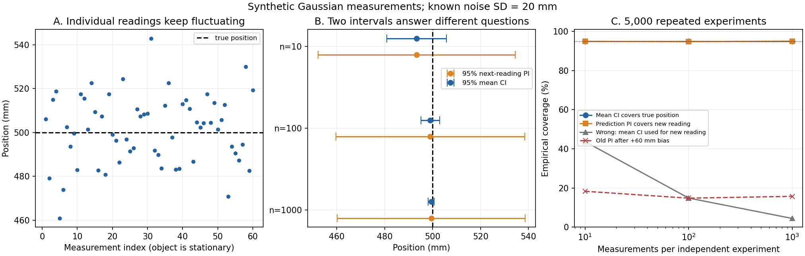
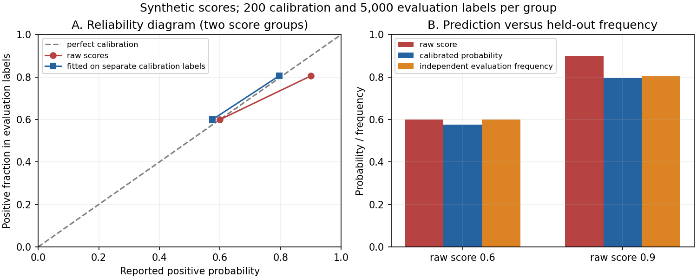

# 最小实践：平均值更准，下一次预测就更准吗？

本文行数：316行，预期阅读时长：15分钟

**统计量从已经看到的数据中总结规律；预测不确定性还要考虑下一次结果本身的随机波动。** 本实践用一个脚本完成两个实验，分别观察数值预测的区间和分类预测的概率。图表与下方数字均由合成数据实际计算得到。

| 实验 | 输入 | 输出 | 要理解的问题 |
| --- | --- | --- | --- |
| A：反复测量固定位置 | 带噪声的一维位置读数 | 均值、标准差、两种区间及其覆盖率 | 估计真实位置与预测下一次读数，为何需要不同区间？ |
| B：检查分类概率 | 人工指定的分数、独立采样的 0/1 标签 | 分组频率、校准映射、概率损失 | 分类结果没变，概率预测为何还能改善？ |

先读图表即可理解现象；要学习具体代码，直接进入[第 3 节核心代码](#3-核心代码按数据流读一遍)，再对照[完整源码](src/run_uncertainty_demo.py)。文末命令供按需复现，全程使用 NumPy 与 Matplotlib，在本机生成数据。

## 1. 实验 A：物体没动，测量值为什么每次不同？

设物体在同一个固定测量坐标系中的一维真实位置为 **0.50 m**，整个实验中保持静止。每次读数等于真实位置加独立高斯噪声，噪声均值为 0，标准差为 **0.02 m = 20 mm**。

这里有三个不同的量：真实位置固定为 0.50 m；每次读数是随机的；把 n 次读数平均得到的位置估计，也会随抽到的样本变化。读数编号只表示测量顺序，不表示物体运动轨迹。

**概率与统计的第一次对应：** 在给定的高斯模型下，一次读数落在真实位置 ±20 mm 内的概率约为 68.27%。程序实际抽取 1,000 次，得到 688 次落入，即频率 **68.80%**。概率来自指定的分布，频率来自有限样本，两者不会每次完全相等。



从左到右读图：

- **A：** 虚线是真实位置 500 mm，散点是前 60 次读数。点在上下波动，物体仍然静止。
- **B：** 蓝线是估计真实位置的 95% **置信区间（CI）**；橙线是预测下一次读数的 95% **预测区间（PI）**。两条线都以当前样本均值为中心，数据增多后，蓝线明显缩短，橙线仍很宽。
- **C：** 每种 n 都重新做 5,000 轮独立实验，统计区间到底覆盖了多少次。蓝线检查真实位置，橙线检查新的独立读数。

### 先看一组实际读数的统计结果

使用随机种子 42 生成 1,000 次读数，再分别取前 10、100、1,000 次。因此下表是同一批数据的逐步扩充，不是挑选三组最好看的结果。

| 测量数 n | 样本均值 / m | 样本标准差 / mm | 真实位置 CI 半宽 / mm | 下一读数 PI 半宽 / mm |
| ---: | ---: | ---: | ---: | ---: |
| 10 | 0.493289 | 18.67 | 12.40 | 41.11 |
| 100 | 0.498995 | 15.53 | 3.92 | 39.39 |
| 1,000 | 0.499422 | 19.78 | 1.24 | 39.22 |

“半宽”表示从中心到端点的距离。例如 n=1,000 时，均值 CI 约为 **[0.498183, 0.500662] m**，下一次读数 PI 约为 **[0.460203, 0.538641] m**。

**原因：** 多次独立测量取平均，可以抵消一部分正负噪声，使我们更精确地估计真实位置。但下一次只测一次，它仍会受到约 20 mm 标准差的噪声影响。平均位置估得更准，不会让传感器下一次读数变得无噪声。

样本标准差也会波动：前 100 次只有 15.53 mm，并不表示传感器噪声已经降到这个水平。本实验为了单独观察均值估计与新读数的差别，**假设噪声标准差 20 mm 已通过独立标定准确获知**，区间始终使用这个已知值；表中的样本标准差只用于描述当前数据。

### “95%”怎样用数据检查？

每一轮都重新采 n 个读数，用它们估计均值、构造区间，再采一个独立的新读数。均值区间检查是否包含真实的 0.50 m，预测区间检查是否包含这个新读数；新读数没有参与均值计算。

| 每轮测量数 n | 均值 CI 覆盖真实位置 | 预测 PI 覆盖新读数 | 错把均值 CI 用于新读数 | 新读数多出 +60 mm 偏移，仍用原 PI |
| ---: | ---: | ---: | ---: | ---: |
| 10 | 95.06% | 94.92% | 43.72% | 18.32% |
| 100 | 95.06% | 94.78% | 14.86% | 14.80% |
| 1,000 | 95.06% | 95.02% | 4.44% | 15.74% |

前三列展示了区间回答的问题不同：两种正确用法都接近 95%；把越来越窄的均值区间拿来预测单次读数，反而漏掉越来越多的读数。

最后一列模拟传感器在采完用于估计的读数后，突然产生固定偏移。物体仍在 0.50 m，但新读数的均值变为 0.56 m。原区间依赖“新旧测量条件一致”，这个条件失效后，标称 95% 的预测区间实际只覆盖约 15%～18%。增加旧条件下的数据量无法消除新出现的系统偏差。

95% 置信区间描述的是**重复采样、重复构造区间时的长期覆盖率**。拿到一组数据后，算出的区间与真实位置都已固定，不能把它解释为真实位置有 95% 的概率在这一个区间中。本实验的重复采样正是在检验这种长期含义。[NIST 置信区间解释](https://www.itl.nist.gov/div898/handbook/eda/section3/eda352.htm)

## 2. 实验 B：报 0.9，实际有多少正类？

沿用正文的杯子例子：正类标签 `1` 表示杯子，`0` 表示其他物体。人工指定两组模型分数为 0.6、0.9，而生成标签时分别使用真实杯子概率 0.6、0.8。这是为了构造一个明确偏自信的分数组，没有训练图像分类器。

每组先独立抽取 **200 个校准标签**，用杯子比例拟合“原分数 → 新概率”的两项映射。拟合结束后固定映射，再用每组 **5,000 个独立评估标签**检查效果。评估标签不参与校准。

| 原分数 | 校准集杯子数 | 拟合后报告概率 | 独立评估集杯子数 | 评估集正类比例 |
| ---: | ---: | ---: | ---: | ---: |
| 0.6 | 115 / 200 | 0.575 | 2,997 / 5,000 | 0.5994 |
| 0.9 | 159 / 200 | 0.795 | 4,026 / 5,000 | 0.8052 |

**看 0.9 组：** 原先报 90%，评估中实际约 80.52% 是杯子；校准后报 79.5%，更接近独立评估频率。这里核对的是整组样本的频率，不是某一个物体的正确保证。

**看 0.6 组：** 原分数已经很接近评估频率，但 200 个校准样本偶然只得到 57.5% 的杯子，使这组调整后反而稍差。这也说明校准会受样本数量影响，并不保证每个组都改善。



左图横轴为报告概率，纵轴为独立评估频率；落在对角线上表示二者一致，对角线下方表示报告概率偏高。右图把原分数、校准后概率和评估频率并排比较。

| 同一批评估标签上的指标 | 原分数 | 校准后 |
| --- | ---: | ---: |
| 阈值 0.5 的分类准确率 | 70.23% | 70.23% |
| Brier score，越小越好 | 0.202980 | 0.198836 |
| 平均负对数似然 NLL，越小越好 | 0.603317 | 0.583955 |

**准确率没变的原因：** 0.6、0.9 和调整后的 0.575、0.795 都大于 0.5，两组始终预测杯子。变化的是报告的概率，因此概率损失可以下降，分类标签却保持相同。Brier 与 NLL 还受区分能力等因素影响，校准应结合分组频率查看，不能只看一个总分。[scikit-learn 校准说明](https://scikit-learn.org/1.7/modules/calibration.html)

## 3. 核心代码：按数据流读一遍

下面按“生成读数 → 统计样本 → 构造区间 → 检验覆盖率 → 校准概率 → 比较损失”摘出核心计算。片段按顺序衔接，用默认实验中的实际参数说明结果；原函数的返回字典在这里拆成中间变量，便于观察每一步。[完整源码](src/run_uncertainty_demo.py)保留参数检查、结果保存和绘图。

### 3.1 生成数据：把概率分布变成一批读数

```python
import numpy as np
from statistics import NormalDist

TRUE_POSITION_M = 0.50
KNOWN_SIGMA_M = 0.02
SAMPLE_SIZES = (10, 100, 1000)

rng = np.random.default_rng(42)
readings = rng.normal(
    TRUE_POSITION_M, KNOWN_SIGMA_M, max(SAMPLE_SIZES)
)
```

`readings` 是形状为 `[1000]` 的一维数组，每个元素是一条以 m 为单位的位置读数。`normal()` 的前两个参数分别是均值与**标准差**，第三个参数是抽样数量。它实现了 `Y_i=μ+ε_i`，其中 `μ=0.50 m`，各次噪声独立同分布为 `N(0,σ²)`，`σ=0.02 m`。[NumPy 1.21 normal](https://numpy.org/doc/1.21/reference/random/generated/numpy.random.Generator.normal.html)

随机种子 42 用于在当前环境复现这一批样本；它不表示概率或测量次数。原程序用 `readings[:n]` 取前 n 次读数，因此 n=10、100、1,000 时逐步扩大同一批样本。

真实位置与噪声参数用于**生成教学数据**。估计位置时，接下来的代码只对读数取平均，不把真实位置 0.50 m 直接当作估计结果；区间计算则使用本实验明确假设已知的噪声标准差。

### 3.2 计算统计量：均值与标准差分别在总结什么？

这部分摘自 `summarize_measurements()`；为便于查看，把返回字典中的表达式分别赋给变量：

```python
n = len(readings)
mean = float(readings.mean())
sample_variance = float(readings.var(ddof=1))
sample_std = float(readings.std(ddof=1))
```

每项输出都是一个标量，实际结果为：

| 变量 | 计算与含义 | n=1,000 时的结果 |
| --- | --- | --- |
| `mean` | `ΣY_i/n`，用平均读数估计真实位置 | 0.499422 m |
| `sample_variance` | `Σ(Y_i−ȳ)²/(n−1)`，描述单次读数的波动 | 0.000391420 m² |
| `sample_std` | 样本方差的平方根，单位回到 m | 0.019784 m，约 19.78 mm |

`ddof=1` 使方差计算的分母为 `n−1`，默认 `ddof=0` 则为 n。这里均值也是从同一批数据估出的，所以使用常见的样本方差估计。[NumPy 1.21 std](https://numpy.org/doc/1.21/reference/generated/numpy.std.html)

**注意这时还没有计算均值估计的误差范围。** `sample_std≈19.78 mm` 描述的是单次读数有多分散；下一段中的 `mean_se≈0.632 mm` 才描述不同批次平均值的波动，二者回答不同问题。

### 3.3 构造两个区间：为什么预测误差里要加一项？

核心摘自 `interval_half_widths()`，随后用当前样本均值构造端点：

```python
Z95 = NormalDist().inv_cdf(0.975)

def interval_half_widths(n, sigma):
    mean_se = sigma / np.sqrt(n)
    prediction_se = np.sqrt(sigma**2 + mean_se**2)
    return float(Z95 * mean_se), float(Z95 * prediction_se)

ci_half, pi_half = interval_half_widths(n, KNOWN_SIGMA_M)
mean_ci = [mean - ci_half, mean + ci_half]
next_reading_pi = [mean - pi_half, mean + pi_half]
```

先读 `mean_se = sigma / np.sqrt(n)`。n 次独立测量平均后，方差从 `σ²` 降为 `σ²/n`，开平方得到均值的标准误：

$$
\operatorname{Var}(\bar Y)=\frac{1}{n^2}\sum_{i=1}^n\operatorname{Var}(Y_i)
=\frac{\sigma^2}{n}.
$$

再读 `prediction_se = np.sqrt(sigma**2 + mean_se**2)`。下一次读数与当前均值估计之差为 `Y_new−Ȳ`，这个误差包含两部分：

- `sigma**2`：新读数自身的噪声方差。
- `mean_se**2`：当前均值估计的误差方差。

由于新读数与用于估计的样本独立，方差相加；最后开平方，把 m² 变回 m。

$$
\operatorname{Var}(Y_{new}-\bar Y)=\sigma^2+\frac{\sigma^2}{n},\qquad
\mathrm{PI}_{95\%}=\bar y\pm z\sigma\sqrt{1+\frac1n}.
$$

`Z95≈1.959964` 把标准差换成双侧 95% 区间的半宽。取 0.975，是因为左尾留 2.5%、右尾也留 2.5%，右端点对应累计概率 97.5%；`NormalDist()` 默认是标准正态分布，`inv_cdf()` 根据累计概率求分位点。[Python 3.10 NormalDist](https://docs.python.org/3.10/library/statistics.html#statistics.NormalDist.inv_cdf)

n=1,000 时，`mean_se≈0.000632 m`，`prediction_se≈0.020010 m`；乘上 z 后，`ci_half≈1.24 mm`，`pi_half≈39.22 mm`。`mean_ci` 和 `next_reading_pi` 各是两个端点组成的列表，单位为 m，实际端点见前面的实验表。

随着 n 增大，均值误差趋近 0，但新读数的噪声仍有 σ；预测区间半宽因此趋近 `1.959964×20≈39.20 mm`。区间原理见 [Penn State 已知 σ 的均值区间](https://online.stat.psu.edu/stat500/Lesson05)与 [NIST 新观测预测误差的方差合成](https://itl.nist.gov/div898/handbook/pmd/section5/pmd512.htm)。如果 σ 也需要从样本估计，应使用相应的 t 区间；如果样本相关、物体移动或噪声条件变化，则要调整模型。

### 3.4 检验覆盖率：每一轮估计，都要配一个新读数

这部分摘自 `repeated_coverage()`，用 n=1,000 的实际配置展开：

```python
n = 1000
repeats = 5000
rng = np.random.default_rng(54)

readings = rng.normal(
    TRUE_POSITION_M, KNOWN_SIGMA_M, (repeats, n)
)
estimates = readings.mean(axis=1)
future = rng.normal(TRUE_POSITION_M, KNOWN_SIGMA_M, repeats)
ci_half, pi_half = interval_half_widths(n, KNOWN_SIGMA_M)
```

这里进入另一组实验，`readings` 表示二维数组：

| 数组 | 形状 | 一个元素或一行表示什么？ |
| --- | --- | --- |
| `readings` | `[5000,1000]` | 第 r 行是第 r 轮的 1,000 次读数 |
| `estimates` | `[5000]` | 第 r 个元素是第 r 行读数的平均值 |
| `future` | `[5000]` | 第 r 个元素是为第 r 轮独立抽取的新读数 |

`mean(axis=1)` 沿每行的 1,000 个读数求平均，所以保留 5,000 轮各自的估计。如果写成不带 axis 的 `mean()`，会把全部数据平均成一个标量，丢掉不同实验轮次的结果。[NumPy 1.21 mean](https://numpy.org/doc/1.21/reference/generated/numpy.mean.html)

接着把原程序的计数表达式拆成“逐轮判断 → 统计次数 → 除以总轮数”：

```python
ci_inside = np.abs(estimates - TRUE_POSITION_M) <= ci_half
pi_inside = np.abs(future - estimates) <= pi_half

ci_coverage = np.count_nonzero(ci_inside) / repeats
pi_coverage = np.count_nonzero(pi_inside) / repeats
```

`ci_inside`、`pi_inside` 都是 `[5000]` 的布尔数组。第 r 个 `True` 表示第 r 轮区间包含要检查的量；`count_nonzero()` 统计 True 的个数。判断 `abs(future−estimate)≤pi_half`，与判断新读数在 `[estimate−pi_half, estimate+pi_half]` 内等价。

实际得到 `ci_coverage=4753/5000=0.9506`，`pi_coverage=4751/5000=0.9502`。均值区间用真实位置检查，预测区间用新读数检查；`future` 没有参与 `estimates` 的计算。

原程序还做了两个对照，核心表达式是：

```python
wrong_coverage = np.count_nonzero(
    np.abs(future - estimates) <= ci_half
) / repeats

shifted_future = future + 0.06
shifted_coverage = np.count_nonzero(
    np.abs(shifted_future - estimates) <= pi_half
) / repeats
```

第一项故意用很窄的均值区间预测新读数，实际覆盖率只有 **4.44%**。第二项给同一批新读数叠加 **+0.06 m** 系统偏移，但保留原来的估计和区间，覆盖率降至 **15.74%**。这两处分别对应前面表格的“问错问题”和“测量条件变化”。

### 3.5 校准概率：为什么标签平均值就是正类比例？

这部分摘自 `calibration_study()`。先定义两组分数和用于生成教学标签的真实概率，再分别采校准集、评估集：

```python
RAW_PROBABILITIES = np.array([0.6, 0.9])
TRUE_GROUP_PROBABILITIES = np.array([0.6, 0.8])
calibration_n = 200
evaluation_n = 5000

calibration_rng = np.random.default_rng(142)
evaluation_rng = np.random.default_rng(143)
calibration_labels = (
    calibration_rng.random((2, calibration_n))
    < TRUE_GROUP_PROBABILITIES[:, None]
).astype(int)
evaluation_labels = (
    evaluation_rng.random((2, evaluation_n))
    < TRUE_GROUP_PROBABILITIES[:, None]
).astype(int)

calibrated = calibration_labels.mean(axis=1)
observed = evaluation_labels.mean(axis=1)
```

`random()` 生成 `[0,1)` 内的均匀随机数。与 p 比较，小于 p 的结果为 True，发生概率就是 p；`astype(int)` 将 True/False 转成标签 1/0。这就从概率生成了伯努利观测。

`TRUE_GROUP_PROBABILITIES` 的形状为 `[2]`，`[:,None]` 把它变成 `[2,1]`，内容相当于 `[[0.6],[0.8]]`。与 `[2,200]` 随机数比较时，第一行的每个数都与 0.6 比，第二行都与 0.8 比；结果是 `[2,200]` 的标签矩阵。评估标签同理，形状是 `[2,5000]`。

**真正拟合校准概率的是 `calibration_labels.mean(axis=1)`。** 因为标签只有 0/1，求和就是正类个数，平均就是 `正类数/样本数`。实际 `calibrated=[0.575,0.795]`，即学习到 `0.6→0.575`、`0.9→0.795` 两项映射。

`observed=[0.5994,0.8052]` 来自另一批评估标签，用于检查映射。它没有用于拟合 `calibrated`。生成器知道教学真实概率，是为了制造可检验的数据；校准这一步只读取校准标签，不直接取用真实概率或评估比例。

从似然角度看，n 个标签中有 k 个正类，该组似然为 `pᵏ(1−p)ⁿ⁻ᵏ`，最大似然估计为 `p̂=k/n`，也就是这行代码算出的标签平均值。推导见[正文第 4 节](README.md#4-似然交叉熵为什么能成为训练目标)。这个校准器只学习两个分数组的映射，其他分数需要另外定义校准规则。

### 3.6 比较预测：准确率与概率损失各算了什么？

核心摘自 `probability_metrics()`。传入一组概率和对应的评估标签，分别计算分类判断和概率误差：

```python
def probability_metrics(probabilities, labels):
    p = probabilities[:, None]
    clipped = np.clip(p, 1e-12, 1 - 1e-12)
    return {
        "accuracy_at_0_5": float(np.mean((p >= 0.5) == labels)),
        "brier_score": float(np.mean((p - labels)**2)),
        "mean_nll": float(-np.mean(
            labels * np.log(clipped) + (1 - labels) * np.log(1 - clipped)
        )),
    }

raw_metrics = probability_metrics(RAW_PROBABILITIES, evaluation_labels)
calibrated_metrics = probability_metrics(calibrated, evaluation_labels)
```

`probabilities` 是 `[2]`，变成 `[2,1]` 后，将每组的一个概率广播给该组全部 5,000 个标签。三种计算的中间数组都是 `[2,5000]`，最后 `np.mean()` 对全部评估样本求平均，输出一个标量：

- **准确率：** 先用 0.5 阈值得到预测类别，再与标签比较，统计有多少判断正确。`True/False` 的平均值就是正确比例。
- **Brier：** 每条样本计算 `(p−y)²`，因此概率数值改变就会影响损失，即使分类标签相同。
- **NLL：** 标签为 1 时取 `−log(p)`，为 0 时取 `−log(1−p)`，惩罚给真实结果分配很小概率的预测。`clip()` 将计算所用的概率限制在略大于 0、略小于 1 的范围内，避免对 0 取对数；当前实验概率在范围内，不受截断影响。

校准前后使用的是**同一批 `evaluation_labels`**。最终准确率都是 0.7023，Brier 从 0.202980 降到 0.198836，NLL 从 0.603317 降到 0.583955；对应的解释与图表在第 2 节。

读完这六段，再回到完整文件的 `run()`：它按上述顺序调用统计、覆盖率和校准函数，把结果传给 `plot_results()`，最后写入 JSON。此时可以把每个输出指标追溯到具体的输入和计算表达式。

## 4. 复现与已完成验证

从仓库根目录运行：

```bash
MPLCONFIGDIR=/tmp/robotics-ml-mpl python3 src/machine_learning/09_probability_uncertainty/src/run_uncertainty_demo.py
python3 src/machine_learning/09_probability_uncertainty/src/check_uncertainty_demo.py
```

第一条生成两张图与[完整结果 JSON](outputs/tables/results.json)，默认写入本章 `outputs/`。路径由脚本位置确定，也可通过 `--output /tmp/uncertainty-demo --seed 43 --repeats 5000` 另存一次实验。`MPLCONFIGDIR` 仅设置 Matplotlib 的临时缓存位置；绘图使用无需桌面的 `Agg` 后端。

本次实际环境为 Python **3.10.12**、NumPy **1.21.5**、Matplotlib **3.5.1**，默认随机种子 **42**。共享的 [requirements.txt](../requirements.txt)列出仓库基础环境版本；本脚本仅使用其中 NumPy 与 Matplotlib 的基础接口。

[数值检查](src/check_uncertainty_demo.py)的 **4 项测试通过**：手算样本统计；均值区间随 n 的缩放与预测噪声下限；模拟覆盖率与独立高斯积分相符（含错用区间和系统偏移）；概率损失与标签逐项枚举相符。默认种子 42 的完整数值结果已复现，改用种子 43 后测量和校准样本均发生变化；两张图已生成并检查。这里验证的是指定合成分布下的统计和预测流程，实际传感器参数与分类器概率仍需相应数据测量。

[返回第 09 章](README.md) · [机器学习目录](../README.md)
