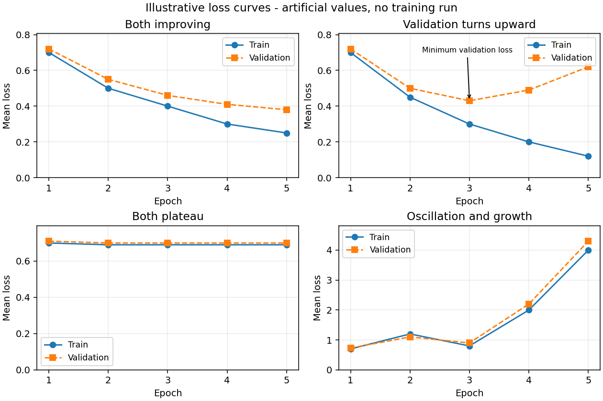

# 11 深度网络为什么能训练、为什么会失败

本文行数：260行，预期阅读时长：15分钟

## 开发者理解：训练能否改善，与改善了什么

**训练优化关心模型能否稳定地学到有用关系，训练诊断关心效果不符合预期的原因。** 能计算梯度，只说明存在调整参数的计算路径；步子是否合适、数据和目标是否正确、对新数据是否改善，是不同问题。

几个常见训练概念可以先理解为不同作用：

| 概念 | 起什么作用 |
| --- | --- |
| 初始化 | 给尚未训练的参数一个起点，影响早期信息怎样传播 |
| 学习率与优化器 | 决定根据训练误差怎样调整参数，调整多大 |
| 归一化 | 调整输入或网络内部数值的尺度，影响计算与学习 |
| 正则化 | 限制对训练细节的依赖，可能帮助新数据预测 |
| 训练过程曲线 | 记录随学习推进，训练与验证效果怎样变化 |

**例子（沿用人工曲线）：** 某网络训练损失一直下降，验证损失先下降、后来又上升。它对已见样本继续改善，却开始失去对新样本的优势；因此更晚的模型不一定更适合使用。另一种情况是训练和验证都几乎不变，可能尚未有效学习，也可能缺少足够的输入信息，不能单看曲线就确定原因。

**学习率**可以先理解为调整参数的步幅。太大可能来回跳过合适区域，太小可能改善很慢；**优化器**决定怎样利用当前及过去的更新信息。SGD、动量和 Adam 是不同规则，不是给任何失败都能套用的修复开关。

网络很深时，训练影响可能在传播中变得极小或极大，称为梯度消失或爆炸。初始化、网络结构和尺度处理会影响这种现象。可以先知道“网络有学习信号，不代表所有部分都能有效学到”，具体乘积和求导机制在后面理解。

**训练与实际使用的行为可能不同。** 例如，Dropout 在训练时随机屏蔽部分内部信息，减少对某些局部路径的依赖，预测时则使用完整计算；有些归一化层也会在两种模式下使用不同统计量。因此保存好参数之后，输入处理和使用模式仍属于预测功能的一部分。

训练目标下降与任务效果提高也不是同一件事。类别正确率、定位误差和抓取成功分别描述不同层次；数据标签错误、单位不一致或缺少关键观测，不会因增加轮次自动消失。

**需要深入时：** [学习率与尺度](#2-学习率与输入尺度梯度大不等于应该迈大步) · [优化器](#3-sgd动量与-adam同一梯度为何更新不同) · [训练与评估模式](#6-dropout-与训练评估求导的关系) · [曲线与原因](#7-看训练曲线先判断现象再查原因)。

[06](../06_pytorch_networks/README.md)已经完整算过反向传播。本章继续回答：同样能求出梯度，为什么某些网络还是不收敛？为什么训练成绩越来越好，验证成绩却变差？默认阅读数值与曲线表即可；这些都是教学构造和公式计算，未运行新的深度模型训练。

## 速记要点

- 反向传播求梯度；优化器使用梯度和内部状态更新参数。梯度正确不等于步长合适。
- 深层网络反复乘局部导数，可能让梯度消失或爆炸；随机初始化、适当方差和残差路径帮助信号传播。
- SGD 使用当前小批量的梯度；动量平滑方向；Adam 根据一阶与二阶矩估计调整各参数步长。
- 输入缩放改变优化问题的曲率；归一化层改变网络内部激活，二者处理的位置不同。
- Dropout 和权重衰减限制对训练样本的依赖，但不能补救泄漏、错标或缺失的任务信息。
- `train()/eval()` 控制层的行为，梯度记录控制求导，`optimizer.step()` 才负责更新；验证时要分别处理。
- 曲线用于缩小问题范围，不能只凭一种形状断定根因。先确认数据、指标与模式，再改超参数。

## 1. 初始化与深度：梯度怎样逐层变小或变大

**最小例子：** 一个有 L 层的标量线性链，L 是正整数。`h_0` 是输入，`h_l` 是第 l 层的输出，`a_l` 是该层系数；以下数值均无量纲。求输入的导数时，各层系数保持不变：

$$
h_l=a_l h_{l-1},\qquad l=1,\ldots,L.
$$

每一层只把上一层乘以一个系数，因此局部导数是：

$$
\frac{\partial h_l}{\partial h_{l-1}}=a_l.
$$

输出依次经过这些层才受到输入影响。链式法则将沿途的局部导数相乘：

$$
\begin{aligned}
\frac{\partial h_L}{\partial h_0}
&=\frac{\partial h_L}{\partial h_{L-1}}
  \cdots\frac{\partial h_1}{\partial h_0}\\
&=a_L\cdots a_1
 =\prod_{l=1}^{L}a_l.
\end{aligned}
$$

例如三层的系数都是 0.5，输入的一个小变化依次缩小为原来的 0.5、0.25、0.125；最后一个比例就是 `∂h_3/∂h_0=0.125`。这里乘的是标量；向量网络中的 Jacobian 矩阵乘积必须保留从最后一层到第一层的顺序。

| 层数 L | 每层 a=0.5 | 每层 a=1.5 |
| ---: | ---: | ---: |
| 5 | 0.03125 | 7.59375 |
| 10 | 0.000976563 | 57.665039 |
| 20 | 约 9.54×10⁻⁷ | 约 3,325.257 |

**结果与解释（静态计算）：** 局部变化并不极端，经过 20 层后差异已很大。真实网络里相乘的是权重矩阵与激活导数，方向也会变化；上表只展示乘积机制。早期层的参数梯度还包含损失对输出的导数和相应输入，不能直接把表中数值当作完整参数梯度。

若末端采用平方损失 `ℒ=½(h_L−y)²`，其中 y 是标量标签，先得到 `∂ℒ/∂h_L=h_L−y`。第 k 层系数影响该层输出，再经过后面的层影响损失，因此：

$$
\begin{aligned}
\frac{\partial\mathcal L}{\partial a_k}
&=\frac{\partial\mathcal L}{\partial h_L}
  \frac{\partial h_L}{\partial h_k}
  \frac{\partial h_k}{\partial a_k}\\
&=(h_L-y)\left(\prod_{l=k+1}^{L}a_l\right)h_{k-1}.
\end{aligned}
$$

`∂h_k/∂a_k=h_(k−1)` 是该层输入；k=L 时没有后续层，空乘积取 1。以三层系数均为 0.5、`h_0=2`、`y=1` 为例，前向得到 `h_1=1,h_2=0.5,h_3=0.25`，损失为 0.28125。第一层参数梯度为 `(0.25−1)×0.5×0.5×2=−0.375`；它与上面的输入敏感度 0.125 是不同的导数。

sigmoid 导数至多 1/4，饱和时更小；ReLU 在正区间导数为 1、负区间为 0，缓解了部分饱和问题，但长期落在负区间的单元可能没有梯度。[数值稳定性与初始化](https://zh.d2l.ai/chapter_multilayer-perceptrons/numerical-stability-and-init.html)

全连接层 `z=Σ_(j=1)^n w_j x_j`，若权重零均值、输入与权重独立且各项满足适当独立假设，近似有 `Var(z)=n Var(w) Var(x)`。因此权重方差不能随意固定为与输入数 n 无关的值。

`fan_in` 是单个输出的输入连接数，`fan_out` 是相应的输出连接数；全连接层中对应输入、输出维度。下表 Xavier 使用基础增益 gain=1，实际实现可按激活函数调整增益；He 取 ReLU 的增益 √2。[PyTorch v2.6.0 初始化定义](https://github.com/pytorch/pytorch/blob/v2.6.0/torch/nn/init.py)

| 初始化 | 常见方差选择 | 适用说明 |
| --- | --- | --- |
| Xavier / Glorot | `Var(w)≈2/(fan_in+fan_out)` | 在前向、反向的尺度之间折中，常用于 tanh 等情形 |
| He / Kaiming | ReLU 常取 `Var(w)≈2/fan_in` | 补偿 ReLU 截断部分信号；还要匹配分布与使用方向 |

例如 `fan_in=fan_out=100`，Xavier 标准差为 0.1；ReLU 的 He 标准差约 0.141421。这里是初始化尺度推导，不能保证任意深度网络一定能训练。隐藏层的神经元若都用相同零权重初始化，会收到相同更新，难以学到不同表示；随机性还用于打破这种对称性。

[07 的残差](../07_transfer_learning/README.md) `h_(l+1)=h_l+F_l(h_l)` 的导数为 `I+J_F`，多出直接传播路径。它帮助优化深层网络，但不保证所有梯度恒定，也不代表可以忽略初始化和数据尺度。

## 2. 学习率与输入尺度：梯度大不等于应该迈大步

**输入（教学损失，参数无量纲）：**

$$
\mathcal L(a,b)=\tfrac12(a^2+100b^2),\qquad
\nabla\mathcal L=(a,100b).
$$

损失在 b 方向变化快 100 倍；这种不同方向曲率悬殊的情形称为条件较差（ill-conditioned）。从 `(a,b)=(1,1)` 出发，初始损失为 50.5。

| 梯度下降学习率 η | 一步后的 `(a,b)` | 一步后的损失 |
| ---: | --- | ---: |
| 0.1 | `(0.9,−9)` | 4,050.405 |
| 0.01 | `(0.99,0)` | 0.49005 |

**结果与原因（静态计算）：** b 的更新是 `b_(t+1)=(1−100η)b_t`。本例要让两个方向都收敛，需 `0<η<0.02`；η=0.02 时 b 来回变号且不衰减。这个界限来自本例二次函数，不能当作所有网络的学习率上限。

缩放输入会改变线性层与损失的曲率，因此[03 的标准化](../03_preprocessing_pipeline/README.md)也影响优化。米与毫米混用造成的大数值，不能只靠“换 Adam”解释或处理；还要核对物理单位和训练、推理的预处理一致性。

学习率调度让 η 随更新变化。warmup 是开头逐步增大学习率，衰减是在后期缩小步长，便于细化参数；它们需要匹配模型与更新次数。epoch 是读过一轮训练数据，step 是一次参数更新，调度器按哪一个计数必须明确。更换 batch size 后，即使 epoch 相同，更新次数也可能变了。

梯度裁剪可以限制一次梯度的范数：`g_clip=g×min(1,M/‖g‖)`。例如 g=(3,4)、最大范数 M=1，变为 (0.6,0.8)，方向保持不变。它能限制突发梯度，不会恢复已消失的梯度，也不会证明输入、损失或学习率合理。

## 3. SGD、动量与 Adam：同一梯度为何更新不同

### 小批量 SGD 与动量

若一批 B 个样本取平均损失，其梯度 `g_t=(1/B)Σ∇ℓ_i` 是本次更新依据。随机抽样让它相对全训练集梯度有波动；batch 大小影响波动、内存和更新频率，不是越大就一定泛化越好。

普通 SGD：`θ_t=θ_(t−1)−ηg_t`。一种常用动量写法为：

$$
v_t=\beta v_{t-1}+g_t,\qquad
\theta_t=\theta_{t-1}-\eta v_t.
$$

**输入（固定梯度序列，非损失求导实测）：** θ₀=1，η=0.1，梯度依次为 2、−1，β=0.9、v₀=0。

| 更新 | 普通 SGD 参数 | 动量状态 v | 动量参数 |
| --- | ---: | ---: | ---: |
| 第一步，g=2 | 0.8 | 2 | 0.8 |
| 第二步，g=−1 | 0.9 | 0.8 | 0.72 |

**结果与解释：** 第二步当前梯度变号，动量仍受到第一步影响，继续沿原方向移动。动量能积累持续方向、减轻部分来回振荡，也可能越过最优点。它不是“每一步都比 SGD 更接近答案”。

### Adam 的一阶、二阶矩

Adam 对每个参数分别维护梯度与梯度平方的指数滑动平均：

$$
m_t=\beta_1m_{t-1}+(1-\beta_1)g_t,\qquad
v_t=\beta_2v_{t-1}+(1-\beta_2)g_t^2,
$$

$$
\hat m_t=\frac{m_t}{1-\beta_1^t},\qquad
\hat v_t=\frac{v_t}{1-\beta_2^t},\qquad
\theta_t=\theta_{t-1}-\eta\frac{\hat m_t}{\sqrt{\hat v_t}+\epsilon}.
$$

平方、开方与除法按元素进行；v 是梯度平方的平均，不是严格意义上减去了均值的方差。零初始化的滑动平均在早期偏小，所以需要偏差修正。ε 避免分母为零。[Adam 原理与公式](https://zh.d2l.ai/chapter_optimization/adam.html)

**同一梯度序列结果（静态计算）：** β₁=0.9、β₂=0.999、ε=10⁻⁸。第一步 `m=0.2,v=0.004`，修正后为 2、4，参数约 0.9；第二步 `m=0.08,v=0.004996`，修正后一阶矩约 0.421053，参数约 0.873366。仍沿原方向移动，但幅度与动量 SGD 不同。

Adam 使用的“每参数尺度调整”不能代替检查梯度、输入与目标。优化器内部状态也影响后续更新；恢复训练仅加载模型参数、丢掉动量状态，不等于从原训练状态继续。

## 4. 权重衰减：SGD 中的等价关系不能直接套到 Adam

[02 的 L2](../02_regression/README.md)若写成 `L_total=L_data+(λ/2)‖θ‖²`，梯度多出 λθ。对不带动量的 SGD：

$$
\theta'=(1-\eta\lambda)\theta-\eta\nabla L_{data}.
$$

这与每步缩小权重的形式等价。Adam 如果先把 λθ 加入梯度，它还会进入 m、v，再受到自适应分母影响；不再等同于直接缩小权重。

AdamW 将衰减与基于数据梯度的自适应更新分开：

$$
\theta'=(1-\eta\lambda)\theta
-\eta\frac{\hat m}{\sqrt{\hat v}+\epsilon}.
$$

**输入输出（第一步教学计算）：** θ=1、数据梯度 0.1、η=0.1、λ=0.1，矩状态从 0 开始。SGD 加 L2 后参数为 0.98；Adam 把 L2 合入梯度后约为 0.9；AdamW 先衰减至 0.99，再作约 0.1 的自适应更新，约为 0.89。不同算法中相同 `weight_decay` 数值不能直接认定为相同作用强度。

公式和解耦顺序核对了 [PyTorch v2.6.0 AdamW 源码与文档](https://github.com/pytorch/pytorch/blob/v2.6.0/torch/optim/adamw.py)。本文只计算标量公式，没有调用 PyTorch 优化器；具体参数分组是否衰减偏置或归一化参数，应按模型与训练配置判断。

## 5. 归一化：输入统计与网络内统计

输入标准化先从训练集求统计量，训练与推理都复用它。归一化层则放在模型内部，还可能有可学习的缩放 γ、平移 β。

BatchNorm 对选定通道在一批样本及相应空间位置上计算统计量，简写为：

$$
\hat h=\frac{h-\mu_B}{\sqrt{\sigma_B^2+\epsilon}},\qquad
y=\gamma\hat h+\beta.
$$

**教学例子：** 单通道批次 `[1,3]`，批均值 2、总体式方差 1，取 γ=1、β=0，为方便计算暂取 ε=0，训练输出为 `[-1,1]`。若评估使用已保存的运行均值 0、运行方差 4，同一输入输出为 `[0.5,1.5]`。这里两组统计量是分别给定的，没有模拟运行统计更新。

**结果与原因：** 模式改变了选用的统计量，同一参数也会产生不同输出。PyTorch 默认跟踪运行统计；训练前向方差使用分母 n，更新运行方差使用无偏估计。实际 ε 为正。冻结 γ、β 不会自动停止运行统计更新；`track_running_stats=False` 时评估也用当前批统计。见 [PyTorch v2.6.0 BatchNorm 文档与实现](https://github.com/pytorch/pytorch/blob/v2.6.0/torch/nn/modules/batchnorm.py)。

LayerNorm 通常在每个样本的指定特征维度上归一化，不依赖同批其他样本。例如两个样本 `[1,3]`、`[11,13]`，各自均值为 2、12、方差都为 1，取同样简化参数时均输出 `[-1,1]`。归一化维度要写清；它也可能丢掉原本有用的绝对量级，不能无条件加在每个物理量上。[PyTorch v2.6.0 LayerNorm 定义](https://github.com/pytorch/pytorch/blob/v2.6.0/torch/nn/modules/normalization.py)

## 6. Dropout 与训练、评估、求导的关系

训练时，Dropout 以概率 p 把激活置零，将保留值乘 `1/(1−p)`，使每个激活的期望保持不变；评估时直接使用原值。[PyTorch v2.6.0 Dropout 定义](https://github.com/pytorch/pytorch/blob/v2.6.0/torch/nn/modules/dropout.py)

**输入（教学枚举）：** 激活 `[2,4]`，p=0.5，每个元素独立保留。四种等概率输出为 `[0,0]`、`[4,0]`、`[0,8]`、`[4,8]`；逐元素平均仍为 `[2,4]`，评估输出也是 `[2,4]`。

但经过后续非线性和损失后，期望通常不能交换计算顺序。例如一个激活 h=2，Dropout 后为 0 或 4，平方损失 `½h²` 的期望为 4；评估时损失只有 2。因此训练 loss 高于验证 loss 未必是异常，两者可能采用不同模式、增强和目标项。

| 操作 | 影响什么 | 不自动完成什么 |
| --- | --- | --- |
| `model.train()` | Dropout 随机屏蔽；默认 BatchNorm 使用批统计并更新运行统计 | 不会清梯度、反向传播或更新权重 |
| `model.eval()` | Dropout 关闭；默认 BatchNorm 使用运行统计 | 不会自动关闭梯度记录或冻结参数 |
| `torch.no_grad()` 等梯度开关 | 控制是否记录求导图 | 不会替代 `eval()`；训练模式的统计更新仍可能发生 |
| `loss.backward()` | 对计算图求参数梯度，通常累加到已有梯度 | 不会调用优化器更新 |
| `optimizer.step()` | 用梯度和状态更新参数 | 不会自动切换模型模式或清掉旧梯度 |

常规训练一批的顺序仍是：清梯度 → 前向 → loss → backward → 必要时裁剪 → step。验证通常同时使用评估模式与关闭梯度记录，且不调用 step。若有计划地跨小批累积梯度，则在累积边界清理并正确缩放损失，不能把遗漏清梯度当成这一设计。

## 7. 看训练曲线：先判断现象，再查原因

下表把曲线采样成五个 epoch 的数值；全部为人工构造的**曲线示意**，不是本仓库模型实测。各行假设 loss 的定义、求平均方式和数据划分保持一致；训练与验证记录注明各自模式。

图的横轴为 epoch，纵轴为平均 loss；实线是训练、虚线是验证，各子图纵轴范围不同。数值与下表一致，[绘图源码](plot_training_curves.py)仅重画人工数据，不训练模型。

| 现象 | 训练 loss（epoch 1→5） | 验证 loss（epoch 1→5） | 支持的判断与下一步核对 |
| --- | --- | --- | --- |
| 都在改善 | `0.70,0.50,0.40,0.30,0.25` | `0.72,0.55,0.46,0.41,0.38` | 尚在学习；继续看任务指标与独立测试，不能推出永远改善 |
| 训练改善，验证回升 | `0.70,0.45,0.30,0.20,0.12` | `0.72,0.50,0.43,0.49,0.62` | 与过拟合相符；检查划分、场景覆盖、容量与正则化 |
| 两边都平台 | `0.70,0.69,0.69,0.69,0.69` | `0.71,0.70,0.70,0.70,0.70` | 可能容量不足、特征不足、梯度问题、冻结或步长太小；仅曲线无法区分 |
| 振荡并增大 | `0.70,1.20,0.80,2.00,4.00` | `0.73,1.10,0.90,2.20,4.30` | 先核对学习率、输入尺度、梯度范数与非有限值；也查批次变化 |

第二行若事先约定按验证 loss 选 checkpoint，会选第 3 轮，而不是第 5 轮。选择标准应与任务一致：分类指标、定位误差和闭环成功率不能相互替代；不能在测试集反复选择轮数。

定位优化问题时，最有解释力的是同时看：关键层激活和梯度是否有限、参数更新是否发生、`‖Δθ‖` 相对 `‖θ‖` 是否异常、样本与标签是否对齐、训练与推理的尺度是否一致。例如 loss 一直不动，可能是 optimizer 未包含新分类头，也可能是 ReLU 全落在负区间；盲目增加 epoch 无法区分。

只有静态曲线无法区分原因时，维护者才需要做小型对照：如固定一小批，关闭增强和 Dropout，检查模型是否能降低该批损失。它回答“学习信号与更新链路是否工作”，不证明泛化；这是按需使用的诊断方法。

## 回到机器人任务与后续章节

本章训练方法既可用于分类，也可用于未来的位置或动作预测，但先要确定输入、目标、单位与时间。动作 loss 降低不代表闭环成功，训练外状态和误差累积见 [18](../18_imitation_learning/README.md)，独立闭环评价见 [20](../20_generalization_sim2real/README.md)；检测与定位输出见 [12](../12_detection_segmentation/README.md)。

标量链、二次损失、优化器状态、归一化和 Dropout 的数值由[标准库程序](../examples/README.md#advanced)核对。训练案例见 [06 MNIST](../06_pytorch_networks/results.md) 和 [07 迁移学习](../07_transfer_learning/results.md)。

[上一章：经典模型](../10_classical_models/README.md) · [回查 06：反向传播](../06_pytorch_networks/README.md) · [下一章：视觉任务](../12_detection_segmentation/README.md) · [数值核对](../examples/README.md#advanced) · [机器学习目录](../README.md)
