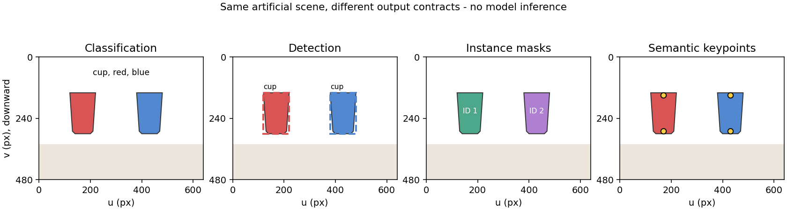

# 12 从图像分类到检测、分割与关键点

本文行数：146行，预期阅读时长：9分钟

## 开发者理解：图片里的对象，需要哪种输出

**视觉任务的区别，首先在希望模型返回什么。** 判断整张图有什么，和找出每个物体的位置、轮廓或指定点，是不同功能。输入都可以是图片，但输出的信息量和含义不同。

| 功能 | 输出 | 适合表达的需求 |
| --- | --- | --- |
| 分类 | 整图类别或多个标签 | 判断图中是否存在某类内容 |
| 检测 | 每个对象的类别、矩形框与分数 | 找出多个杯子各自大致在哪里 |
| 分割 | 像素归属的区域，也叫掩码 | 得到物体轮廓，区分物体与背景 |
| 关键点 | 事先定义的点及有效性等信息 | 找杯口中心等有明确含义的位置 |

**例子（沿用人工桌面图）：** 左边红杯、右边蓝杯。分类可以说明画面有杯子；检测可以给两只杯子各自的框；实例分割可以给两个独立轮廓；关键点可以标出各自杯口和杯底。

**语义分割**区分像素属于杯子还是背景等类别；**实例分割**还区分哪只杯子。若后续要选择其中一个对象，“一片杯子区域”和“两个独立对象区域”就不是同一个接口。

评价时既要看对象是否找对，也要看区域或点是否准确。**IoU（Intersection over Union，交并比）**可以先理解为预测区域与真实区域的重叠程度；框重叠得多，不代表类别正确，也不能把同一杯子的多个重复框当成多个成功检测。关键点还要说明点的含义以及遮挡时是否有效。

**但要注意，这些输出仍是图像信息。** 原图坐标通常以像素表示；图片经过缩放或裁剪后，最终还要恢复位置到相应的参考图像，并不是说一个准确的框或轮廓，就自动变成机器人使用的米制三维位置与朝向，要实现这些还需要深度、相机几何等信息。

**需要深入时：** [四种视觉输出](#1-同一张桌面图四种输出) · [区域重叠](#3-一个框的-iou完整算一次) · [分割](#5-分割矩形中哪些像素属于杯子) · [关键点与坐标恢复](#6-关键点与坐标恢复)。

[07](../07_transfer_learning/README.md)回答整张图属于什么类别，[08](../08_robot_integration/README.md)需要可用于定位的目标。本章解释从类别到区域、轮廓和点的区别；同一张人工桌面图贯穿例子，读者无需运行模型。

## 速记要点

- 分类返回类别；检测返回每个对象的类别、框和分数；分割返回像素归属；关键点返回有定义的点及可见性等信息。
- 框、掩码和关键点都是图像坐标信息，不自动提供以 m 为单位的三维位姿。
- IoU 比较区域重叠。检测评估还要按类别、一对一匹配和分数排名统计，不能只平均各框 IoU。
- NMS 删除重叠的重复候选；它也可能误删相邻实例，并非所有检测器都采用相同后处理。
- 语义分割区分类别，实例分割还区分同类的不同对象；背景占比大时像素准确率容易误导。
- 缩放、裁剪、补边、框格式和可见性定义是输出契约的一部分，必须随结果解释。

## 1. 同一张桌面图，四种输出

**输入（教学示意）：** RGB 图像宽 640、高 480 像素；左红杯、右蓝杯。图像坐标原点在左上角，u 向右、v 向下。本章按连续边界坐标表示矩形，不使用离散端点的 `+1` 面积规则。

图中轮廓、框、颜色和点均为人工绘制，没有调用检测模型。示意点称为“杯口中心”和“杯底中心”，表示预先定义的语义点；不是算法自行发现的抓取点。[绘图源码](../examples/plot_multimodal_examples.py)

| 任务 | 输出示意 | 额外提供什么 | 仍然缺什么 |
| --- | --- | --- | --- |
| 多标签分类 | 杯子存在，红色和蓝色存在 | 整图类别信息 | 每个对象位置及属性对应关系 |
| 检测 | 红杯框 `[120,140,220,300]`，蓝杯框 `[380,140,480,300]` | 对象级区域与类别 | 精确轮廓、深度、朝向 |
| 实例分割 | 两个独立杯子掩码 | 每个对象的像素轮廓 | 看不见的表面、三维几何 |
| 关键点 | 红杯杯口 `(170,150)`、杯底 `(170,290)` | 按任务定义的语义位置 | 深度、遮挡点是否可靠、完整姿态 |

单标签分类常只选一个类别；多标签分类允许同图多个标签。图里有两只杯子，不能强行把整图单标签“红杯”解读成所有对象都已识别。

在实现中，图像常为 `[B,3,H,W]`；一张图的 n 个框可为 `[n,4]`，类别与分数各 `[n]`；实例掩码可为 `[n,H,W]`；K 个关键点可为 `[n,K,2]`，另带可见性或有效性。这里只说明一种接口，实际排列和字段须按模型核对。

## 2. 检测怎样同时学习类别与位置

CNN 等骨干提取空间特征，检测头从特征预测对象类别与位置。部分方法以锚框或候选区域为参照预测偏移，部分直接预测中心、尺度或对象集合；“输出四个数”并不决定训练机制。

常见目标包含分类损失和定位损失，例如：

\[
L=L_{class}+\lambda_{box}L_{box}.
\]

`L_box` 可比较坐标偏差或区域重叠。两项的数值尺度、匹配方式和背景处理影响训练；定位损失低并不代表类别正确。[DETR 原论文](https://arxiv.org/abs/2005.12872)用对象查询、集合预测和一对一匹配展示了另一种检测组织方式，理解查询与注意力可回查 [14](../14_attention_transformer/README.md)。

本章不把某个检测器的输出分数当作已校准概率；概率解释仍按 [09](../09_probability_uncertainty/README.md)核对。分类头猜中杯子，也可能框到旁边物体或截掉杯把。

## 3. 一个框的 IoU，完整算一次

真实红杯框为 `G=[120,140,220,300]`，预测框为 `P=[140,140,240,300]`。两者宽 100、高 160，面积均为 16,000 px²；交集宽 80、高 160，面积 12,800 px²。

\[
\operatorname{IoU}(P,G)=\frac{|P\cap G|}{|P\cup G|}
=\frac{12800}{16000+16000-12800}=\frac23\approx0.666667.
\]

**结果与解释（静态计算，已核对）：** 按 IoU≥0.5 的匹配要求，这个框可以通过；按 IoU≥0.75 则不能。阈值改变是在改变评价定位精度的要求，不是改变类别阈值。

交集由 `max` 左上角、`min` 右下角计算，宽高小于 0 时截为 0。两个不相交框 IoU 为 0，完全相同的非空框为 1；对两个空区域需预先约定行为，本例检查器拒绝零面积框，避免分母为 0。

IoU 没有物理单位：等比例缩放两个框，结果不变。同一像素偏差对小目标影响通常更大；同样的 IoU 也不直接对应相同的三维误差。

## 4. 重复框、NMS 与检测 AP

**教学候选：** 同一杯子有框 A=G、分数 0.9，框 B=P、分数 0.8；另一个蓝杯有框 C、分数 0.7。按类别分别执行 NMS，先保留最高分框，再删除与它 IoU 超过给定阈值的候选。

**结果（静态计算）：** NMS 重叠阈值设为 0.5，A 与 B 的 IoU 为 2/3，B 被删除；C 与 A 不重叠，保留。若两个真实杯子靠得很近，NMS 也可能误删一个，需要结合密集目标、实例和训练方式判断。NMS 阈值、最低检测分数、评估匹配 IoU 是三种不同条件。

检测评价按分数从高到低尝试与同类真值一对一匹配：一个真值最多被算一次正确检测。重复框即使 IoU 很高，也不能增加正确数。

**教学排名例子，NMS 前：** 两个杯子真值，三条预测依次是“红杯正确框、红杯重复框、蓝杯正确框”，因此为 `[TP,FP,TP]`。

| 排名 | 累计 TP / FP | Precision | Recall |
| ---: | --- | ---: | ---: |
| 1 | 1 / 0 | 1 | 1/2 |
| 2 | 1 / 1 | 1/2 | 1/2 |
| 3 | 2 / 1 | 2/3 | 1 |

**结果（静态计算）：** 本例采用便于手算的非插值 AP，即对每次召回率增加的面积求和：`AP=1×1/2+(2/3)×1/2=5/6≈0.833333`。它描述排名效果，不是三条预测的准确率，也不是平均 IoU。

真实评价协议还可能插值 precision、按类别取平均，并跨 IoU 阈值汇总。COCO 常用 AP 在 IoU 0.50～0.95、步长 0.05 上平均，还涉及召回采样、面积和最大检测数；本例 5/6 **不是 COCO AP 实测**。细节以 [COCO 官方评估实现](https://github.com/cocodataset/cocoapi/blob/master/PythonAPI/pycocotools/cocoeval.py)为准。

## 5. 分割：矩形中哪些像素属于杯子

语义分割可对每个像素输出 K 类 logits，形状 `[B,K,H,W]`；同类杯子可以共享类别。实例分割进一步给两个杯子各自的对象身份，避免把它们当作一个整体区域。

**输入（仅代表一个对象的 2×3 教学掩码）：**

~~~text
真值 G：1 1 0        预测 P：1 0 0
        0 1 0                0 1 1
~~~

两个掩码各有 3 个前景像素，交集 2 个，并集 4 个。前景 IoU=2/4=0.5；Dice=2|交集|/(|P|+|G|)=4/6≈0.666667。

**结果与解释（静态计算）：** 两项指标使用相同区域，但公式不同。像素级交叉熵学习每个位置的类别；区域损失可补充轮廓重叠目标。类别不平衡仍会影响训练与指标：若杯子仅占 5% 像素，全部报背景也能达到 95% 像素准确率，但前景召回率为 0。

掩码比框更精细，仍可能包含错误边界、遮挡缺失或孔洞。对象掩码可以帮助选择深度样本，不能保证这些样本都有效；透明或反光物体的深度问题仍需单独处理。

## 6. 关键点与坐标恢复

关键点常用直接坐标回归或热力图表示：热力图是各像素位置的响应，取峰值或相应解码得到点。必须先定义点含义和遮挡标注；“中心”可能是框中心、可见轮廓中心或物体语义中心，三者未必相同。

**教学误差：** 某可见关键点真值为 `(170,220)` px、预测 `(173,224)` px，欧氏误差为 `√(3²+4²)=5 px`。若评价 PCK，以误差不超过约定参考尺度的 τ 倍为正确，参考尺度 100 px、τ=0.1 时它通过；换成 20 px 则不通过。参考尺度与不可见点的计分规则不能省略。

**图像预处理例子：** 640×480 原图等比例缩为 224×168，再在上下各补 28 px，得到 224×224。原图红杯框映射为：

\[
[u'_1,v'_1,u'_2,v'_2]=[42,77,77,133].
\]

恢复时 `u=u'/0.35`、`v=(v'−28)/0.35`，重新得到 `[120,140,220,300]`。若忘记补边，纵坐标将偏移 80 个原图像素。裁剪需要再处理裁剪原点，不能统一假设所有 processor 都直接缩放。

## 7. 接回机械臂：区域是几何输入的一部分

类别用于选对象，掩码用于选择其可见表面，关键点可提供定义明确的语义位置。随后还需深度与相机内参、有效性检查和采集时刻的坐标变换，才可能得到三维点；姿态和抓取接触点还需额外信息。

框中心 `(170,220)` px 的反投影可回查 [16 的完整数值例子](../16_vision_language/05_robotics_vla.md)，标定与单位回查[相机标定](../../perception/01_camera_calibration/README.md)。没有深度时，框再准确也不能唯一确定米制位置。

本章完成教学区域、排名和坐标计算，未训练检测/分割模型、调用真实相机或验证定位与抓取。数字核对见[12～17 核对记录](../examples/README.md#multimodal)。

[上一章：训练与优化](../11_training_optimization/README.md) · [下一章：序列模型](../13_sequence_models/README.md) · [机器学习目录](../README.md)
