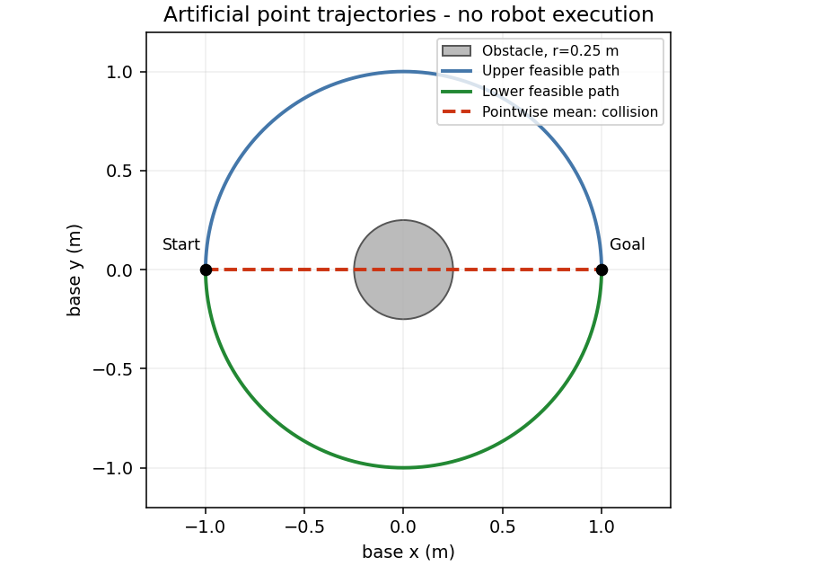

# 17 生成模型与扩散模型

本文行数：172行，预期阅读时长：10分钟

## 开发者理解：同一条件可以有多个合理结果

**生成模型学习可能的输出分布，再从中产生结果。** 分类选择类别，数值回归常返回一个估计；生成可以在同样条件下产生多种图片、文字或动作序列。开发时要区分“求一个平均答案”和“产生合理候选”。

**例子（沿用教学路径）：** 从障碍左边走到右边，可以从上侧或下侧绕过。两条路都合理，但把它们逐点平均，得到的中间路线却可能穿过障碍。若用单一平均预测表示所有答案，就可能丢掉原本有效的两种选择。

**条件生成**是根据给定信息产生结果，例如场景与目标决定允许的路线，图片与问题决定回答内容。随机因素让模型可以产生不同候选；随机性不是随意胡乱变化，理想输出应符合学到的规律与当前条件。

| 生成方式 | 可以先理解为什么 |
| --- | --- |
| 自回归 | 依据已有内容逐项产生后续内容，如生成文字 |
| 变分自编码器 VAE | 通过内部随机表示产生不同结果 |
| 生成对抗网络 GAN | 生成样本，同时学习区分真实与生成的结果 |
| 扩散 | 学习去噪，再从噪声逐步产生样本 |

**扩散训练**可以先理解为：给真实样本加已知噪声，让网络学习怎样减少这种噪声影响。**采样**则固定已学参数，从噪声开始，多次利用网络得到最终候选；生成过程本身不是重新训练。

生成模型可能直接在图片上工作，也可能在压缩表示或一段动作上工作。因此“用了扩散”不等于输出一定是图片；它描述生成机制，输出含义仍由任务定义决定。

**生成合理与实际可用是两个层次。** 一条看起来连贯的路线，仍可能不满足关节可达性、碰撞或执行要求。动作序列还有单位、坐标系和控制周期；模型内部的去噪步数不等于机器人将执行多少步，也不等于运动持续多久。

**需要深入时：** [平均路径为何不合适](#1-两条可行路径平均后却撞障碍) · [生成方式](#3-几类生成模型分别怎样学习) · [扩散训练](#5-去噪训练目标为何可以自己构造) · [动作的两个时间轴](#8-为机器人动作生成明确两个时间轴)。

分类选类别，回归常给一个数；生成模型还可以表达“同样条件下存在多个合理结果”。本章从两条绕障路径讲起，逐步解释潜变量、加噪、去噪与条件生成，为[18 模仿学习](../18_imitation_learning/README.md)建立基础。

## 速记要点

- 平方误差的最优单点预测是条件均值；多峰分布的均值可能落在低概率甚至不可行区域。
- 生成模型学习输出分布；条件生成把图像、语言、状态等作为条件，随机变量让它产生不同候选。
- 潜变量是模型中的隐藏随机量或表示，不自动等于真实机器人状态。
- 扩散训练将真实样本加噪，学习在给定噪声级别与条件下去噪；采样从噪声开始迭代生成。
- 扩散步数不是机器人控制时长；输出轨迹的采样时间、单位和执行方式需要另外定义。
- 一次准确的噪声预测与一个可行的完整动作序列是不同证据；生成多样性也不自动保证碰撞、动力学与任务成功。

## 1. 两条可行路径，平均后却撞障碍

**教学环境：** 平面 `base` 的 x/y 单位为 m，将运动物体简化为没有体积的点。起点 `(-1,0)`、终点 `(1,0)`，原点有半径 0.25 m 的圆形障碍；不考虑机械臂关节、速度与动力学约束。

指定路径参数 θ 从 π 逐渐减到 0，两个候选为：

\[
p_+(\theta)=(\cos\theta,\sin\theta),\qquad
p_-(\theta)=(\cos\theta,-\sin\theta).
\]

两条路径的每个点距原点都为 1 m，大于障碍半径。若两种路径在同一条件下各占一半，按相同进度逐点平均：

\[
E[p\mid\theta]=(\cos\theta,0).
\]

**结果（静态几何计算）：** θ=π/2 时，均值为 `(0,0)`，位于障碍中心；两种原路径此时在 `(0,±1)`，都可行。[图的源码](../examples/plot_multimodal_examples.py)绘制的是这些公式，不是规划器或策略实测。

若把两条路径作为同条件监督目标，用单条路径的逐点平方误差训练，最优预测会倾向条件均值。因此训练 MSE 更低，并不意味着输出更可行。相同问题也可出现在动作标签、遮挡图像恢复等多解任务中。

## 2. 单点回归与分布预测

令一个无量纲输出 Y 以相同概率取 −1 或 +1。单点预测 a 的期望平方损失为：

\[
E[(Y-a)^2]=\tfrac12(-1-a)^2+\tfrac12(1-a)^2=1+a^2.
\]

**结果（静态计算）：** a=0 最优，损失为 1；a=±1 的损失为 2。但 0 从未出现在目标中。也可以用两个窄高斯峰的混合分布表达这两个模式，再采样某一峰；“生成多个候选”不是围绕平均值任意加一点噪声。

条件生成写为 `p_θ(x | c)`，c 是当前图像、指令或观测等，x 是要生成的输出。在本例中 c 是起终点与障碍场景；随机选择“上方/下方”的潜变量 z，可以得到两条不同路径。`G(c,z)` 把条件与随机量映射为样本，z 本身没有 m 或关节角单位。

“多模态分布”（multimodal distribution）在这里指多个概率峰，不是 VLM 中图像与文字的多个输入模态；两个中文术语相似，需要看上下文。

## 3. 几类生成模型分别怎样学习

| 类型 | 基本机制 | 和已有章节的联系 |
| --- | --- | --- |
| 自回归模型 | `p(x \| c)=∏p(x_i \| c,x_<i)`，依次产生输出 | [14](../14_attention_transformer/README.md)的下一 token；也可组织其他离散序列 |
| 变分自编码器 VAE | 学近似后验与解码分布，重建目标加潜变量分布约束 | [15](../15_representation_learning/README.md)的普通自编码器还没有这个概率约束 |
| 生成对抗网络 GAN | 生成器产生样本，判别器区分真实与生成，交替学习 | 不依赖下一 token 或固定扩散链 |
| 扩散模型 | 学不同噪声级别上的去噪，采样时迭代生成 | 使用 [11](../11_training_optimization/README.md)的梯度训练，但生成不是参数更新 |

[VAE 原论文](https://arxiv.org/abs/1312.6114)解释近似推断与重参数化，[GAN 原论文](https://arxiv.org/abs/1406.2661)解释对抗学习。本章用这些名称建立机制印象，不展开全部推导，也不依据模型名称承诺效果。

普通自编码器把任意随机向量送入解码器，未必能得到合理样本；“有解码器”本身不足以建立可采样的分布。接下来用扩散解释一条更具体的生成过程。

## 4. 扩散的前向过程：给真实样本加噪

先把数据按训练规则变成适合模型的数值尺度，记为 x₀。扩散索引 t 表示噪声级别，α_t=1−β_t，0<β_t<1，`ᾱ_t=∏_(s=1)^t α_s`。

\[
x_t=\sqrt{\alpha_t}x_{t-1}+\sqrt{\beta_t}\epsilon_t,
\quad \epsilon_t\sim\mathcal N(0,I).
\]

逐步加噪也可以直接写成给定干净样本的边缘分布采样：

\[
x_t=\sqrt{\bar\alpha_t}x_0+
\sqrt{1-\bar\alpha_t}\epsilon,\quad \epsilon\sim\mathcal N(0,I).
\]

**输入（标量教学样本）：** x₀=2，连续两级 β₁=β₂=0.2，所以 ᾱ₂=0.64；为看清计算，指定本次抽样 ε=−1。

**结果（静态计算）：** `x₂=0.8×2+0.6×(−1)=1`。这次 ε 是已知的人工抽样，不代表真实网络已经知道它。给定 x₀，x₂ 的期望是 1.6，方差为 0.36；随着 ᾱ 降低，信号被衰减、噪声影响增大。

分布计算来自 [DDPM 原论文](https://arxiv.org/pdf/2006.11239)的前向过程。只有当累计噪声足够大等条件满足时，末端分布才接近标准高斯；任意设置两步后直接从标准高斯采样，不能自动匹配训练分布。

## 5. 去噪训练：目标为何可以自己构造

训练抽取真实 x₀、级别 t 和噪声 ε，得到 x_t；网络接收 `(x_t,t,c)`，预测 ε̂=`ε_θ(x_t,t,c)`。常见简化目标是：

\[
L=E[\|\epsilon-\epsilon_\theta(x_t,t,c)\|^2].
\]

噪声是程序抽出来的，所以目标已知，不需要人工逐个标注“这幅噪声图应该如何去噪”；真实数据和条件仍需要采集与组织。这与 [15 的自监督目标](../15_representation_learning/README.md)联系起来。

**延续标量例子：** 若网络预测 ε̂=−0.8，目标 ε=−1，本次平方误差为 0.04。根据预测噪声估计干净样本：

\[
\hat x_0=\frac{x_t-\sqrt{1-\bar\alpha_t}\hat\epsilon}{\sqrt{\bar\alpha_t}}
=\frac{1-0.6(-0.8)}{0.8}=1.85.
\]

**结果与原因：** 噪声预测偏差 0.2 变成干净样本偏差 −0.15。一般偏差放大系数为 `√((1−ᾱ_t)/ᾱ_t)`，高噪声级别可能更敏感。若使用真正已知 ε=−1，则公式精确恢复 x₀=2；这是代数往返，不能证明学出的网络可以精确去噪。

## 6. 采样：预测一次噪声以后还做什么

训练更新参数；采样固定参数，从 x_T 的噪声开始，反复调用去噪网络。DDPM 一种常见更新均值为：

\[
\mu_\theta(x_t,t)=\frac1{\sqrt{\alpha_t}}
\left(x_t-\frac{\beta_t}{\sqrt{1-\bar\alpha_t}}\epsilon_\theta(x_t,t,c)\right),
\qquad x_{t-1}=\mu_\theta+\sigma_t z.
\]

z 是新高斯噪声；方差选择与采样器有关，最后一步常不再加入随机噪声。继续使用本例的 t=2，并假设有教学 oracle 给出 ε̂=−1，则 μ≈1.490712。若使用后验方差 `σ²=β_t(1−ᾱ_(t−1))/(1−ᾱ_t)`，本例为 1/9。

**解释：** 即使这次噪声已知，DDPM 的下一状态也不是“直接恢复原先那一次加噪轨迹”；它是采样过程的一个中间状态，还可加入随机量。上述 oracle 持有人工构造的真噪声，不是训练成果。

[DDIM 原论文](https://arxiv.org/abs/2010.02502)提供另一类采样过程，允许确定性设置与不同步数。本例取确定性更新，并在每次都给出真噪声，按 `x_s=√ᾱ_s x̂₀+√(1−ᾱ_s)ε̂` 从 ᾱ₂=0.64 转到 ᾱ₁=0.8，得到 x₁≈1.341641；转到 ᾱ₀=1，得到 x₀=2。它只演示公式路径，不是把两步网络当作已训练的快速生成器。

采样步数减少会改变质量、延迟与数值误差，需按训练和采样器核对；扩散模型不必逐 token 生成，也不代表一次网络调用就得到完整结果。

## 7. 条件、引导与潜空间

条件 c 可以通过拼接、特征调制或 [14 的 cross-attention](../14_attention_transformer/README.md)进入去噪网络。语言条件告诉模型想生成什么，但不保证几何约束自动成立。

一种 classifier-free guidance 写法为 `ε̂_guided=ε̂_uncond+s(ε̂_cond−ε̂_uncond)`，训练时需相应地让模型支持无条件分支。s=1 使用条件预测，s=0 使用无条件预测，其他实现可能采用不同尺度约定。[无分类器引导原论文](https://arxiv.org/abs/2207.12598)

**教学数值：** 无条件噪声预测 0.2、条件预测 −0.4，s=2 得到 −1.0。更大的引导强度是在加强条件方向，不是事实准确率或任务成功率的倍数，也可能损害多样性和生成质量。

潜空间扩散先用编码器把图像压缩，在潜表示上去噪，再解码回像素；这改变扩散所在空间，压缩与重建也会引入误差。[潜空间扩散原论文](https://arxiv.org/abs/2112.10752)解释这一方案。动作扩散可以直接使用归一化动作块，不能因名称相同就假设一定经过图像自编码器。

## 8. 为机器人动作生成明确两个时间轴

假设未来动作块为 `A∈Rᴴˣᵈᵃ`，H=4、d_a=2，各行为每隔 0.1 s 的 `base` 系末端平移增量 `[Δx,Δy]`，单位 m，姿态固定。模型内部可以归一化后对整个动作块加噪；反归一化后才回到上述物理量。

扩散索引 t 是内部噪声级别，动作行索引 k 是未来控制时刻。20 次去噪调用不表示机器人要执行 20 个动作，也不表示预测 2 s。噪声级别从大到小，动作序列仍按未来时间排序。

[Diffusion Policy 原论文与项目](https://diffusion-policy.cs.columbia.edu/)把动作扩散与视觉条件、动作序列和滚动执行联系起来：预测一段，只执行其中一部分，再用新观测更新。动作标签、误差累积与分块见 [18](../18_imitation_learning/README.md)，闭环评价见 [20](../20_generalization_sim2real/README.md)；本章没有实现该策略。

生成的绕障候选还需检查关节可达性、碰撞、速度、加速度、接触与当前时效。候选分布能保留不同模式，并不提供约束保证；也不能把两种模式逐点混合后仍称为可行样本。

本章概率、轨迹几何、加噪往返、预测误差和采样公式已做[教学数值核对](../examples/README.md#multimodal)。未训练 VAE/GAN/扩散模型、生成真实图像、加载 Diffusion Policy 或验证机器人动作。

[上一章：VLM](../16_vision_language/README.md) · [下一章：模仿学习](../18_imitation_learning/README.md) · [机器学习目录](../README.md)
