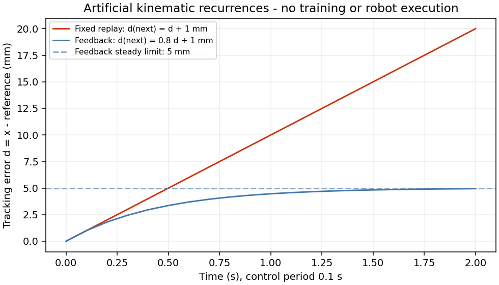

# 18. 模仿学习与机器人动作策略

本文行数：134行，预期阅读时长：10分钟

**模仿学习从示教中学习怎样行动；行为克隆（Behavior Cloning，BC）把它写成“观测 → 动作”的监督学习。** 离线动作误差小，仍可能在连续执行中越走越偏，因为自己的动作会改变下一次输入。

本章先用一维 reaching（到达目标）算清数据、损失与反馈，再解释 DAgger、动作分块、ACT 和 Diffusion Policy。注意力按需回查 [14](../14_attention_transformer/README.md)，多峰与扩散回查 [17](../17_generative_models/README.md)。所有数字是教学构造与代数核对，没有训练或执行机械臂策略。

## 速记要点

- observation 是决策时可得到的观测；action 是送给下层接口的命令，必须明确位置目标、增量、速度还是力矩。
- 示教标签应是专家发出的命令。实测运动受到控制器、负载与延迟影响，不能直接当成相同语义的命令。
- BC 学习示教分布中的动作；rollout 指让策略连续执行并接收新观测，此时输入分布可能改变。
- DAgger 收集策略自己遇到的状态，再请专家给动作标签；它改变数据覆盖范围。
- 动作分块一次预测未来多个时刻；执行多少步、多久重新观测，决定反馈能多快介入。
- ACT 与 Diffusion Policy 都可从示教训练动作序列；架构更复杂不会自动解决坐标、时间与动作接口问题。

## 1. 先定义一个能读懂的数据样本

机械臂末端只沿固定基座坐标系 B 的 x 轴运动，姿态和其他轴固定。用理想运动学更新 `x_(t+1) = x_t + a_t`，决策间隔 Δt=0.1 s；不模拟惯量、接触或执行器。

| 字段 | 单个样本 | 语义 |
| --- | --- | --- |
| 观测 `o_t=[x_t,g]` | `[0.20,0.30]`，形状 `[2]` | 当前末端位置与目标位置，均为 B 系中的米 |
| 输入特征 `e_t=g−x_t` | `0.10 m`，形状 `[1]` | 朝目标的有符号位置误差；负值应向负 x 移动 |
| 专家动作 `a_t*` | `+0.02 m`，形状 `[1]` | 在 `[t,t+Δt)` 请求执行的 x 方向位移增量 |
| 下一位置 `x_(t+1)` | `0.22 m` | 理想接口恰好执行增量后的结果 |

观测先采样，再产生动作，最后才有下一观测。采集格式可以存 `o_t,a_t,o_(t+1),timestamp,episode_id`；不能把执行后的图像配到执行前的命令。[S8 数据契约](../../../doc/learning-roadmap.md#s8)展开了时钟、采样率、关节顺序和回放要求。

同一个 `0.02` 若表示绝对位置目标，就是去 `x=0.02 m`；若表示速度 `0.02 m/s`，0.1 s 内仅移动 `0.002 m`。本章动作是**增量**。实际接口可转换成目标 `x_cmd=x_t+a_t`，但是否能在一个周期内到达由控制与约束决定。若改为关节动作，还要指定每个关节的顺序、rad/m 单位及夹爪字段。

## 2. 行为克隆：从三条标签到一个策略

专家使用 `a*=0.2e`。这里 0.2 是无量纲增益，不是神经网络优化器的学习率。

| 当前位置 x（m） | 目标 g（m） | 输入 e（m） | 标签 a*（m） | 初始策略 `a=0.1e`（m） |
| ---: | ---: | ---: | ---: | ---: |
| 0.20 | 0.30 | +0.10 | +0.020 | +0.010 |
| 0.10 | 0.30 | +0.20 | +0.040 | +0.020 |
| 0.40 | 0.30 | −0.10 | −0.020 | −0.010 |

用单参数策略 `π_k(e)=ke`，损失取三个动作的平均平方误差：

~~~text
L(k) = (1/3) Σ_i (k e_i − a_i*)²
     = 0.02 (k−0.2)² m²
k*   = Σ_i e_i a_i* / Σ_i e_i² = 0.012/0.06 = 0.2
~~~

**结果与解释：** k=0.1 时 MSE=0.0002 m²，RMSE≈0.01414 m，即 14.14 mm；k=0.2 恰好拟合三条人工标签。梯度 `dL/dk=0.04(k−0.2) m²`，在 k=0.1 时为 −0.004 m²。数值差分与此一致；这是解析拟合，没有运行 MLP 训练。

真实 BC 把 `π_k` 换成 MLP 或视觉网络，批量输入可以是 `[N,2]`、动作标签 `[N,1]`。混合关节、米制位移与夹爪动作时，未经处理的平方损失会偏向数值较大的通道；需要逐维归一化或明确损失权重，并在推理端恢复物理单位。均值与尺度只从训练轨迹计算。

离散动作可用交叉熵；连续动作可回归或拟合条件分布 `p(a|o)`。同一观测存在多条有效绕障路线时，平方回归容易给出碰撞的均值，原因见 [17 的两条路径](../17_generative_models/README.md)。增加模型容量不等于消除标签歧义。

## 3. 一步预测与闭环误差为什么不同

先在理想 reaching 中执行正确策略 `a_t=0.2(g−x_t)`。目标固定，所以：

~~~text
e_(t+1) = g − (x_t + 0.2e_t) = 0.8e_t
e_t     = 0.8^t e_0
~~~

从 x₀=0.20 m、g=0.30 m 出发，三步位置为 0.22、0.236、0.2488 m；第 20 步误差约 1.153 mm。这里每一步重新读取当前位置，反馈根据当前误差修正动作。这一收敛只适用于本章的理想更新和无延迟假设。

再看跟踪一条专家参考轨迹时，**每个周期多移动 b=1 mm** 的简化偏差。令 `d_t=x_t−x_t*` 为实际位置相对参考位置的误差，起始 d₀=0；参考轨迹处于可执行范围内：

| 执行规则 | 误差递推 | 第 20 步结果 |
| --- | --- | --- |
| 固定回放参考增量，不使用新观测 | `d_(t+1)=d_t+b` | `20b=20 mm` |
| 在参考增量上补 `−0.2d_t` | `d_(t+1)=0.8d_t+b` | `b(1−0.8²⁰)/0.2≈4.942 mm` |

**结果与解释：** 持续小偏差会在固定回放中累积；反馈把此例误差限制在趋近 5 mm 的范围。图由上述递推生成，既不是 BC 的训练曲线，也不是机械臂动力学记录。反馈策略仍有稳态偏差，且延迟、饱和与观测噪声可能改变结论。

BC 的额外困难是**分布偏移**：示教多在参考路径附近，偏差后的观测却来自路径之外。模型在这种状态上的动作没有被离线误差充分评价。上表只是两种执行规则的反例，不声称所有 BC 的误差都线性增长，或加入反馈就一定恢复。

## 4. DAgger：让专家标注策略实际遇到的状态

假设最初只采到目标左侧的示教，输入误差均为正；策略因偏差到了 x=0.32 m，目标仍为 0.30 m。此时专家应给 `a*=0.2(−0.02)=−0.004 m`。若策略仍输出正增量，它会继续远离目标。

DAgger（Dataset Aggregation）的核心循环是：用当前策略收集观测 → 专家为这些观测给正确动作 → 合并旧数据与新标签 → 重新监督训练。早期可混合专家与学习策略控制。新标签描述“偏离以后怎样修正”，而非仅把成功示教重复更多遍；方法依据见 [DAgger 原论文](https://proceedings.mlr.press/v15/ross11a.html)。

**结果与解释：** 上例应新增 `(e=−0.02 m,a*=−0.004 m)`，随后重新检查偏离状态和闭环表现。本文只核对标签方向，没有实施 DAgger。它需要能对访问状态提供可靠动作的专家；接触、遮挡等状态未必都有容易获得的恢复标签，数据聚合也不保证当前模型一定学会。

## 5. 动作分块：预测范围与执行范围分开

单步 BC 输出 `[B,d_a]`；动作分块（action chunking）输出 `[B,H,d_a]`，H 是预测的动作时刻数。对本章 d_a=1、H=4，一个观测可对应：

~~~text
预测增量（m）：[0.020, 0.016, 0.0128, 0.01024]
对应时段：    [t,t+0.1), [t+0.1,t+0.2), [t+0.2,t+0.3), [t+0.3,t+0.4)
~~~

它们来自当前误差 0.1 m 的理想四步。若只执行前 K=2 步，位置到 0.236 m，在 t+0.2 s 重新观测并预测新块；旧块后两项可丢弃。H=4、K=2 表示预测 0.4 s、执行 0.2 s 后反馈，不是一个周期移动四步之和。

训练时取 `o_t` 与未来 `a_t…a_(t+H−1)` 配对；轨迹末尾没有的动作要用有效位置遮罩排除，不能从下一个 episode 接过去。把未来动作作为训练标签正常；把未来图像作为推理输入会泄漏。动作块的归一化与单步语义应一致。

**结果与解释：** 分块可学习动作之间的时间关联，减少逐步拼接的不连贯；执行前缀越长，期间新扰动越晚被观测到。动作块长度、重规划频率与推理耗时要一起看，不能用“预测得更远”替代反馈。

## 6. ACT：Transformer 预测动作块

ACT（Action Chunking with Transformers）用当前图像、关节位置与潜变量预测一段动作。其 CVAE（条件变分自编码器）训练时，用示教动作序列与关节观测编码潜变量 z；策略根据当前观测与 z 重建动作块，并以 KL 项约束 z 的分布。原论文实现采用 L1 重建损失；推理时不再读取专家动作，设 z=0，即先验均值。Transformer 通过交叉注意力将观测信息关联到各动作位置，见 [ACT 原论文第 IV 节](https://arxiv.org/html/2304.13705v1#S4)。

因此“训练时输入过动作”不等于“执行时需要正确动作”。训练编码器和执行策略承担不同职责。原 ACT 输出绝对关节目标，本章 reaching 输出米制增量，两者不能直接接到同一个接口上。

ACT 还可在每步预测重叠的动作块，对**同一个执行时刻**的多次预测做 temporal ensembling（时间集成）。例如时刻 t 的目标分别为 0.250 m 与 0.254 m，教学权重取 2/3 与 1/3，合并为约 0.251333 m；不要把时刻 t 与 t+1 的动作当成这两个候选。原方法使用指数权重，其具体权重约定应随实现核对。[原论文的动作分块与集成](https://arxiv.org/html/2304.13705v1#S4.SS1)

集成减小切换抖动，同时可能延缓对新观测的反应。若候选属于不同绕障模式，平均仍可能落在不可行位置；平滑输出本身不证明无碰撞或可跟踪。

## 7. Diffusion Policy：生成条件动作序列

Diffusion Policy 将待输出的动作序列当作扩散变量，以图像或状态历史为条件。训练时对示教动作块加噪并学习噪声预测；推理时从噪声逐步得到动作块，再滚动执行部分动作并重新观测。它适合表达多峰动作分布，机制见 [Diffusion Policy 原论文](https://arxiv.org/abs/2303.04137)；去噪公式在 [17](../17_generative_models/README.md)已展开。

例如观测历史长 2、预测 H=4、执行 K=2，低维条件形状可为 `[B,2,d_o]`，动作块为 `[B,4,d_a]`。历史结束于当前观测；这里约定块第一项就是当前待执行动作。实际实现可能含与历史对齐的动作索引，必须核对执行切片。20 次去噪是在生成这个块，控制仍按 Δt=0.1 s 执行两步。

| 方法 | 学习目标与输出 | 容易遗漏的条件 |
| --- | --- | --- |
| 单步 BC | 观测到一个动作；例如回归损失 | 分布偏移、多解被平均 |
| ACT | 条件潜变量与 Transformer 动作块 | 训练/推理潜变量差别、目标关节语义、集成的时刻对齐 |
| Diffusion Policy | 条件去噪生成动作块 | 动作归一化、历史切片、采样耗时与执行前缀 |

**结果与解释：** 三者都可使用示教，不必为了采用 Transformer 或扩散模型改成强化学习。复杂策略应与同一数据、同一任务条件下的简单 BC 和传统控制基线比较；不能拿不同任务中的论文成功率替代本机效果。

## 8. 从动作拟合到实际任务还缺什么

实际接入按 [S9 策略评估](../../../doc/learning-roadmap.md#s9)核对：示教能回放，按轨迹划分，训练统计固定，动作单位和时间一致，再加载策略闭环观察。离线 MSE、关节跟踪误差和任务成功率分别回答不同问题，统一到 [20 的评估与迁移](../20_generalization_sim2real/README.md)。

本章的解析策略、理想反馈、专家新标签和块索引已通过[教学数值核对](../examples/README.md#robot-learning)。它们不包含示教采集、网络 checkpoint、ACT/扩散推理或机器人执行；仓库实际 BC 闭环案例仍待按路线实现。

[上一章：生成与扩散](../17_generative_models/README.md) · [下一章：强化学习](../19_reinforcement_learning/README.md) · [20 章目录](../README.md)
