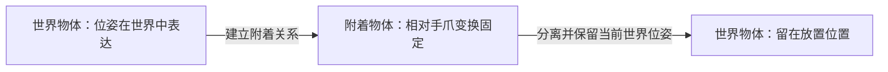

# 规划场景、碰撞与物体附着

本文行数：158行，预期阅读时长：9分钟

**规划场景是机器人对当前几何世界的表示：机器人处于什么构型、障碍在哪里、哪些物体随手移动、哪些接触允许发生。规划结果只对它实际使用的场景成立。**

说明运行中的场景对象、坐标变换、碰撞关系和附着状态。模型与 SRDF 静态配置见[第二章](../02_moveit_setup/README.md)，MTC 如何传递场景见[第五章](../05_mtc_stages/README.md)，接触的物理条件见[第六章](../06_pick_place/README.md)。

## 速记要点

- 物体由 **ID、几何尺寸、位姿、参考坐标系和操作类型** 共同定义；只有位置数值不够。
- RViz marker 是显示对象；碰撞对象是规划数据。画出来不等于规划器会避开它，未画出来也不等于它不在场景中。
- 自碰撞检查机器人与自身，环境碰撞检查机器人与世界；携带物体后也要考虑物体扫过的空间。
- 允许碰撞矩阵（ACM）只改变特定对象对的碰撞判定，不产生接触力，也不证明这种接触物理上合理。
- 附着表示物体相对某个 link 的变换固定；分离表示它恢复为世界物体。两者都是场景关系，不是抓取传感器的读数。
- 场景更新、规划、执行不是同一瞬间；必须区分本地副本、`move_group` 使用的场景和现实环境。

## 1. PlanningScene、接口和监视器分别是什么？

| 对象 | 作用 | 复习时的关键区别 |
| --- | --- | --- |
| `PlanningScene` | 容纳机器人状态、世界几何、附着物体和碰撞规则，可进行状态检查 | 一份场景对象可能只是本地副本 |
| `PlanningSceneInterface` | 向 MoveIt 提交或查询场景对象 | 创建接口不等于自动获得完整、实时的物理世界 |
| `PlanningSceneMonitor` | 接收状态、变换和场景等更新，维护场景 | 数据源、更新时间与同步关系影响结果 |
| RViz 显示或 marker | 将模型、路径和标记画出来 | 可视化与规划数据需要分别确认 |

场景不仅有障碍物，还需要机器人当前状态。同一张桌子，在手臂收起与伸展时会产生不同的碰撞结果。场景与状态检查的关系见 [Humble Planning Scene 教程](https://moveit.picknik.ai/humble/doc/examples/planning_scene/planning_scene_tutorial.html)。

一次状态无碰撞只证明该构型通过当前检查；它不证明前后两点之间的运动段合法。连续路径的离散检查问题已在[第一章](../01_motion_planning/README.md)说明。

## 2. 碰撞物体的几何与坐标怎样读？

### 例子一：基础程序中的 `box1`

[hello_moveit.cpp](../packages/hello_moveit/src/hello_moveit.cpp) 使用 `getPlanningFrame()` 设置物体的 `header.frame_id`，盒子参数如下：

```text
ID = box1
尺寸 (X,Y,Z) = (0.5, 0.1, 0.5) m
中心位置 = (0.2, 0.2, 0.25) m
姿态四元数 (x,y,z,w) = (0,0,0,1)
操作 = ADD
```

**静态推导：** 对这个与参考系轴对齐的盒子，每个方向的占据范围为“中心 ± 尺寸的一半”：

| 方向 | 范围 / m |
| --- | --- |
| X | `[-0.05, 0.45]` |
| Y | `[0.15, 0.25]` |
| Z | `[0.00, 0.50]` |

所以中心 `z=0.25 m` 并不是盒子底部高度；它的底部在此参考系 `z=0` 平面。源码中的末端目标 `y=0.4 m` 虽然在盒子 Y 范围外，也不能推出整台机器人无碰撞，因为肘部、手爪和运动中间段都还没检查。

上述范围依赖盒子姿态为单位旋转；如果盒子旋转，不能仍把这三个区间直接当作它的精确占据形状。

### 物体位姿与子几何位姿

一个 `CollisionObject` 可以包含多个 primitive 或 mesh。按 Humble 消息定义，`object.pose` 描述物体相对 `header.frame_id` 的位姿，各 `primitive_poses` 描述子几何相对物体的位姿。

设规划参考系为 `F`、物体坐标系为 `O`、子几何坐标系为 `G`，记 `⁽ᴬ⁾T_B` 为将 B 系坐标变换到 A 系：

```text
⁽ᶠ⁾T_G = ⁽ᶠ⁾T_O · ⁽ᴼ⁾T_G
```

不要把同一个世界坐标平移同时填进这两个层级，否则可能重复平移。本地基础盒子代码使用 `primitive_poses`，桌面案例使用 `object.pose`；阅读时应沿实际字段及其局部变换解释，而不是把字段名当作可以无条件互换的别名。新增消息应显式设置有效旋转，不能把未初始化的四元数当作单位旋转。

字段含义和 `ADD`、`REMOVE`、`APPEND`、`MOVE` 操作见 [Humble CollisionObject 消息定义](https://raw.githubusercontent.com/moveit/moveit_msgs/humble/msg/CollisionObject.msg)。`MOVE` 不是重新定义几何；`ADD` 对已存在的同 ID 对象有替换语义，ID 因而影响更新的是哪个对象。

### 例子二：相机位置不能直接当作世界位置

**输入（教学示意）：** 相机系 `C` 与世界系 `W` 轴向平行，相机原点在世界系 `(0.3,0,0.5) m`。物体在相机系的位置为 `(0.1,0.2,0.4) m`。

**推导：** 世界位置为 `(0.4,0.2,0.9) m`。若直接把原数值填入 `frame_id="world"` 的消息，障碍会被放在错误位置，相差 `(0.3,0,0.5) m`。

一般情形还要乘旋转矩阵，位姿数据与 TF 应使用对应的测量时刻。运动相机或运动物体不能只凭“有一个最新 TF”就忽略时间。具体变换和时间问题见[位姿变换](../../perception/02_pose_transforms/README.md)与[时间对齐](../../perception/06_time_alignment/README.md)。

## 3. 场景更新完成，究竟指哪里完成？

仓库基础程序调用 `applyCollisionObject(box)`，桌面程序调用 `applyCollisionObjects(objects)`。`apply...` 使用同步服务更新 `move_group` 的场景，返回值应检查；其他场景监视器是否已收到相同更新，仍取决于它们的订阅与同步关系。

异步发布式的添加、删除操作则不能把“消息已发出”直接当作“规划使用的场景已经更新”。方法差异见 [Humble PlanningSceneInterface 接口](https://raw.githubusercontent.com/moveit/moveit2/humble/moveit_ros/planning_interface/planning_scene_interface/include/moveit/planning_scene_interface/planning_scene_interface.h)。

**建议的逻辑顺序：** 构造对象并检查 frame / 单位 → 提交更新 → 检查返回或查询所需对象状态 → 基于更新后的场景规划。附着和分离后也应确认对象位于正确集合，而不是只等固定时长就宣称同步完成。

本地上述程序没有检查 `apply...` 返回值。因此代码能证明它尝试提交对象，不能单独证明添加已经成功。程序中的 “Added table and box” 日志也不是额外的成功证据。

场景快照还会过期：如果物体被人移动、抓取失败或传感器重估了位姿，原路径需要重新判断。场景同步正确也不等于现实环境没有变化。

## 4. 自碰撞、环境碰撞和允许碰撞

| 类型 | 例子 | 核心问题 |
| --- | --- | --- |
| 自碰撞 | 手爪碰到前臂 | 当前构型下机器人自身几何是否相交？ |
| 环境碰撞 | 肘部碰桌子 | 所有相关连杆是否避开世界障碍？ |
| 携物碰撞 | 手臂能通过，但夹着的盒子碰桌沿 | 是否把携带物体纳入运动后的碰撞检查？ |
| 允许的接触对 | 指尖接触待抓物体 | 这一阶段是否确实需要豁免这两个对象之间的检查？ |

SRDF 中的排除项构成静态配置背景；运行时 ACM 可以进一步管理指定对象对。本章关注后者的生命周期。

[完整抓放代码](../packages/hello_moveit/src/pick_and_place.cpp) 在闭合手爪前，对 `object` 与手爪组内所有带碰撞几何的 link 调用 `allowCollisions(..., true)`。它不是仅按名字“允许指尖接触”，实际豁免范围由获取到的 link 列表决定；范围过宽可能连手掌穿过物体也不再被这一对检查拒绝。

代码在释放阶段将相同对象对改回 `false`。这是任务内部的规则切换，不意味着所有场景副本在构建 Stage 时就立即改变。MTC 如何将修改留在各候选场景中，见第五章。

## 5. 附着与分离：改变的是物体所属关系



在附着期间，设世界为 `W`、手爪 link 为 `H`、物体为 `O`：

```text
⁽ᵂ⁾T_O(t) = ⁽ᵂ⁾T_H(t) · ⁽ᴴ⁾T_O
```

`⁽ᴴ⁾T_O` 在理想刚性附着假设下不随时间变化。若物体在手中滑动，这个假设就失效，需要实际观察或估计更新；规划器不会因为执行了 `attachObject()` 就知道滑落发生。

### 例子三：一个被携带的盒子应该跟着谁？

**输入（教学示意）：** 两坐标系轴向平行，手爪世界位置为 `(0.4,0,0.3) m`，物体相对手爪偏移 `(0,0,0.1) m`。

**结果：** 物体世界位置为 `(0.4,0,0.4) m`。手爪平移到 `(0.6,0,0.3) m` 后，附着物体变为 `(0.6,0,0.4) m`；若在此处分离且世界物体没有其他运动，它就留在该位置，不再随手爪移动。

分离不是删除。若直接把对象从场景中移除，后续规划就可能穿过现实中仍然存在的物体。反之，附着后仍遗留同一物体的独立世界副本，也会造成“旧位置还有一个障碍”的错误表示。

`touch_links` 等附着相关设置用于声明允许与附着物体接触的 link；它们与 ACM 一样属于碰撞规则，不会给仿真器增加摩擦、质量或约束力。

## 6. 桌面案例中的接触豁免与目标区域

[desktop_pick_place.cpp](../packages/mtc_week3_demo/src/desktop_pick_place.cpp) 在 `attach object` 后允许 `box` 与 `table` 碰撞，然后抬升、搬运；放置分离后恢复该对象对的碰撞检查。

**静态结论：** 豁免贯穿了这两次修改之间的阶段，并不只覆盖刚离开桌面的瞬间。因此这段搬运不能仅凭规划成功就证明盒子全程未穿过桌面；还要检查携带路径或收紧接触规则的适用阶段。恢复检查也不会回溯验证此前的运动。

同一文件定义了 `target_area`，但把 `collision_objects.push_back(target)` 注释掉了。它因此没有通过这段代码提交为碰撞对象，也没有因此自动成为成功判据或可视化 marker。

目标区域是任务语义，桌子是物理障碍，两者不必用相同消息表示。若只是希望在 RViz 标出允许放置范围，可以用显示标记，同时用明确的几何条件评价结果；不要为显示目标而无意增加一个阻挡放置的实体障碍。

## 7. 场景问题速查

| 现象 | 检查方向 |
| --- | --- |
| RViz 里有物体，规划仍穿过 | 是 marker 还是碰撞对象？规划使用的场景是否收到更新？ |
| 物体整体偏移或悬空 | frame、物体与子几何位姿、中心与底面、单位 |
| 手爪闭合阶段失败 | 预期接触对是否允许，是否误碰了桌子或其他 link |
| 抓起后路径忽略了物体尺寸 | 是否建立附着关系，实际携带几何是否正确 |
| 放下后物体继续跟手走 | 是否分离，后续反馈是否又覆盖了对象状态 |
| 机器人穿过不该穿的地方 | ACM、touch links、SRDF 排除项是否过宽 |
| 更新场景后旧计划仍被执行 | 计划生成时刻、当前状态与当前对象位姿 |

## 源码与参考

本页几何范围、变换例子和阶段顺序来自静态推导与本地源码阅读，未调用运行中的规划场景服务，未进行碰撞检测或 ROS 构建。源文件中未检查的返回值与接触豁免范围已明确标注，不把场景配置意图等同于实际同步成功。

[上一章：运动请求与反馈](../03_move_group_interface/README.md) · [下一章：MTC 多阶段规划](../05_mtc_stages/README.md) · [返回 MoveIt 目录](../README.md)
