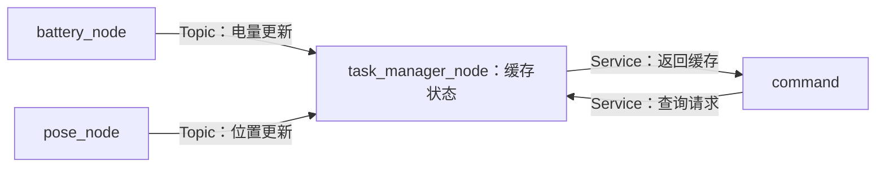

# 01：节点与通信接口

本文行数：91行，预期阅读时长：4分钟

**ROS 2 将机器人程序拆成各司其职的节点，再用 Topic、Service、Action 协作。接口不仅要对上类型，还要约定数据的单位、坐标系和时间。** 本系列按 Humble 整理，直接阅读例子即可复习。

## 速记：程序与节点怎样对应

| 名称 | 含义 | 本仓库例子 |
| --- | --- | --- |
| Workspace | 组织源码包、构建结果和环境的工作空间 | 通常有 `src/`、`build/`、`install/`、`log/` |
| Package | 声明源码、资源和依赖的包 | `ros2_comm_demo`，由 `package.xml` 描述 |
| Executable | 启动后成为进程的程序 | `command_node` |
| Node | ROS 图中承担具体职责的节点 | 程序 `command_node` 内创建的节点叫 `command` |

一个包可以生成多个程序，一个进程也可以创建多个节点。节点是功能组织单位，不等于操作系统进程；Lesson 2 就把两个节点放在同一进程。

## 例子 1：一条电量消息经过了什么

Lesson 1 有四个节点。下面先看其中三个节点的状态链：



**输入（源码节选）：** 电量节点创建一个发布者，并每隔约 1 s 尝试发布一次消息。

```cpp
publisher_ = this->create_publisher<std_msgs::msg::Int32>("battery_level", 10);
```

这一行从左到右读：消息类型是 `Int32`，话题相对名是 `battery_level`，`10` 设置 Keep Last 缓存深度，**不是 10 Hz**。发布频率由另一处定时器代码决定。

**结果（源码推导）：** 电量初值 100，每次发布前减 1，所以发布序列为 `99、98、97……0、0`。任务节点收到消息后执行订阅回调，把 `msg->data` 保存到 `current_battery_`。晚启动的订阅者不一定收到 99。

**解释：** 回调是“收到消息等事件后，由执行器调用的函数”。发布者无需直接调用任务节点的函数，也无需知道有几个订阅者。同一话题可以有多个发布者和订阅者，因此数据来源也要约定清楚。

## 例子 2：什么时候用哪种通信

| 需求 | 选择 | 一次交互包含什么 |
| --- | --- | --- |
| 不断更新关节角、电量或图像 | Topic | 一条条消息，不为每条消息等待业务响应 |
| 查询当前缓存状态 | Service | Request → Response |
| 执行较长时间的运动任务 | Action | Goal → 接受或拒绝 → Feedback → Result |

接口文件分别使用 `.msg`、`.srv`、`.action`。Service 用一个 `---` 分开请求和响应；Action 用两个 `---` 分开目标、结果、反馈。定义之后由构建工具生成 C++ / Python 类型，不是手写生成头文件。[Humble 接口文档](https://raw.githubusercontent.com/ros2/ros2_documentation/humble/source/Concepts/Basic/About-Interfaces.rst)

**Service 的教学时序：** 任务节点在 `t=1.0 s` 缓存电量 99；假设下一条更新尚未收到，客户端在 `t=1.8 s` 查询，就仍得到 99。这是有效响应，但不是在 `1.8 s` 重新测量了一次电量。

Lesson 1 的 `async_send_request()` 表示先发出请求，稍后处理响应；返回时不代表响应已经到达。Future 可以理解为“将来结果的占位对象”。响应处理也需要执行器得到运行机会，不能在回调里一直阻塞等待而占住它所需的线程。

## 例子 3：Action 有反馈，为什么还不能说成功

**教学目标：** 在 `map` 平面坐标系中到达 `(5, 3) m`。

| 客户端看到的事件 | 能说明什么 |
| --- | --- |
| 目标被接受 | 服务端愿意处理；机器人还可能没有运动 |
| 反馈“剩余 1 m” | 一次进度更新；还没有最终结果 |
| 发送取消请求 | 客户端希望停止；仍需服务端接受、停止执行并报告结果 |
| 收到 `SUCCEEDED` / `ABORTED` / `CANCELED` | 本次已接受任务的终止状态；成功标准由服务端实现 |

本仓库默认链路有两个独立问题：客户端找 `/Navigation`，服务端叫 `/navigation`；即使修正名字，`pose_node` 也只生成 `y=0` 的位置。

**结果（源码推导）：** 对目标 `(5, 3)`，距离为 $\sqrt{(5-x)^2+3^2}\geq3\ \mathrm{m}$，无法满足代码中小于 `0.1 m` 的成功条件。它还没有发送任何机器人运动指令，所以反馈日志不能证明机器人被控制了。

## 数据类型之外，还必须说明什么

Lesson 1 的位置类型是 `geometry_msgs/msg/PointStamped`：

| 字段 | 本例含义 | 易错点 |
| --- | --- | --- |
| `point.x/y/z` | `map` 中的位置，单位按案例约定为 m | `Point` 没有姿态；名字叫 `robot_pose` 也不会增加朝向 |
| `header.frame_id` | 坐标系名 `map` | 写标签不会创建 TF 或进行坐标转换 |
| `header.stamp` | 发布节点填写的节点时钟时间 | 不能一概当成传感器真实采样时间 |

同样，`Int32` 只约束整数类型，不能自动保证数值是合法电量百分比。**类型正确、通信成功、业务正确，是三个不同层面的判断。**

## 按需查阅

- [源码与通信图](../examples/communication/README.md#4-通信关系) · [接口定义与生成代码](../examples/communication/ros2_interfaces_notes.md#interfaces)
- [详细通信解释](../examples/communication/ros2_interfaces_notes.md#topics)：保留完整代码拆解，需要时再读。

本章源码结论为静态分析，时间线为教学示意；自定义 `robot_interfaces` 的来源仍待补齐，未完成整套运行验证。

[返回目录](../README.md) · [下一章：参数与启动](../02_parameters_launch/README.md)
