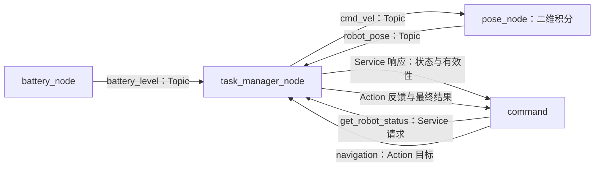

# Lesson 1：ROS 2 四节点通信与二维任务模拟

本文行数：85行，预期阅读时长：4分钟

**用一个能到达目标的二维点模拟，串起 Topic 状态更新、Service 状态查询、Action 目标与反馈。** 这是通信教学，不含真实导航、避障或执行器动力学。

## 速记与文件入口

| 节点 / 包 | 职责 | 实现 |
| --- | --- | --- |
| `battery_node` | 发布电量；默认保持 100，可配置递减 | [电量节点](ros2_comm_demo/src/battery_node.cpp) |
| `pose_node` | 根据速度指令积分二维位置，发布带时间戳的位置 | [位置节点](ros2_comm_demo/src/pose_node.cpp) |
| `task_manager_node` | 缓存状态、提供查询、按目标计算速度与反馈 | [任务节点](ros2_comm_demo/src/task_manager_node.cpp) |
| `command` | 等待服务和有效状态，查询后发送一次目标 | [客户端](ros2_comm_demo/src/command_node.cpp) |
| `robot_interfaces` | 状态查询与导航通信协议 | [Service](robot_interfaces/srv/GetRobotStatus.srv) · [Action](robot_interfaces/action/Navigation.action) |

源码放在 `ros2_comm_demo/src/`；公共参数与时钟辅助放在 `include/ros2_comm_demo/common.hpp`；启动文件、接口定义和自动检查分别独立保存。基础概念见 [ROS 2 五章教程](../../README.md)，具体实现见[源码阅读笔记](ros2_interfaces_notes.md)。

## 通信关系

默认 namespace 为 `lesson1`，图中通信名均在 `/lesson1/` 下。



## 例子：从原点到 `(1.0, 0.5) m`

**条件：** 两维位置均在右手坐标系 `map` 下，z 恒为 0；速度 `vx/vy` 表示 map 轴方向的 m/s。默认初始位置为原点，电量 100，目标速度模长上限 `0.5 m/s`，到达阈值 `0.03 m`。

**执行过程：** 位置与电量就绪 → 客户端查询得到 `valid=true` → Action 接受目标 → 任务节点不断发速度 → 位置节点更新位置 → 距离达到阈值后发布零速度并返回 `arrived`。

**结果解释：** 初始距离为 `sqrt(1² + 0.5²) ≈ 1.118 m`。控制量按位置误差计算并限制速度，接近目标时减速；成功不要求坐标严格等于目标，而是最终距离不大于阈值。具体运行证据见[实现检查记录](verification.md)。

## 失败时怎样结束

| 情况 | 当前行为 |
| --- | --- |
| 没有有效状态、坐标系不符或位置时间戳过旧 | 不接受新任务；已有任务状态过期时中止 |
| NaN / Inf 目标，或目标超出默认 `[-5, 5] m` 的 x/y 范围 | 拒绝目标 |
| 已有任务时又来一个目标 | 拒绝新目标，不抢占原任务 |
| 客户端取消 | 定时器检查取消状态，发布零速度，返回 `CANCELED` |
| 电量低于 20、状态超时、任务超时 | 发布零速度并返回 `ABORTED`，说明原因 |
| 任务节点意外停止发布速度 | 位置节点最多继续使用最后指令 0.3 s，然后停止积分运动 |
| 服务端晚启动 | 客户端在启动等待期限内重试查询，直到状态有效 |

客户端发出目标后不自动重发；超过结果等待期限会尝试取消已知目标，并提示结果未确认，不能将通信超时误报为任务取消成功。

## 需要运行时查

依赖 ROS 2 Humble、C++17、colcon 及标准消息/Action 包。接口源码已在本课内，无需另一私人项目提供。以下从仓库根目录执行：

```bash
source /opt/ros/humble/setup.bash
colcon build --base-paths src/ros2/examples/communication --packages-up-to ros2_comm_demo
source install/setup.bash
ros2 launch ros2_comm_demo launch.py
```

这是墙钟驱动的独立教学模拟，使用 `use_sim_time=false`，不接 MuJoCo `/clock`。应用参数在启动时确定并设为只读；运行中不支持改值，修改后重启节点。

需要自行发送目标时，用 `start_command:=false` 启动，避免默认客户端抢先发目标。下列命令供另外一个已加载相同环境的终端使用：

```bash
ros2 service call /lesson1/get_robot_status robot_interfaces/srv/GetRobotStatus '{}'
ros2 action send_goal /lesson1/navigation robot_interfaces/action/Navigation \
  '{target_x: 1.0, target_y: 0.5}' --feedback
```

[launch 文件](ros2_comm_demo/launch/launch.py)支持 `namespace`、`start_command`、`target_x`、`target_y`。所有通信名使用相对名称；修改 namespace 后查询命令也需相应修改，`frame_id` 默认仍为 `map`。

## 模型与接口

Service 返回 `PointStamped`、状态有效性和状态年龄，Action 返回导航反馈与终止结果。

位置节点只是平面运动学积分，不模拟质量、碰撞或电机。单线程执行器的定时器回调逐步推进任务，不使用 `detach()`。取消和停止有调度与通信延迟，不属于真机急停设计。

[返回总体目录](../../../README.md) · [实现细节](ros2_interfaces_notes.md) · [实现检查记录](verification.md)
