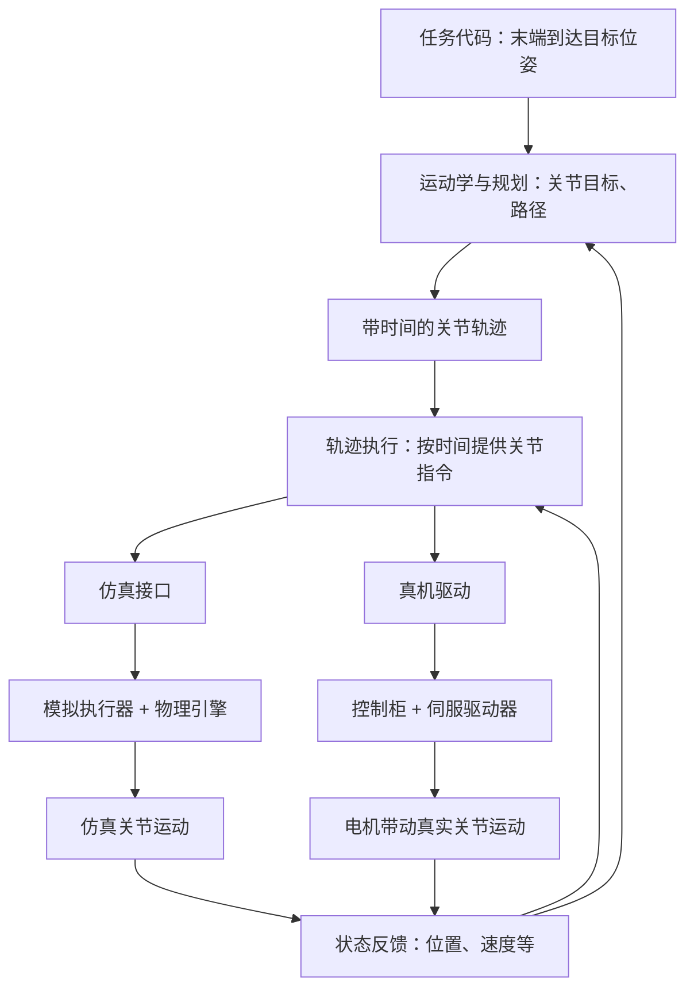

# 1：导读：代码怎样让仿真机械臂与真机运动

本文行数：191行，预期阅读时长：10分钟

**控制机械臂的基本流程是：给出目标 → 生成运动指令 → 执行器产生力 → 关节运动 → 读取实际状态，再继续调整。仿真用物理引擎计算运动，真机用电机完成运动；上层可以使用相同接口。**

本章先建立完整印象，再进入模型、状态与控制输入等章节。下文数值是教学示意，代码与配置结论来自仓库静态检查；不代表本次运行了仿真或接入了真机。

## 1. 速记要点

- 任务代码提出“去哪儿、做什么”；规划生成可执行的路径和轨迹；控制负责跟踪目标。
- 带时间的关节轨迹规定“各关节在什么时候应该到哪里”，并不保证实际关节准时到达。
- `ctrl` 是 MuJoCo 执行器输入，含义取决于模型；`qpos` 是状态。写入目标与直接修改状态是两件事。
- MoveIt 可以把同样形式的轨迹交给仿真或真机，但需要适配执行接口、关节映射、时间和反馈。
- RViz 显示运动、假硬件执行成功、物理仿真跟踪成功、真机运动成功，是不同层次的证据。

## 2. 从任务目标到关节运动

假设任务是“让末端到达基坐标系下的某个位姿”，其中位置以 m 表示，姿态也必须明确表达方式和参考系。运动学求解把末端目标转换成关节目标，规划考虑路径与约束，执行环节再按照时间下发指令。



这是功能划分，不要求每一层都是独立进程。MoveIt 可以负责规划，厂商控制柜可以负责底层伺服；简单 MuJoCo 程序也可以完全不经过 ROS。状态反馈用于获得规划起点和监控执行，不表示每收到一次反馈就自动重新规划。

## 3. “带时间的关节轨迹”具体是什么

### 例子：同一条路径，可以用不同速度走完

假设只有两个转动关节，顺序固定为 `joint_names = [joint1, joint2]`，每个位置向量都是 `[q1, q2]`，单位 rad，角度相对各关节定义的零位。下面是简化轨迹中的三个点：

| 从轨迹开始经过的时间 / s | joint1 目标角 / rad | joint2 目标角 / rad |
| --- | --- | --- |
| 0.0 | 0.0 | 0.0 |
| 1.0 | 0.5 | -0.25 |
| 2.0 | 1.0 | -0.5 |

只有位置序列时，知道的是“经过哪些关节构型”；加上时间后，才知道“何时应该到达这些构型”。在 ROS 的 `JointTrajectory` 中，`joint_names` 定义向量顺序，`points` 保存各点；每个点的 `time_from_start` 是**相对整条轨迹起点的累计时长**，不是相邻点的间隔，也不是电脑当前时间。

例如最后一行可表示为下面的消息字段片段；这是结构示意，不是完整的 Action 请求：

```yaml
positions: [1.0, -0.5]
time_from_start:
  sec: 2
  nanosec: 0
```

轨迹还可按接口要求包含速度 `velocities`（rad/s）、加速度 `accelerations`（rad/s²）等信息。点的相对时间应递增；轨迹何时开始还要结合消息起始时间和控制器规则理解。`JointTrajectory.header.stamp` 非零时可表达计划起始时刻；零时间戳的立即启动语义要以接收端实现为准。

### 结果与解释：两个轨迹点之间怎样运动

假设本例只给位置并采用线性插值，在开始后 `0.5 s`，目标向量为 `[0.25, -0.125] rad`；在 `1.5 s`，目标为 `[0.75, -0.375] rad`。控制器会在两个已知点之间计算当前目标，并不是等到第 1 秒才突然发送第二行。

若轨迹控制器按 `100 Hz` 更新，名义上每 `0.01 s` 算一次目标。开始后 `0.51 s`，本例目标就是 `[0.255, -0.1275] rad`。这是目标的采样频率，不是必须把所有这些采样点都提前塞进轨迹消息，也不是画面刷新频率。

若保持位置路径不变，把整条运动的时长从 `2 s` 拉长到 `4 s`，即各时间都乘 2，那么对应路径位置处的速度变为原来的一半；对同一条光滑时间曲线，加速度变为原来的四分之一。已有速度和加速度字段也必须相应调整，不能只改时间戳。正式规划还需要满足机器人速度、加速度等限制；上面的线性例子在起停处不光滑，只用于解释时间含义。

### 目标时间不等于实际到达时间

在 `1.0 s`，目标可能是 `[0.5, -0.25] rad`，反馈却是 `[0.47, -0.23] rad`，那么“目标减实际”的跟踪误差为 `[0.03, -0.02] rad`。惯性、负载、控制增益、限幅和通信延迟都可能造成误差。执行端根据配置的路径容差、终点容差和允许时间判断是否成功，不能只因已经发送轨迹或时间走完就宣称到位。

纯 MuJoCo 循环通常按 `data.time` 采样轨迹，仿真可能快于或慢于现实时间。ROS 仿真链路需要让轨迹相关节点与仿真时钟保持一致；真机则需要满足驱动规定的通信和控制节拍。仓库旧轨迹脚本使用 `time.time()` 生成目标，这一点要与控制器、物理步进和显示的时钟区分开。

## 4. 写入 MuJoCo 目标后，机械臂为什么会动

[关节轨迹跟踪示例](../mujoco/examples/state_and_control/joint_space_trajectory_tracking_demo.py)中的核心语句是：

```python
self.data.ctrl[:7] = self.q_des
```

该示例把前 7 项执行器输入当作 Panda 机械臂的关节位置目标，`q_des` 是对应顺序的 7 维角度向量，单位 rad。这依赖外部模型的执行器类型、传动比与排列，并不是任意模型都能直接使用的切片规则。

### 例子：当前位置 0.2 rad，目标 0.5 rad

对一个单位传动比的简化位置伺服关节，执行器可以按 PD 关系产生力矩：

$$
\tau = K_p(q_{\mathrm{des}}-q)-K_d\dot q
$$

这里 `q` 为关节角（rad），`q_dot` 为关节角速度（rad/s），`tau` 为关节力矩（N·m）；`Kp` 单位为 N·m/rad，`Kd` 单位为 N·m·s/rad。若 `Kp=100`、当前速度为零，那么这个时刻产生 `100 × (0.5 - 0.2) = 30 N·m` 的力矩。此计算未考虑力矩限幅等因素，也不意味着所有 position actuator 默认带有同样的阻尼项。

随后 `mujoco.mj_step(model, data)` 根据力矩、质量、惯量、重力、接触等计算新的速度和位置。一个仿真步后，关节通常只是向目标靠近一点，不会立刻变成 `0.5 rad`，也不保证最终恰好达到目标。

**结果与解释：** 连续重复“给目标 → 算力 → 积分更新状态”，形成运动；viewer 把状态画出来。[末端控制示例](../../kinematics/examples/model_alignment/control_ee_with_pinocchio.py)中可以看到读取当前关节角、求解 IK、写入 `ctrl`、调用 `mj_step`、更新画面的顺序。该脚本在缺少足够执行器时还有直接写 `qpos` 的兜底分支，需要另行区分。

`ctrl` 的含义由 actuator 配置决定：位置型接收位置目标，速度型接收速度目标，motor 的输入还要经过传动映射才能得到关节力矩。单位传动比等条件不满足时，不能直接把 `ctrl` 数值当作关节角或关节力矩。细节见[控制输入](../04_control_inputs/README.md)。

## 5. 画面动了，是否就验证了控制

| 方式 | 实际发生了什么 | 可以说明什么 |
| --- | --- | --- |
| 直接修改 `qpos`，再更新计算和画面 | 程序直接指定状态 | 姿态与运动学演示 |
| 假硬件执行 | 软件模拟命令和状态接口，可能直接把命令映射成状态 | 规划、通信、执行流程是否联通 |
| 写 `ctrl` 并调用 `mj_step` | 执行器产生力，物理引擎计算运动 | 当前模型下的动力学响应 |
| RViz 播放规划轨迹 | 显示预先计算的构型序列 | 规划结果的可视化，不代表已经执行 |

仓库 [Panda 硬件配置](../../manipulation/packages/panda_moveit_config/config/panda.ros2_control.xacro)使用 `mock_components/GenericSystem`，属于假硬件。在这套配置下，RViz 中机械臂运动不表示背后有 MuJoCo 在计算惯性、重力和接触。RViz 本身主要负责显示。

## 6. MoveIt 的控制链：仿真与真机哪些相同

**当仿真与真机都采用相同的 `ros2_control` 轨迹控制方案时，上层可以保留相同的规划与执行流程，底层通过不同的硬件接口实现连接各自后端：**

```text
任务代码 / MTC：提出目标、组织任务
    ↓
MoveIt
    ├─ 规划：求解路径、进行时间参数化 → 带时间的关节轨迹
    └─ 执行管理：发送轨迹、接收反馈与结果
             ↓ 通过 FollowJointTrajectory Action 通信
JointTrajectoryController：按时间采样轨迹，输出关节指令
    ↓
ros2_control 硬件接口：写出命令、读取状态
    ├─ 假硬件：模拟命令与状态
    ├─ 仿真适配：MuJoCo 等仿真器
    └─ 真机驱动：厂商 SDK/协议 → 控制柜 → 电机
```

图中的“规划”和“执行管理”是 **MoveIt 内部的两类职责**，合起来就是下文所说的 MoveIt 规划与执行组件。`FollowJointTrajectory` Action 则是 MoveIt 与轨迹控制器之间的通信接口，约定轨迹请求、反馈和结果；图中把它标在连接两者的箭头上。

### 各层分别负责什么

| 层次 | 职责与输出 |
| --- | --- |
| 任务代码 / MTC | 提出目标、组织接近与抓取等阶段；MTC 是可选的任务编排工具 |
| MoveIt：规划 | 求解路径、进行时间参数化，生成带时间的关节轨迹 |
| MoveIt：执行管理 | 通过 `FollowJointTrajectory` 把轨迹交给对应控制器，接收执行反馈与结果 |
| `JointTrajectoryController` | 随时间采样或插值轨迹，输出关节指令，按配置监控执行误差 |
| `ros2_control` 硬件接口 | 写出命令、读取状态；后端可以是 mock、物理仿真或真机 |

### 例子：规划与执行调用分别交给谁

下面是调用关系示意，省略了错误处理；只有规划成功后才应执行：

```cpp
move_group_interface.plan(plan);     // 请求 MoveIt 规划，得到轨迹
move_group_interface.execute(plan);  // 请求 MoveIt 执行已有规划
```

**结果与解释：** `execute(plan)` 触发 MoveIt 的轨迹下发与结果监控。收到轨迹后，`JointTrajectoryController` 计算每个控制时刻的关节指令；底层执行器或真机伺服再让关节跟随目标。这三个环节分别承担执行管理、轨迹跟踪和底层驱动职责。

仓库的 [MoveIt 执行配置](../../manipulation/packages/panda_moveit_config/config/moveit_controllers.yaml)把机械臂轨迹交给 `panda_arm_controller/follow_joint_trajectory`；[轨迹控制器配置](../../manipulation/packages/panda_moveit_config/config/ros2_controllers.yaml)使用 `position` 命令接口，配置更新频率为 `100 Hz`。这是配置值，不是本次实测频率。

`ros2_control` 典型更新循环是“读取状态 → 更新控制器 → 写出命令”。在这里，轨迹控制器向下提供位置目标，底层执行器或真机伺服负责让关节跟随目标；不能把这个位置接口的轨迹控制器直接理解成电机力矩 PID。状态还可经 `joint_state_broadcaster` 发布为 `/joint_states`，供 MoveIt 获取当前构型，并经 `robot_state_publisher` 计算 TF 供 RViz 显示。

### 仓库里在哪里用过 FollowJointTrajectory

**当前仓库通过 MoveIt 间接使用了 `FollowJointTrajectory`，没有找到手写该 Action 服务端或直接客户端的代码。** 任务代码调用执行方法，MoveIt 内部的客户端发送轨迹，现成的 `JointTrajectoryController` 提供服务端。

| 证据位置 | 对应内容 | 说明 |
| --- | --- | --- |
| [hello_moveit.cpp](../../manipulation/packages/hello_moveit/src/hello_moveit.cpp) | `move_group_interface.execute(plan)` | 任务代码发起执行，不需要自己构造 Action 请求 |
| [moveit_controllers.yaml](../../manipulation/packages/panda_moveit_config/config/moveit_controllers.yaml) | `type: FollowJointTrajectory`、`action_ns: follow_joint_trajectory` | 指定 MoveIt 使用的执行接口，机械臂端点为 `/panda_arm_controller/follow_joint_trajectory` |
| [ros2_controllers.yaml](../../manipulation/packages/panda_moveit_config/config/ros2_controllers.yaml) | `joint_trajectory_controller/JointTrajectoryController` | 加载现成的控制器，由它提供该 Action 服务端 |
| [历史运行记录](../../manipulation/03_move_group_interface/history.md) | `sending trajectory to panda_arm_controller`、`Goal request accepted!`、`successfully finished` | 保存了发送轨迹、接受目标和执行成功的历史日志，不是本次重新运行的结果 |

**结果与解释：** 这里写的是上层执行调用，配置指定接口，底层通信和轨迹执行由已有组件完成。结合第 5 节的假硬件配置，不能把上述成功日志当作 MuJoCo 动力学跟踪验证。

第 4 节的 MuJoCo Python 示例走的是“自定义插值函数 → `q_des` → `data.ctrl` → MuJoCo 仿真”，没有接入 `FollowJointTrajectory`；要接收 MoveIt 的轨迹，还需对应的桥接或控制器集成。

### 为什么不能说所有 MoveIt 系统都必须经过 JointTrajectoryController

有些厂商驱动或自定义仿真桥接节点直接提供 `FollowJointTrajectory` Action 服务端，自己处理轨迹、插值或将整条轨迹交给控制柜，便不必使用 `ros2_control` 的 `JointTrajectoryController`：

```text
任务代码 → MoveIt（规划与执行管理）
                    ↓ 通过 FollowJointTrajectory Action 通信
               厂商驱动/仿真桥接
```

因此，**MoveIt 上层依赖的是兼容的执行接口，具体由谁实现接口可以不同。** 仿真和真机使用同一个 `JointTrajectoryController` 是常见方案，不是 MoveIt 的强制要求；其他执行适配方式还可能使用不同接口。单独运行 MuJoCo Python 脚本也不会自动接上这条 ROS 链路。

[返回仿真目录](../README.md) · [下一章：机器人模型](../01_robot_models/README.md)
