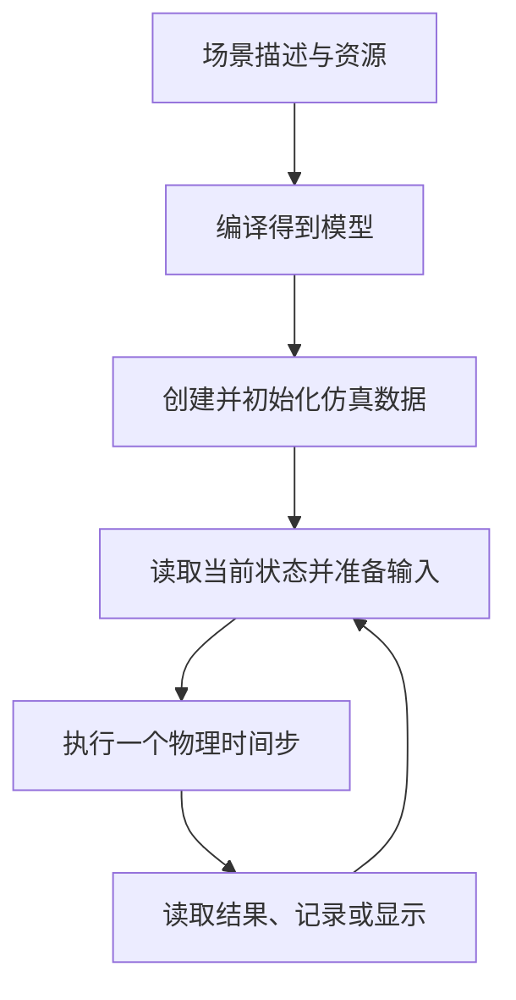

# 01：一次 MuJoCo 仿真怎样发生

本文行数：99行，预期阅读时长：6分钟

## 开发者理解：把一个物理系统交给计算机推进

假设你想观察“给杆一个力矩后，它怎样转动”。你需要描述杆有多长、多重、绕哪里转，再设置初始角度、速度和输入。MuJoCo 根据这些信息计算后续运动；程序可以把结果画出来、保存下来，也可以根据结果计算下一次输入。

**模型描述系统，状态描述它此刻怎样，输入描述你施加什么，步进计算它接下来怎样。** 先把这四件事分清，再看代码就容易找到每句语句的职责。

| 需要的信息 | 单摆中的具体含义 | 谁提供或计算 |
| --- | --- | --- |
| 模型 | 杆、关节轴、质量、重力、执行器与步长 | MJCF 文件及编译器 |
| 当前状态 | 关节角 `0.5 rad`，初速度 `0 rad/s` | 初始化或上一步结果 |
| 输入 | 本例 motor 命令，对应 `0.2 N·m` | 用户程序或控制器 |
| 新状态 | 下一时刻的角度和速度 | MuJoCo 计算 |
| 观测 | 杆尖位置、关节状态、图像等 | 计算结果及渲染接口 |

## 一段程序的主线



模型通常只加载一次。循环内反复发生的是“根据状态准备输入 → 步进 → 获得新状态”。窗口只是结果的一种展示方式；无窗口程序也能完成同样的物理计算。

## 例子：0.2 秒之后杆转到了哪里

使用[仓库单摆](../mujoco/models/pendulum.xml)：杆长 `0.5 m`、质量 `1 kg`，关节位于世界坐标 `(0,0,1) m`，绕局部 `+y` 轴转动，零位竖直向下。初始角 `0.5 rad`、速度为零；重力向下，固定步长 `0.002 s`。

本例每一步都给同一个 motor 命令 `0.2`；单位传动比使其对应关节力矩 `0.2 N·m`。循环只示意核心操作，模型加载与状态设置见后续章节：

```python
for _ in range(100):
    data.actuator("hinge_motor").ctrl[0] = 0.2
    mujoco.mj_step(model, data)
```

**实际结果：** 在 MuJoCo 3.13.0 中，100 步后仿真时间为约 `0.2 s`，关节角约 `0.305970 rad`，小于初始的 `0.5 rad`。原 3.8.1 结果相同，见[验证记录](../mujoco/verification.md)。

正力矩为什么没有让角度增大？因为输入力矩只是总受力的一部分。这个姿态下重力使杆朝零位回落，结果由重力、驱动、阻尼和惯性共同决定。理解输入需要结合模型与当前状态。

本模型还有一个不接触其他物体的自由球；它随重力下落，但不影响这个单摆。后续用它解释自由关节的状态维度。

## 三种“让机器人动起来”的含义

| 程序做了什么 | 实际发生了什么 | 适合回答什么问题 |
| --- | --- | --- |
| 改 `qpos` 并更新计算结果 | 直接指定构型 | 这个角度对应的末端位置在哪里 |
| 写 `ctrl` 并连续步进 | 执行器产生力，物理引擎推进状态 | 这个模型能否在输入作用下达到目标 |
| 改 Viewer 的相机 | 改变观察视角 | 怎样看清场景；机器人本身没有因此运动 |

“希望关节到 `0.5 rad`”是一项任务。可以用位置执行器接收目标，也可以自己计算驱动力矩；选择取决于你想模拟的执行接口。MuJoCo 不会仅凭一个末端位置目标自动完成 IK、路径规划和反馈控制。

## MoveIt、RViz、Gazebo 与 MuJoCo：分工与连接

**MoveIt 规划怎样运动，RViz 显示数据，Gazebo 与 MuJoCo 都能用于物理仿真。** 它们处在不同层次，需要按任务选择和连接。

| 工具 | 定位 | 典型输入与结果 |
| --- | --- | --- |
| [MoveIt](https://moveit.ai/documentation/concepts/) | 以运动规划为核心的机器人操作框架，集成逆运动学、碰撞检测与执行管理 | 根据机器人模型、当前状态、目标和障碍物生成路径与轨迹，再通过执行接口交给控制器 |
| [RViz](https://github.com/ros2/rviz) | ROS 的三维可视化与交互工具 | 将关节状态、TF、点云、地图和规划轨迹等数据画出来；插件可提供设置目标、发起规划等交互 |
| [Gazebo](https://gazebosim.org/libs/sim/) | 把世界、传感器、插件、通信等组织成一套仿真平台 | 根据世界与机器人模型、控制输入，计算模拟运动并生成模拟传感器数据 |
| [MuJoCo](https://mujoco.readthedocs.io/en/3.13.0/overview.html) | 通用物理引擎，擅长关节系统与接触动力学，也提供 Viewer 和渲染接口 | 根据模型、当前状态与执行器等输入，计算动力学响应并推进状态，供程序读取或显示 |

Gazebo 的物理计算由其接入的物理引擎完成(Gazebo Classic 默认用 ODE，新版 Gazebo Sim 默认用 DART。但是都可以改)；MuJoCo 自身就是物理引擎(MuJoCo、DART、ODE、Bullet 都是物理引擎，各自实现动力学计算。)，可直接嵌入 Python 仿真循环。两者都能承担动力学仿真，但场景描述、模型和控制接口不同，切换时需要适配。

例如，“让机械臂绕过障碍物到达目标位姿”可以按下面的职责分工实现；这是连接方式示意：

1. **MoveIt** 根据当前构型、目标与规划场景，生成避障轨迹。
2. **控制器与仿真适配** 按轨迹时间提供关节指令，转换为 MuJoCo 或 Gazebo 对应执行器的输入，并返回仿真反馈状态。
3. **MuJoCo 或 Gazebo** 根据驱动、惯性、重力和接触等计算模拟运动；实际状态可能偏离目标轨迹。
4. **RViz** 显示规划轨迹与反馈姿态，帮助比较“计划怎样动”和“模拟中怎样动”。

RViz 本身不进行动力学仿真。在其中看到机械臂运动，可能只是播放规划轨迹或显示假硬件反馈；点击 MoveIt 插件的“规划／执行”，实际计算与执行也由背后的组件完成。规划时的碰撞检测用于判断构型或路径是否碰撞，接触动力学则计算碰撞后怎样受力、怎样运动。

**仓库中已做的动力学实践使用 MuJoCo。** [MoveIt 示例](../../manipulation/packages/hello_moveit/src/hello_moveit.cpp)搭配的[硬件配置](../../manipulation/packages/panda_moveit_config/config/panda.ros2_control.xacro)使用 `mock_components/GenericSystem` 假硬件；MuJoCo 的[轨迹跟踪示例](../mujoco/examples/state_and_control/joint_space_trajectory_tracking_demo.py)则自行计算目标、写入 `ctrl` 并推进物理状态。这两条链路目前分开，不能把 MoveIt 示例中的运动当作 Gazebo 或 MuJoCo 动力学执行结果。

ROS 为这些组件提供通信接口。MoveIt 生成轨迹后，需要执行适配把轨迹变成仿真程序能理解的关节目标，同时返回实际状态；打开 MuJoCo 和 RViz 两个窗口，并不会自动形成这条连接。纯 MuJoCo Python 程序也能独立完成仿真，不要求接入 ROS、MoveIt 或 Gazebo。

接入真机时，由真机驱动把命令交给控制柜和电机，并读取真实状态。若执行接口兼容，上层规划流程可以复用，但仍需核对关节顺序、单位、时间和控制限制。轨迹控制与接口细节见[控制链专题](../mujoco/control_flow_reference.md)。

## 速记与查阅

- 先检查模型、初态和输入含义，再解释运动结果。
- 创建数据、更新当前计算结果、推进时间、刷新画面是不同操作。
- 仿真时间由物理步进推进，电脑实际耗时由计算和显示速度决定。
- 阅读程序时先找模型入口、初始化、输入赋值和 `mj_step`，再看记录与显示。

资料：[MuJoCo 概览](https://mujoco.readthedocs.io/en/3.13.0/overview.html) · [仿真过程](https://mujoco.readthedocs.io/en/3.13.0/programming/simulation.html)

[返回目录](../README.md) · [下一章：对象与空间关系](../02_scene_objects/README.md)
